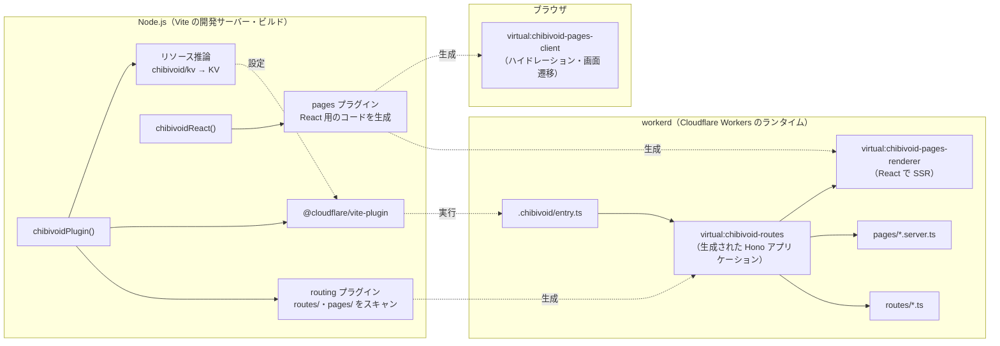

この本は、[Void](https://void.cloud/guide/) というフレームワークの「中身」について理解するためのガイドブックです。そのために、Void と同じしくみをもつ小さなフレームワークである chibivoid を自分の手で作りながら、Void が内部で何をしているのかについて 1 つずつ確かめていきます。

なお、chibivoid という名前は、本書と同じように Vue.js を小さく作りながら学ぶ書籍である [chibivue](https://book.chibivue.land/) にならって付けたものです。chibivue と作者の [ubugeeei](https://github.com/ubugeeei) 氏に感謝します 🙏

## Void とは何か

公式ドキュメントの「[What is Void?](https://void.cloud/guide/)」のページは、Void を次のように紹介しています:

> Void is a full-stack framework for Cloudflare Workers, powered by Vite.

これをもう少しかみ砕くと、Void は次の 3 つのツールの集まりです（Void の [README](https://github.com/voidzero-dev/void#readme) より）:

| ツール | 役割 |
| --- | --- |
| Void SDK | ファイルベースの API ルート、サーバーで描画するページ、データベースやストレージを使うための型付き API |
| Void CLI | アプリケーションのビルド、必要な Cloudflare リソースの作成、マイグレーション、デプロイを 1 コマンドでおこなう |
| Void Platform | チームで共有するデプロイ環境を、自分の Cloudflare アカウントに構築する |

本書では、このうち SDK のコア部分と、CLI のデプロイの流れについて扱います。なお、Void は設定ファイル（`void.config.ts`）の `target` を変えると、Node.js、Bun、Deno で動くサーバーとしてもビルドできます。ただし、その場合は KV などの Cloudflare リソースを使うことができなくなるため、本書ではデフォルトの Cloudflare Workers 向けの場合のみを想定します。

### ミニマルな Void アプリケーション

まずは、Void のアプリケーションのコードを簡単に眺めてみましょう。以下の 4 つのファイルを作成するだけで、API とページをもつ Void アプリケーションを作成できます:

```ts:routes/api/hello.ts
// GET /api/hello
import { defineHandler } from "void";

export const GET = defineHandler(() => {
  return { message: "Hello from Void" };
});
```

```ts:pages/users/index.server.ts
// /users ページのサーバー側
import { defineHandler, type InferProps } from "void";
import { kv } from "void/kv";

type User = { id: number; name: string };

export const loader = defineHandler(async () => {
  return { users: (await kv.get<User[]>("users")) ?? [] };
});

export type Props = InferProps<typeof loader>;
```

```tsx:pages/users/index.tsx
// /users ページの UI
import type { Props } from "./index.server";

export default function UsersPage({ users }: Props) {
  return (
    <ul>
      {users.map((u) => (
        <li key={u.id}>{u.name}</li>
      ))}
    </ul>
  );
}
```

```ts:vite.config.ts
import { voidReact } from "@void/react/plugin";
import { defineConfig } from "vite";
import { voidPlugin } from "void";

export default defineConfig({
  plugins: [voidPlugin(), voidReact()],
});
```

これを `vite dev` コマンドにより起動すると、次の結果が得られます:

- `http://localhost:5173/api/hello` が JSON を返す
- `http://localhost:5173/users` がサーバーで描画された HTML を返し、ブラウザでは React が動く
- `void/kv` をインポートしたことにより、ローカルに KV（キー・バリュー型ストレージ）が自動的に用意される

さらに `void deploy --platform cloudflare` コマンドを実行すると、Cloudflare 上に KV を作成し、アプリケーションをビルドして公開まで済ませてくれます（`--platform cloudflare` は、Void Platform を経由せず、自分の Cloudflare アカウントに直接デプロイするための指定です）。設定ファイルのどこにも「KV を使う」とは記述していないにもかかわらず、Void は KV が必要だと自ら判断し、リソースを用意してくれるのです。

この裏側で何が起きているのかについて、実際に chibivoid を作りながら確かめていくのが本書の目的です。

## Void を支えるアイデア

chibivoid を作り始める前に、まずはその全体像を見ておきましょう。Void のソースコードを読むと、本書で扱う部分のしくみは、以下の 7 つのアイデアに整理できます。この時点ですべてを理解する必要はありません。各アイデアは末尾の括弧内に示した章で詳しく説明するので、ここでは本書を読み進めるための地図として、軽く目を通しておいてください:

1. Void は Vite プラグインである: `voidPlugin()` は Vite のプラグインの配列を返す関数です。開発サーバーもビルドも、Vite のしくみの上で動きます（第 2・4 章）。
2. 開発中も Cloudflare の本物のランタイムで動かす: Cloudflare 公式の Vite プラグインを使い、開発中のコードを本番と同じランタイム（workerd）で実行します（第 3・4 章）。
3. ファイルベースルーティングは「コード生成」で実現する: `routes/` をスキャンして、Hono アプリケーションのソースコードを生成し、それを「仮想モジュール」（virtual module）として Vite に渡します（第 5・6 章）。
4. インポートからリソースを推論する: ソースコードを実行せずに解析し、`void/kv` がインポートされていれば KV バインディング（binding）を用意します（第 7 章）。
5. Pages は「ページオブジェクト」（page object）のプロトコル: 初回は HTML を返し、画面遷移では同じ URL からページオブジェクトを JSON で返す、Inertia.js に似たしくみです。描画は React などのアダプターに任せます（第 8 章から第 10 章）。
6. 型は TypeScript に計算させる: ファイル構成から、`routes/` のファイルの型を参照するだけの型定義を生成し、実際の型の計算は TypeScript に任せます（第 11 章）。
7. デプロイは「推論 → プロビジョニング → ビルド → 公開」: 必要なリソースをコードから割り出し、なければ作り、その ID を埋め込んでビルドして公開します（第 12 章）。

## 本書で作る chibivoid の構成

最終的に完成する chibivoid は、次のような構成になります。ファイル名やディレクトリ構成は、Void と対応が取れるようになるべくそろえています:

```
chibivoid/                         npm workspaces のモノレポ
├── packages/
│   ├── chibivoid/                 chibivoid 本体（Void の packages/void、npm の "void" に相当）
│   │   └── src/
│   │       ├── index.ts           chibivoidPlugin()
│   │       ├── plugin-routing.ts  ルーティングの Vite プラグイン
│   │       ├── router/            routes/ のスキャンとコード生成
│   │       ├── pages/             pages/ のスキャン、プロトコル、ナビゲーション
│   │       ├── shared/            スキャンで共通に使う部品（ファイルの列挙）
│   │       ├── inference/         リソース推論
│   │       ├── codegen/           型定義の生成
│   │       ├── runtime/           Worker やブラウザの中で動くコード
│   │       └── cli/               chibivoid deploy
│   └── react/                     React アダプター（Void の packages/react、"@void/react" に相当）
└── playground/                    chibivoid を使うサンプルアプリケーション
```

ただし、`runtime/` の中は Void とは異なります。Void では、`runtime/routing/index.ts` や `runtime/handler/index.ts` のように機能ごとのディレクトリに分かれていますが、chibivoid はファイルが少ないため、`runtime/routing.ts` や `runtime/handler.ts` のように 1 つのディレクトリに並べています。

また、名前に `void` を含むものは、Void と区別できるように `void` を `chibivoid` に置き換えています。たとえば、Void の `packages/void`、`voidPlugin()`、`.void/`、`X-VoidPages` は、chibivoid ではそれぞれ `packages/chibivoid`、`chibivoidPlugin()`、`.chibivoid/`、`X-ChibivoidPages` になります。

全体の関係を図にすると次のようになります。今はまだわからない言葉ばかりでも大丈夫です。章を進めるごとに、この図の中の部品が 1 つずつ埋まっていきます:



ところで、chibivoid はフレームワークであるため、動作を確かめるには、それを使うアプリケーションが必要です。そこで本書では、chibivoid 本体と並行して、冒頭の「ミニマルな Void アプリケーション」に似たサンプルアプリケーションを `playground/` に作り、各章で chibivoid に加えた機能をこのアプリケーション上で動かして確かめていきます。

完成したサンプルアプリケーションでは、次のことができるようになります:

- `routes/api/*.ts` に作成した API が動く（`GET`/`POST` などを名前付きエクスポートで定義）
- `middleware/` に置いたミドルウェアが、API やページなど Worker に届くすべてのリクエストで動く
- `chibivoid/kv` をインポートするだけで KV を使うことができる
- `pages/` の React コンポーネントがサーバーで描画され、ブラウザでハイドレーション（hydration）される
- `Link` により画面遷移すると、ページ全体を読み込み直さずに JSON を取得して画面が切り替わる
- `Form` により送信したデータを `action` が受け取り、バリデーションエラーがあればページに表示される（JavaScript が無効でも動く）
- `chibivoid/client` の `fetch()` により、`fetch("/api/hello")` の戻り値に型が付く
- `vite build`/`vite preview` により本番ビルドを確認し、`chibivoid deploy` により Cloudflare にデプロイできる

### ここでは作らないもの

もちろん Void には、chibivoid では作らない機能も数多くあります。たとえば、次のようなものです:

- アイランド（islands）、Markdown ページ、遅延 props（deferred props、`defer()`）、Vue/Svelte/Solid のアダプター
- ISR（Incremental Static Regeneration）や事前レンダリング（prerendering）、リダイレクトやヘッダーのルール
- D1/PostgreSQL/MySQL と Drizzle によるデータベース、マイグレーション、環境変数のスキーマ
- 認証、キュー、cron、メール、WebSocket、AI
- Astro や SvelteKit などのメタフレームワーク連携
- Void Platform

これらはすべて、本書で作るコアの上に積み重なっています。コアを理解すれば、Void のコードを読む際に「この機能はコアのどこに差し込まれているのか」がわかるようになるでしょう。

## 読み進めるための準備

### 開発環境

- Node.js 24 以上

  ```sh
  node -v
  # v24.x.x などと表示されれば OK
  ```

  本書では、chibivoid の TypeScript のソースコードをビルドせずにそのまま Node.js で読み込みます。Node.js 24 以降は、TypeScript の型注釈を取り除いて実行する機能（type stripping）がデフォルトで有効になっているため、それを利用します。

- npm（Node.js に付属しています）
- エディター（TypeScript の補完が効くもの。VS Code など）
- （第 12 章で実際にデプロイする場合のみ）Cloudflare のアカウント。無料プランで十分です。デプロイしない場合でも、本書の内容はすべてローカルで確認可能です

本書のコマンドは macOS/Linux のシェルを想定しています。Windows の場合は WSL を使うのが簡単です。

本書のコードは次のバージョンで動作を確認しています:

| パッケージ | バージョン |
| --- | --- |
| vite | 8.4 |
| @cloudflare/vite-plugin | 1.70 |
| wrangler | 4.168 |
| hono | 4.13 |
| react / react-dom | 19.3 |
| @vitejs/plugin-react | 6.3 |
| typescript | 7.0 |

### 前提知識

- JavaScript/TypeScript の基本（`import`/`export`、`async`/`await`、型注釈）
- React の基本（コンポーネント、props、`useState`）
- HTTP の基本（`GET` と `POST`、ステータスコード、ヘッダー）

Vite、Cloudflare Workers、Hono、サーバーサイドレンダリング（SSR）については、本文の中で必要に応じて説明します。また、本書によく出てくる言葉は、巻末の[用語集](/morinokami/books/how-void-works/viewer/glossary)にまとめています。読んでいる途中で意味を確かめたい場合などに使ってください。

## 本書の進め方

各章は、おおむね次の流れで進みます:

1. この章のゴール: 何を作り、何がわかるようになるか
2. しくみの説明: なぜそのしくみが必要か
3. 実装: ファイルを作ったり書き換えたりする
4. 動かしてみる: コマンドを実行して結果を確かめる
5. まとめ: その章で学んだことを振り返る
6. Void の実装: 対応する Void のファイルと、chibivoid との違い

新しいファイルはファイル全体を、既存のファイルへの変更は差分（`diff`）のかたちで示します。ただし、変更が多い場合は、既存のファイルでもファイル全体を示すことがあります。差分の読み方は次の通りです:

```diff ts:packages/chibivoid/src/index.ts
@@ -10,3 +10,4 @@
 変わらない行
-削除する行
+追加する行
+追加する行
 変わらない行
```

コードブロックの上に表示しているのは、変更するファイルの名前です。`@@ -10,3 +10,4 @@` は変更箇所の位置で、変更前の 10 行目から 3 行分が、変更後は 10 行目から 4 行分になることを表わします。変更のない部分は、変更箇所の前後の数行だけを残して省略しています。

各章の完成形は、本書のリポジトリ内の [`code/how-void-works/chNN/`](https://github.com/morinokami/zenn-docs/tree/master/code/how-void-works) に置いてあります。うまく動かない場合は、手元のコードと見比べてください。第 2 章と第 3 章ではそれぞれ独立した小さなプロジェクトを作り、第 4 章から chibivoid を作り始めます。第 5 章から第 12 章までは、どの章も前の章のコードに手を加えるかたちで進みます。そのため、これらの章から読み始める場合は、前の章の完成形を出発点にしてください。

本文中に出てくる Void のファイルは、原則として `packages/void/src/plugin-routing.ts` のように、リポジトリのルートからのパスで示します。同じパッケージのファイルが続くところや表の中では、前後と共通する部分（`packages/void/src/` など）を省いて、`cli/deploy-cloudflare.ts` や `codegen/route-types.ts` のように示すこともあります。Void のソースを読みながら進めると理解が深まるため、可能であればクローンしておきましょう:

```sh
git clone https://github.com/voidzero-dev/void.git
```

本書の Void の説明は、2026 年 11 月時点の `main`（`void@1.12.2` のリリースより後のコミット [`eaeb02e`](https://github.com/voidzero-dev/void/tree/eaeb02e78dc5cdf9d6d8f0469521fa9184f29dad)）をもとにしています。Void は活発に開発されているため、ファイルの中身や行数は変わっていることがあります。

それでは、以上の準備のもと、さっそく Vite のしくみの学習から始めていきましょう。
