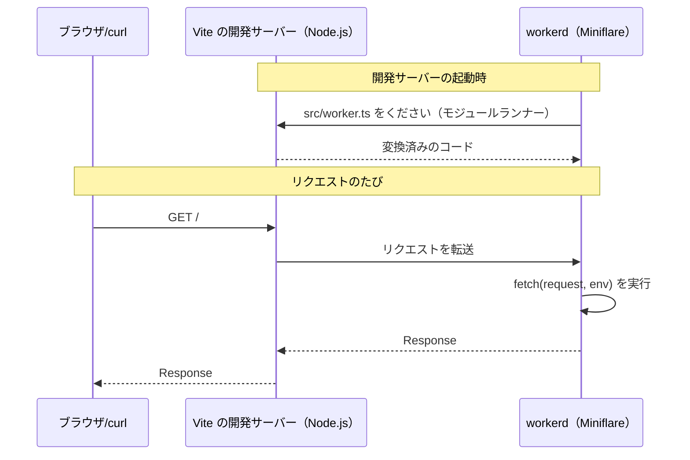

Void のアプリは、既定では Cloudflare Workers の上で動きます。しかも開発中であっても、本番と同じランタイムでコードを実行できます。この章ではまだ Void を使わず、Cloudflare 公式の Vite プラグインにより Worker を動かし、Void の土台になっているしくみについて確認します。

## この章のゴール

- Cloudflare Workers の実行モデル（`fetch` ハンドラーと `env`）がわかる
- workerd、Miniflare、Wrangler の関係がわかる
- `@cloudflare/vite-plugin` が、Vite の「Worker 用の環境」の中で Worker を動かしていることを確かめる
- アプリのビルド時に出力される `index.js` と `wrangler.json` の役割がわかる

## 2.1 Cloudflare Workers とは何か

[Cloudflare Workers](https://developers.cloudflare.com/workers/) は、Cloudflare の世界中のデータセンターでコードを動かすことができるサーバーレスの実行環境です。その特徴を 3 つ挙げます。

### 1. ウェブ標準の API を使う

Worker は、Node.js の `http` モジュールではなく、ブラウザと同じ `Request`、`Response`、`fetch()` などのウェブ標準 API により記述します。たとえば一番小さな Worker は次のようになります:

```ts
export default {
  async fetch(request: Request, env: Env, ctx: ExecutionContext): Promise<Response> {
    return new Response('Hello!');
  },
};
```

「`fetch` メソッドをもつオブジェクトをデフォルトエクスポートする」のが Worker の基本の書き方です。リクエストが来るたびに `fetch` が呼ばれ、そこから返された `Response` がクライアントに届きます。

### 2. リソースは「バインディング」から受け取る

`fetch` の 2 番目の引数 `env` には、その Worker が利用できるリソースが入っています。たとえば KV（キー・バリュー型ストレージ）を `KV` という名前で使うように設定すると、`env.KV.get('key')` のように使うことができます。この「名前でリソースにつなぐしくみ」をバインディング（[binding](https://developers.cloudflare.com/workers/runtime-apis/bindings/)）と呼びます。KV、D1（SQLite のデータベース）、R2（オブジェクトストレージ）、Queues、環境変数やシークレット、そして静的アセットを配信する `ASSETS` も、すべてバインディングとして `env` に入ってきます。

バインディングは、Worker の設定で宣言します。データベースやストレージを使うために、コードの中で接続先の URL や API キーを渡して SDK のクライアントを作る必要はありません。「どのバインディングをもつか」は Worker の設定で決まっており、実行中に増やすことはできません。この性質が、第 6 章の「リソース推論」（resource inference）において重要になります。

### 3. ランタイムの挙動を日付で固定する

Workers のランタイムは継続的に更新されていますが、勝手に挙動が変わると既存の Worker が壊れるかもしれません。そこで、設定の [`compatibility_date`](https://developers.cloudflare.com/workers/configuration/compatibility-dates/) に日付を指定しておくと、Worker をその日付時点の挙動に固定することができます。また [`compatibility_flags`](https://developers.cloudflare.com/workers/configuration/compatibility-flags/) により、個別の機能を有効にできます。たとえば `nodejs_compat` を付けると Node.js 互換の API を利用できるようになります。ただし、多くのフラグには既定で有効になる日付が決まっており、`nodejs_compat` は、`compatibility_date` が `2026-08-04` 以降であれば[既定で有効になります](https://developers.cloudflare.com/workers/runtime-apis/nodejs/)。本書では `compatibility_date` を `2026-10-01` にしているため、第 6 章で使う `node:async_hooks` の `AsyncLocalStorage` も、フラグを付けずに使うことができます。

## 2.2 workerd、Miniflare、Wrangler

Workers の周辺には、似た名前のツールがいくつか出てくるため、ここで整理しておきます:

| 名前 | 何をするものか |
| --- | --- |
| [workerd](https://github.com/cloudflare/workerd) | Workers の本番環境でも使われているランタイム（実行エンジン）。オープンソースで、ローカルでも動かすことができる |
| [Miniflare](https://developers.cloudflare.com/workers/testing/miniflare/) | workerd を使って、KV や D1 などのバインディングまで含めた Workers の環境をローカルで再現するシミュレーター |
| [Wrangler](https://developers.cloudflare.com/workers/wrangler/) | Workers の公式 CLI。`wrangler dev`（ローカル実行）、`wrangler deploy`（デプロイ）、`wrangler kv namespace create`（リソース作成）など。設定ファイルは `wrangler.jsonc`（`wrangler.json` や `wrangler.toml` でもよい） |

以前は `wrangler dev` によりローカル実行するのが一般的でしたが、フロントエンドを Vite で開発している場合は、Vite の開発サーバーと Wrangler を別々に動かす必要がありました。それを 1 つにまとめたのが、次に紹介する Cloudflare の Vite プラグインです。

## 2.3 `@cloudflare/vite-plugin` のしくみ

[`@cloudflare/vite-plugin`](https://developers.cloudflare.com/workers/vite-plugin/) は、第 1 章で紹介した Environment API を使って、Vite の中に Worker 用の環境を追加します。この環境のモジュールランナーは、Node.js ではなく workerd の中で動きます:



- Worker のコードは、workerd の中のモジュールランナーが、Vite から変換済みのモジュールとして取ってきます。つまり、Vite のプラグイン（仮想モジュールを提供するものなど）が、Worker のコードにもそのまま適用されます
- リクエストは Vite の開発サーバーが受け取り、Worker に転送します
- バインディングは Miniflare がローカルに用意します

開発中から本番と同じ workerd によってコードが動くため、「ローカルでは動いたのに本番では動かない」という事態が起きにくくなります。Void はこのプラグインを内部で使っており、`void dev` のような独自の開発サーバーはもっていません。Void のアプリは `vite dev` によりそのまま起動します。

ビルドでは、Worker のコードをバンドルし、デプロイに必要な設定を `wrangler.json` として一緒に出力します。`wrangler deploy` は、その出力をそのまま Cloudflare にアップロードできます。

## 2.4 Worker を動かしてみる

第 1 章の `vite-basics` とは別のプロジェクトにするため、`vite-basics` の外に新しいディレクトリを作成します:

```sh
mkdir workers-basics
cd workers-basics
```

<!-- file: code/how-void-works/ch02/package.json -->
```json:package.json
{
  "name": "workers-basics",
  "private": true,
  "type": "module",
  "scripts": {
    "dev": "vite",
    "build": "vite build",
    "preview": "vite preview"
  },
  "devDependencies": {
    "@cloudflare/vite-plugin": "^1.67.0",
    "@cloudflare/workers-types": "^5.20261106.1",
    "@types/node": "^26.6.6",
    "typescript": "^7.0.2",
    "vite": "^8.3.6",
    "wrangler": "^4.158.0"
  }
}
```
<!-- /file -->

次の点を押さえておいてください:

- `@cloudflare/vite-plugin` が Cloudflare の Vite プラグインです
- `wrangler` はビルドしたものをデプロイする際に使います（この章ではデプロイまではしません）
- `@cloudflare/workers-types` は、`KVNamespace` などの Workers の型定義です

パッケージをインストールします:

```sh
npm install
```

### Worker のコード

`src/worker.ts` を作成します。このファイルには、`/count` にアクセスするたびに KV のカウンターを増やし、それ以外のパスでは挨拶を返す Worker を記述します。まずは、`src` ディレクトリを作成しておきます:

```sh
mkdir src
```

<!-- file: code/how-void-works/ch02/src/worker.ts -->
```ts:src/worker.ts
// `virtual:build-info` は vite.config.ts のプラグインが生成する仮想モジュール
import buildInfo from 'virtual:build-info';

// Worker からアクセス可能な「バインディング」の型。KV は vite.config.ts で設定する
type Env = {
  KV: KVNamespace;
};

export default {
  // Worker は「Request を受け取って Response を返す関数」をもつオブジェクトをエクスポートする
  async fetch(request: Request, env: Env): Promise<Response> {
    const url = new URL(request.url);

    if (url.pathname === '/count') {
      // KV に訪問回数を保存する
      const count = Number((await env.KV.get('count')) ?? 0) + 1;
      await env.KV.put('count', String(count));
      return Response.json({ count });
    }

    return new Response(
      [
        `こんにちは！ このコードは ${navigator.userAgent} の上で動いています。`,
        `仮想モジュールを生成した Vite 環境: ${buildInfo.environment}`,
        `生成した時刻: ${buildInfo.generatedAt}`,
      ].join('\n'),
      { headers: { 'Content-Type': 'text/plain; charset=utf-8' } },
    );
  },
};
```
<!-- /file -->

`navigator.userAgent` は、workerd の上では `"Cloudflare-Workers"` になります。本当に Workers のランタイムで動いているかを確かめるために表示しています。`virtual:build-info` は、この後 `vite.config.ts` で定義する仮想モジュールです。TypeScript はこのモジュールを知らないため、第 1 章の `src/virtual-notes.d.ts` と同じように、`src/env.d.ts` で型を宣言しておきます:

<!-- file: code/how-void-works/ch02/src/env.d.ts -->
```ts:src/env.d.ts
declare module 'virtual:build-info' {
  const buildInfo: { environment: string; generatedAt: string };
  export default buildInfo;
}
```
<!-- /file -->

### Vite の設定

`vite.config.ts` を作成します:

<!-- file: code/how-void-works/ch02/vite.config.ts -->
```ts:vite.config.ts
import { cloudflare } from '@cloudflare/vite-plugin';
import { defineConfig, type Plugin } from 'vite';

/** Worker からインポート可能な仮想モジュールを提供する、小さなプラグイン */
function buildInfoPlugin(): Plugin {
  return {
    name: 'build-info',
    resolveId(id) {
      if (id === 'virtual:build-info') {
        return '\0virtual:build-info';
      }
    },
    load(id) {
      if (id === '\0virtual:build-info') {
        // this.environment.name により、どの Vite 環境のためのモジュールかがわかる
        return `export default ${JSON.stringify({
          environment: this.environment.name,
          generatedAt: new Date().toISOString(),
        })};`;
      }
    },
  };
}

export default defineConfig({
  plugins: [
    buildInfoPlugin(),
    cloudflare({
      // Worker を動かす Vite 環境の名前
      viteEnvironment: { name: 'worker' },
      // 本来 wrangler.jsonc に記述する Worker の設定を、ここで直接指定できる
      config: {
        name: 'workers-basics',
        main: './src/worker.ts',
        compatibility_date: '2026-10-01',
        kv_namespaces: [{ binding: 'KV', id: 'local' }],
      },
    }),
  ],
});
```
<!-- /file -->

ここでのポイントは、`cloudflare()` に渡しているオプションです:

- `viteEnvironment: { name: 'worker' }`: Worker 用の Vite 環境の名前です
- `config`: 本来は `wrangler.jsonc` に記述する Worker の設定を、ここで直接指定しています。`main` が Worker のエントリファイル、`kv_namespaces` が KV のバインディングです

`kv_namespaces` の `id: 'local'` に注目してください。本番の KV ネームスペース（KV の 1 つの保存領域）には Cloudflare が発行した ID が必要ですが、ローカルの Miniflare では ID は何でもよいため、仮の値を入れています。

Void にとって重要なことは、設定ファイルに記述する代わりに、プログラムで設定を組み立てて渡すことができるという点です。Void はソースコードを解析した結果から、この `config` を自動で組み立てています（第 3・6 章）。

`tsconfig.json` も作成しておきます。Worker のコードには DOM の型ではなく Workers の型を使います:

<!-- file: code/how-void-works/ch02/tsconfig.json -->
```json:tsconfig.json
{
  "compilerOptions": {
    "target": "ES2022",
    "lib": ["ES2022"],
    "module": "ESNext",
    "moduleResolution": "Bundler",
    "strict": true,
    "noEmit": true,
    "skipLibCheck": true,
    "allowImportingTsExtensions": true,
    "verbatimModuleSyntax": true,
    "types": ["@cloudflare/workers-types"]
  },
  "include": ["src"]
}
```
<!-- /file -->

### 開発サーバーを起動する

次のコマンドを実行して、開発サーバーを起動します:

```sh
npm run dev
```

別のターミナルから Worker の出力を確認します:

```sh
curl http://localhost:5173/
```

```
こんにちは！ このコードは Cloudflare-Workers の上で動いています。
仮想モジュールを生成した Vite 環境: worker
生成した時刻: 2026-11-06T11:04:04.636Z
```

`Cloudflare-Workers` と表示されました。これにより、Vite の開発サーバー経由で、Worker のコードが workerd の上で動いていることがわかります。

2 行目にも注目してください。第 1 章の `notes` プラグインでは `this.environment.name` が `client` でしたが、今回は `worker` になっています。`build-info` プラグインの `load` が、Worker 用の環境のために呼ばれたということです。仮想モジュールは Worker のコードからもまったく同じように使うことができます。

KV も試しましょう:

```sh
curl http://localhost:5173/count
# {"count":1}
curl http://localhost:5173/count
# {"count":2}
```

KV のデータは `.wrangler/state/v3/kv` に保存されているため、開発サーバーを再起動しても値は残ります。

:::message
起動時に ``Unable to fetch the `Request.cf` object!`` という警告が出ることがあります。`request.cf`（リクエスト元の国などの情報）の値を Cloudflare から取得できなかったという意味で、ネットワークが制限された環境では表示されます。動作には影響しません。
:::

## 2.5 ビルドとプレビュー

開発サーバーを止めて、ビルドします:

```sh
npm run build
```

```
vite v8.3.6 building worker environment for production...
✓ 5 modules transformed.
dist/worker/.vite/manifest.json  0.15 kB │ gzip: 0.11 kB
dist/worker/wrangler.json        1.23 kB │ gzip: 0.64 kB
dist/worker/index.js             0.86 kB │ gzip: 0.59 kB │ map: 1.69 kB
✓ built in 93ms
```

`building worker environment` と表示されている通り、ビルドも環境ごとにおこなわれます。出力先は環境の名前（`worker`）と同じ `dist/worker/` です:

- `index.js`: バンドルされた Worker のコード。仮想モジュールの中身も含まれています
- `wrangler.json`: デプロイ用の設定。`vite.config.ts` で渡した `config` をもとに、Cloudflare のプラグインが出力したものです

`wrangler.json` の中身を一部だけ抜き出すと、次のようになっています:

```json
{
  "name": "workers-basics",
  "main": "index.js",
  "compatibility_date": "2026-10-01",
  "compatibility_flags": [],
  "kv_namespaces": [{ "binding": "KV", "id": "local" }],
  "no_bundle": true
}
```

`no_bundle: true` は「バンドルは Vite が済ませたため、Wrangler はもうバンドルしなくてよい」という意味です。

また、ビルドすると `.wrangler/deploy/config.json` というファイルも作られます:

```json
{"configPath":"../../dist/worker/wrangler.json","auxiliaryWorkers":[]}
```

これは Wrangler に「設定ファイルは `dist/worker/wrangler.json` を使って」と伝える[リダイレクト設定](https://developers.cloudflare.com/workers/wrangler/configuration/#generated-wrangler-configuration)です。このおかげで、プロジェクトのルートで引数なしに `npx wrangler deploy` を実行するだけで、ビルド結果がデプロイされます（第 11 章で使います）。

ビルド結果をローカルの workerd で動かすには、`vite preview` を使います:

```sh
npm run preview
# 別のターミナルで
curl http://localhost:4173/
```

`vite preview` も、Cloudflare のプラグインのおかげで、ビルド済みの `index.js` を Node.js ではなく workerd で実行します。そのため、デプロイする前に、本番に近い状態でビルド結果の動作をローカルで確かめることができます。第 11 章でも、chibivoid のビルド結果を `vite preview` により確かめます。

:::message
ここで `npx wrangler deploy` を実行するとデプロイを試すことができますが、KV の `id` が仮の値（`local`）のままであるため失敗します。本物の KV ネームスペースを作ってその ID を設定に記述するか、`id` を省略して、デプロイ時に Wrangler の自動プロビジョニング（[automatic provisioning](https://developers.cloudflare.com/workers/wrangler/configuration/#automatic-provisioning)）で作らせる必要があります。chibivoid では、この「リソースを作って ID を設定に入れる」作業を、第 11 章で作る `chibivoid deploy` が自前でおこないます。
:::

## まとめ

- Worker のエントリファイルは、基本的に「`fetch(request, env, ctx)` をもつオブジェクト」をデフォルトエクスポートする。`fetch` は、リソースを `env` のバインディングとして受け取る
- バインディングは設定で宣言するもので、実行中に増やすことはできない
- `@cloudflare/vite-plugin` は Vite に Worker 用の環境を追加し、開発中もビルド後も workerd でコードを実行する
- Worker の設定は `wrangler.jsonc` に記述する代わりに、`cloudflare({ config })` によりプログラムから渡すことができる
- ビルドすると、Worker のコードと `wrangler.json` が `dist/<環境名>/` に出力される

## Void の実装

`packages/void/src/plugin-cloudflare.ts` は、`@cloudflare/vite-plugin`（執筆時点では 2.0 のリリース候補版）を包む関数 `cloudflare()` を定義しています。`voidPlugin()` は、メタフレームワークを使わないアプリでこれを呼ぶ際に、次のものを渡しています:

- `viteEnvironment: { name: 'void_worker' }`（`plugin-worker-environment.ts` の `DEFAULT_WORKER_ENVIRONMENT_NAME`）
- `config: mergeBindings`（推論したバインディングを、利用者が記述した設定とマージする関数。中身は `plugin-worker-bindings.ts` の `mergeWorkerBindings()`）

Void ではさらに、Worker のビルド出力先を `dist/ssr` に変える設定（`createDefaultWorkerEnvironmentPlugin()`）も加わっています。

次の章から、いよいよ chibivoid を作り始めます。Worker 用の環境名は、Void の `void_worker` にならって `chibivoid_worker` にします。
