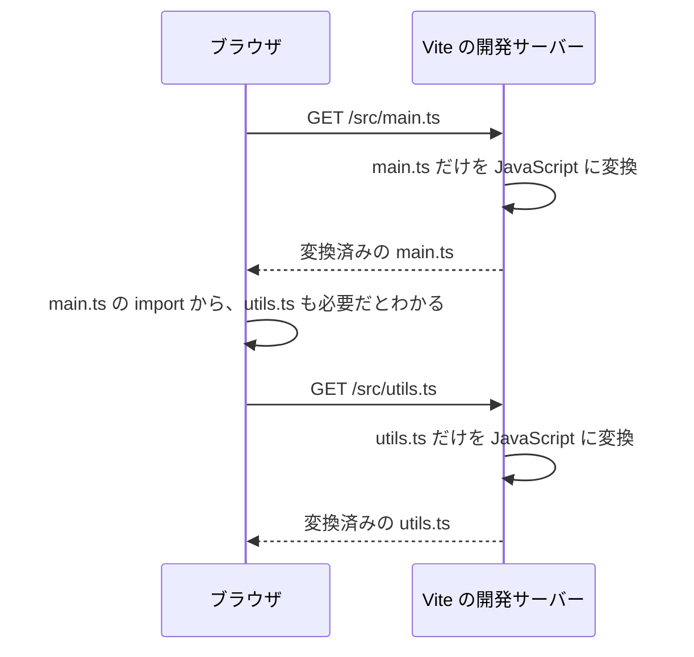
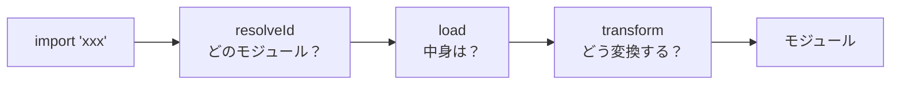
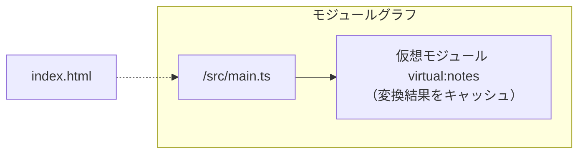
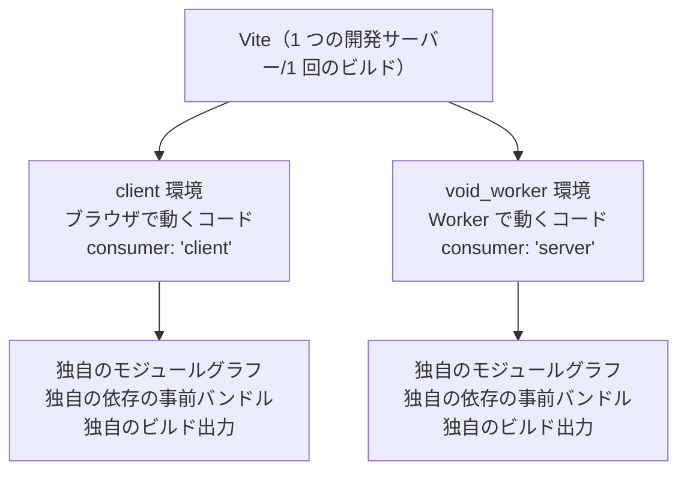

すでに述べたように、Void は「Vite のプラグイン」として作られています。よって、Void を理解するには、まず Vite が何をしていて、その処理をプラグインによりどう拡張できるのかについて知る必要があります。この章では Vite だけを用いて小さなプロジェクトを作り、Void が使っている Vite の機能を一通り体験していきます。

## この章のゴール

- 開発中とビルド時に、Vite がそれぞれ何をしているかを説明できる
- プラグインのフック（`resolveId`、`load`、`configureServer` など）を使って、仮想モジュール（virtual module）を作ることができる
- 「モジュールグラフ」（module graph）、「無効化」（invalidate）、「環境」（environment）という言葉の意味がわかる

## Vite とは何か

[Vite](https://vite.dev) は、Vue.js の作者でもある Evan You が公開した、ウェブアプリの開発サーバーと本番ビルドを提供するツールです。Vite と、その部品であるバンドラーの [Rolldown](https://rolldown.rs)、パーサーを含むツール群の [Oxc](https://oxc.rs) などは、のちに Evan You が創業した [VoidZero](https://voidzero.dev) という会社が中心となって開発してきました。VoidZero は 2026 年に Cloudflare に買収されましたが、その後も VoidZero のチームがこれらのツールをオープンソースのまま開発し続けています。本書のテーマである Void も、VoidZero のチームが開発している Cloudflare のプロダクトであり、Vite と深く統合されています。

### なぜ Vite が必要なのか

昔のブラウザには、ファイル同士を `import` によりつなぐしくみ（ES モジュール、ESM）がありませんでした。`<script>` タグを並べれば複数のファイルを読み込むことはできましたが、ファイル同士はグローバル変数を介してやり取りするしかなく、読み込む順番も手作業で管理する必要がありました。そこで webpack のようなバンドラーが、モジュールに分けて書かれたコードの依存関係をたどり、1 つ（または少数）のファイルにまとめてからブラウザに渡すようになりました。

しかしアプリが大きくなると、開発中にコードを少し変えて保存するたびに、大量のファイルをまとめ直すことになり、待ち時間が長くなります。

Vite のアイデアは単純です。モダンなブラウザは ESM をそのまま読み込むことができるため、開発中はファイルをバンドルしないようにします。その代わり、ブラウザがインポートをたどって「このファイルをください」と要求してきた際に、そのファイルだけをその場で変換して返します:



本番では、たくさんのファイルを 1 つずつ読み込むと遅くなるため、従来通りバンドルします。Vite 8 では、このバンドルに Rust 製の Rolldown が使われています。

ここまで見てきた開発サーバーと本番ビルドは、それぞれ別のコマンドにより実行します。ビルドした結果をローカルで確かめるためのコマンドも合わせると、Vite の主なコマンドは次の 3 つです:

| コマンド | していること |
| --- | --- |
| `vite`（`vite dev`） | 開発サーバーを起動し、要求されたファイルをその場で変換して返す。ファイルが変更された場合はブラウザに通知する（HMR、Hot Module Replacement） |
| `vite build` | ソースコード全体をバンドルし、本番用のファイルを `dist/` に出力する |
| `vite preview` | ビルドした `dist/` を、確認用にローカルで配信する |

そして、開発サーバーでの変換もビルドも、同じ「プラグイン」のしくみにより拡張できる点が Vite の大きな特徴です。Void はこのしくみを使って、ファイルベースルーティングなどを実現しています。

## 初めての Vite プロジェクト

まずは Vite だけを用いて小さなプロジェクトを作ってみましょう。好きな場所に新しいディレクトリを作ってください:

```sh
mkdir vite-basics
cd vite-basics
```

`package.json` を作成します:

<!-- file: code/how-void-works/ch02/package.json -->
```json:package.json
{
  "name": "vite-basics",
  "private": true,
  "type": "module",
  "scripts": {
    "dev": "vite",
    "build": "vite build",
    "preview": "vite preview"
  },
  "devDependencies": {
    "@types/node": "^26.6.6",
    "typescript": "^7.0.2",
    "vite": "^8.3.6"
  }
}
```
<!-- /file -->

`"type": "module"` は「このパッケージの `.js`/`.ts` ファイルは ES モジュールとして扱う」という宣言です。本書では、すべてのパッケージでこの値を指定します。

依存パッケージをインストールします:

```sh
npm install
```

次に、アプリのエントリポイントとなる `index.html` を、プロジェクトのルートに作成します。ブラウザで開発サーバーにアクセスすると、Vite はまずこのファイルを返します:

<!-- file: code/how-void-works/ch02/index.html -->
```html:index.html
<!doctype html>
<html lang="ja">
  <head>
    <meta charset="utf-8" />
    <title>Vite 入門</title>
  </head>
  <body>
    <h1>メモ一覧</h1>
    <ul id="notes"></ul>
    <script type="module" src="/src/main.ts"></script>
  </body>
</html>
```
<!-- /file -->

`<script type="module" src="/src/main.ts">` に注目してください。ブラウザは本来 TypeScript を実行できませんが、Vite がその場で JavaScript に変換して返してくれるため、`.ts` を直接指定できます。

`src/main.ts` を作成し、まずはごく簡単な内容を記述します:

```sh
mkdir src
```

```ts
const list = document.querySelector('#notes')!;
list.innerHTML = '<li>まだメモはありません</li>';
```

開発サーバーを起動しましょう:

```sh
npm run dev
```

```
  VITE v8.3.6  ready in 281 ms

  ➜  Local:   http://localhost:5173/
```

ブラウザで `http://localhost:5173/` を開くと「まだメモはありません」と表示されるはずです。

### 開発サーバーは何を返しているのか

開発者ツールのネットワークタブを開いて再読み込みするか、別のターミナルから `curl` で確かめてみましょう:

```sh
curl http://localhost:5173/
```

```html
<!doctype html>
<html lang="ja">
  <head>
    <script type="module" src="/@vite/client"></script>

    <meta charset="utf-8" />
    ...
```

書いた覚えのない `<script type="module" src="/@vite/client">` が差し込まれています。これは Vite のクライアントで、開発サーバーと WebSocket でつながり、ファイルの変更を受け取ってページを更新する役目をもっています。`/@vite/` で始まる URL は、Vite 自身が用意している特別なパスです。

続いて `src/main.ts` を見てみます:

```sh
curl http://localhost:5173/src/main.ts
```

```js
const list = document.querySelector("#notes");
list.innerHTML = "<li>まだメモはありません</li>";
```

`!`（非 null アサーション）が消え、ただの JavaScript になっています。ブラウザがファイルを要求したタイミングで、Vite がこのファイルだけを変換して返したためです。

試しに `src/main.ts` の文字列を書き換えて保存してみると、ブラウザが自動で更新されるはずです。これが `/@vite/client` の仕事です。

## プラグインとフック

Vite の振る舞いをプラグインにより拡張することができます。プラグインは、`name` と、いくつかのフック（決まったタイミングで Vite から呼ばれる関数）をもつただのオブジェクトです:

```ts
import type { Plugin } from 'vite';

// 例: .ts ファイルが変換されるたびにログを出すだけのプラグイン
function logPlugin(): Plugin {
  return {
    name: 'log',
    transform(code, id) {
      if (id.endsWith('.ts')) {
        console.log('transform:', id);
      }
    },
  };
}
```

プラグインは、Vite の設定ファイルである `vite.config.ts` の `plugins` に並べて使います:

```ts
export default defineConfig({
  plugins: [logPlugin()],
});
```

フックは、Vite のドキュメントの「[Plugin API](https://vite.dev/guide/api-plugin)」のページで説明されています。このうち、本書に登場するものを表にまとめておきます:

| フック | 呼ばれるタイミング | 本書での使い道 |
| --- | --- | --- |
| `config` | 設定を確定する前。設定の一部を返すとマージされる | 開発サーバーかビルドかを記録する（第 5 章）、環境ごとの設定を足す（第 8・9・12 章） |
| `configureServer` | 開発サーバーの起動時のみ | ファイルを監視する（この章と第 6 章） |
| `buildStart` | 開発サーバーの起動時とビルドの開始時 | `routes/` などをスキャンする（第 5 章） |
| `resolveId` | インポートの指定子（`'./foo'` など）を、モジュールの ID に解決する際 | 仮想モジュールの ID を返す（この章）、インポートの行き先を差し替える（第 5 章） |
| `load` | ID からモジュールのソースコードを読み込む際 | 仮想モジュールのコードを生成して返す（この章） |
| `transform` | 読み込んだソースコードを変換する際。TypeScript や JSX から JavaScript への変換もここでおこなわれる | 本書のプラグインでは使わない（上の `logPlugin()` は説明用） |

1 つのモジュールが読み込まれる際、プラグインのフックは次の順に呼ばれます:



`resolveId` と `load` は、いずれかのプラグインが値を返した時点で、それ以降のプラグインでは呼ばれません。値を返さなければ、次のプラグインに進みます。`transform` は、すべてのプラグインで順に呼ばれます。

ここで注意したいのは、Vite 本体の処理の多くも組み込みのプラグインとして実装されており、利用者のプラグインと一緒に順に呼ばれることです。たとえば、インポートの行き先をファイルやパッケージから探す処理は、`builtin:vite-resolve` という組み込みのプラグインの `resolveId` がおこなっており、利用者のプラグインは、特に指定しなければその後に呼ばれます。そのため、ファイルやパッケージとして見つかるインポートでは、利用者のプラグインの `resolveId` は呼ばれません。なお、`load` では、どのプラグインも値を返さなければ、最後に Vite がファイルを読み込みます。

プラグインの順番は `plugins` に並べた順ですが、[`enforce: 'pre'`](https://vite.dev/guide/api-plugin#plugin-ordering) を付けると Vite 本体の処理より前に回されます。Void のルーティングプラグインは `enforce: 'pre'` を指定しています（その理由は第 5 章でわかります）。

:::message
上の `logPlugin()` は説明用です。この章の完成形には含まれていないため、試した場合は消しておいてください。
:::

## 仮想モジュールを作成する

いよいよ本題です。Void のファイルベースルーティングは、「`routes/` ディレクトリのファイル一覧から、ルートを登録するコードを生成し、それをモジュールとして読み込ませる」というしくみで動いています。生成したコードはディスクに書き出さず、プラグインの中から直接 Vite に渡します。このような、ディスク上には存在しないモジュールを仮想モジュールと呼びます。

ここでは練習として、`notes/` ディレクトリに置いたテキストファイルの一覧を、`virtual:notes` という仮想モジュールとして読み込むことができるようにしてみます:

```ts
import notes from 'virtual:notes';
// notes は [{ title: 'hello', body: 'はじめてのメモ' }, ...] のような配列
```

まず、メモを 2 つ用意します:

```sh
mkdir notes
echo "はじめてのメモ" > notes/hello.txt
echo "Vite はプラグインで拡張できる" > notes/vite.txt
```

### プラグインを作成する

プロジェクトのルートに `notes-plugin.ts` を作成します:

<!-- file: code/how-void-works/ch02/notes-plugin.ts -->
```ts:notes-plugin.ts
import { readdirSync, readFileSync } from 'node:fs';
import { join } from 'node:path';
import { normalizePath, type Plugin } from 'vite';

// アプリのコードがインポートする ID と、プラグインの内部で使う ID
const VIRTUAL_ID = 'virtual:notes';
const RESOLVED_ID = '\0' + VIRTUAL_ID;

/**
 * notes/ ディレクトリの .txt ファイルを集めて、
 * `virtual:notes` という仮想モジュールとして提供するプラグイン。
 */
export function notesPlugin(): Plugin {
  const notesDir = normalizePath(join(process.cwd(), 'notes'));

  return {
    name: 'notes',

    // 1. インポートされた ID を「どのモジュールか」に解決する
    resolveId(id) {
      if (id === VIRTUAL_ID) {
        return RESOLVED_ID;
      }
    },

    // 2. 解決した ID のソースコードを返す
    load(id) {
      if (id !== RESOLVED_ID) {
        return;
      }
      console.log(`[notes] "${this.environment.name}" 環境でモジュールを生成します`);
      const notes = readdirSync(notesDir)
        .filter((file) => file.endsWith('.txt'))
        .sort()
        .map((file) => ({
          title: file.replace(/\.txt$/, ''),
          body: readFileSync(join(notesDir, file), 'utf8').trim(),
        }));
      return `export default ${JSON.stringify(notes)};`;
    },

    // 3. 開発サーバーに手を入れる: notes/ が変更された場合は仮想モジュールを作り直す
    configureServer(server) {
      const onChange = (file: string) => {
        if (!normalizePath(file).startsWith(notesDir + '/')) {
          return;
        }
        const client = server.environments.client;
        const mod = client.moduleGraph.getModuleById(RESOLVED_ID);
        if (mod) {
          // キャッシュを捨てる。次に要求された際に load が再び呼ばれる
          client.moduleGraph.invalidateModule(mod);
        }
        // ブラウザにページの再読み込みを指示する
        client.hot.send({ type: 'full-reload' });
      };
      server.watcher.on('add', onChange);
      server.watcher.on('change', onChange);
      server.watcher.on('unlink', onChange);
    },
  };
}
```
<!-- /file -->

順に見ていきましょう。

`resolveId` は、`import notes from 'virtual:notes'` の指定子 `'virtual:notes'` を受け取った場合に、`'\0virtual:notes'` という ID を返します。これで「このモジュールは `notes` プラグインが担当する」ことが決まります。

ID の先頭に `\0`（ヌル文字）を付けるのは、プラグインの間での慣習で、Rolldown のドキュメントの「[Virtual Modules Convention](https://rolldown.rs/apis/plugin-api#virtual-modules)」で説明されています。`\0` は「これは実在するファイルではない」という目印で、他のプラグインがこの ID をファイルパスだと思って処理しようとするのを防ぎます。アプリのコードに記述する名前（`virtual:notes`）と、内部の ID（`\0virtual:notes`）を分けておくのがポイントです。`virtual:` という接頭辞は、付けるだけで仮想モジュールになるような特別な指定ではなく、「仮想モジュールである」ことを示すための慣習的な目印です。

`load` は、ID が `\0virtual:notes` の場合だけ、`notes/` ディレクトリを読んでモジュールのソースコードを文字列として返します:

```js
export default [{"title":"hello","body":"はじめてのメモ"},{"title":"vite","body":"Vite はプラグインで拡張できる"}];
```

`JSON.stringify()` により作成した文字列は、そのまま JavaScript の式としても正しいため、`export default` の後ろに置くだけでモジュールのコードができあがります。Void のコード生成でも、この「`JSON.stringify()` により値を埋め込む」テクニックを多用します。

`this.environment.name` と `configureServer` については、それぞれ「Environment API: 複数の実行環境をまとめて扱う」と「モジュールグラフと無効化」で説明します。

### プラグインを登録する

起動中の開発サーバーは、起動後に追加された `vite.config.ts` を読み込みません。このまま次の `src/main.ts` を保存すると `virtual:notes` を解決できないというエラーになるため、ここで開発サーバーをいったん止めて（Ctrl+C）から、`vite.config.ts` を作成します:

<!-- file: code/how-void-works/ch02/vite.config.ts -->
```ts:vite.config.ts
import { defineConfig } from 'vite';
import { notesPlugin } from './notes-plugin.ts';

export default defineConfig({
  plugins: [notesPlugin()],
});
```
<!-- /file -->

`src/main.ts` を、仮想モジュールを使うかたちに書き換えます:

<!-- file: code/how-void-works/ch02/src/main.ts -->
```ts:src/main.ts
// `virtual:notes` はディスク上には存在しない「仮想モジュール」。
// 中身は notes-plugin.ts が notes/ ディレクトリから組み立てる。
import notes from 'virtual:notes';

const list = document.querySelector('#notes')!;
for (const note of notes) {
  const item = document.createElement('li');
  item.textContent = `${note.title}: ${note.body}`;
  list.append(item);
}
```
<!-- /file -->

TypeScript は `virtual:notes` というモジュールを知らないため、型を宣言しておきます:

<!-- file: code/how-void-works/ch02/src/virtual-notes.d.ts -->
```ts:src/virtual-notes.d.ts
// 仮想モジュールの型を TypeScript に教える。
declare module 'virtual:notes' {
  const notes: Array<{ title: string; body: string }>;
  export default notes;
}
```
<!-- /file -->

最後に `tsconfig.json` も作成しておきます:

<!-- file: code/how-void-works/ch02/tsconfig.json -->
```json:tsconfig.json
{
  "compilerOptions": {
    "target": "ES2022",
    "lib": ["ES2022", "DOM"],
    "module": "ESNext",
    "moduleResolution": "Bundler",
    "strict": true,
    "noEmit": true,
    "skipLibCheck": true,
    "allowImportingTsExtensions": true,
    "verbatimModuleSyntax": true,
    "types": ["node"]
  },
  "include": ["src", "notes-plugin.ts", "vite.config.ts"]
}
```
<!-- /file -->

開発サーバーを起動し直し、ブラウザに 2 つのメモが表示されれば成功です。ターミナルには、`load` の中から出力したログが表示されているはずです:

```
[notes] "client" 環境でモジュールを生成します
```

### 仮想モジュールはどう配信されているのか

`src/main.ts` がどう変換されたかを見てみましょう:

```sh
curl http://localhost:5173/src/main.ts
```

```js
// `virtual:notes` はディスク上には存在しない「仮想モジュール」。
// 中身は notes-plugin.ts が notes/ ディレクトリから組み立てる。
import notes from "/@id/__x00__virtual:notes";
const list = document.querySelector("#notes");
...
```

`import notes from 'virtual:notes'` が `import notes from "/@id/__x00__virtual:notes"` に書き換わっています。ブラウザは URL しか扱うことができないため、Vite はインポートの指定子をブラウザが要求できる URL に置き換えます（インポート解析と呼ばれる Vite の内部処理です）:

- `/@id/` は「ファイルパスではなく、モジュール ID で要求する」ための Vite の特別なパス
- [`__x00__`](https://vite.dev/guide/api-plugin#importing-a-virtual-file) は `\0` を URL で表わしたもの（URL にはヌル文字を入れることができないため）

その URL を直接開くと、`load` が返したコードが表示されます:

```sh
curl http://localhost:5173/@id/__x00__virtual:notes
```

```js
export default [{"title":"hello","body":"はじめてのメモ"},{"title":"vite","body":"Vite はプラグインで拡張できる"}];
```

この `/@id/__x00__...` という URL は、第 9 章で Void のブラウザ用のエントリを読み込ませる際に、もう一度登場します。

:::message
`load` のログが出力されるのは、仮想モジュールが初めて要求された場合だけです。ブラウザを再読み込みしても、もう一度出力されることはありません。これは Vite が変換結果をキャッシュしているためです（次の「モジュールグラフと無効化」で説明します）。
:::

## モジュールグラフと無効化

ここで、開発サーバーを起動したまま、メモを 1 つ追加してみてください:

```sh
echo "メモを追加すると自動で再読み込みされる" > notes/plugin.txt
```

ブラウザが自動で再読み込みされ、3 つ目のメモが表示されたはずです。これは `notes-plugin.ts` の `configureServer` のおかげです。もし `configureServer` がなかった場合、どうなるでしょうか。

### Vite は変換結果をキャッシュしている

Vite の開発サーバーは、モジュールの依存関係をモジュールグラフというデータ構造で管理しています。グラフの各ノード（モジュール）は、「誰にインポートされているか」、「誰をインポートしているか」といった情報や、変換済みのコードなどをもっています:



`index.html` は `/src/main.ts` を読み込みますが、モジュールではないため、モジュールグラフには入りません（図では点線で示しています）。

一度読み込んで変換したモジュールは、キャッシュされた結果が使い回されます。ファイルが変更されると、Vite はそのファイルに対応するモジュールを無効化してキャッシュを捨て、変更を HMR でブラウザに伝えます。

ところが、`\0virtual:notes` は `notes/*.txt` をインポートしているわけではありません。プラグインが `load` の中でこっそり `readdirSync()` により読んでいるだけです。Vite から見ると、`notes/plugin.txt` が増えたことと `\0virtual:notes` の間には何の関係もありません。そのため、何もしなければ古いキャッシュが返され続けます。

### 自分で監視して、自分で無効化する

そこで `configureServer` フックで開発サーバーに手を入れています:

- `server.watcher` は、Vite がプロジェクトのファイルを監視するために使っているウォッチャーです。`add`（追加）、`change`（変更）、`unlink`（削除）のイベントを受け取ることができます。Vite は既定でプロジェクトのルート以下（`node_modules` などを除く）を監視しているため、`notes/` も最初から監視対象です
- `server.environments.client.moduleGraph.getModuleById(RESOLVED_ID)` により、モジュールグラフから仮想モジュールのノードを探します
- `invalidateModule(mod)` によりキャッシュを捨てます。次に要求された際には、もう一度 `load` が呼ばれます
- `client.hot.send({ type: 'full-reload' })` により、ブラウザにページ全体の再読み込みを指示します

「仮想モジュールが、インポートしていないファイルの内容から作られている場合は、自分で監視して無効化する」。これは Void のルーティングプラグインがやっていることと、まったく同じです（第 6 章）。

追加した `notes/plugin.txt` は、この章の完成形には含まれていないため、消しておきましょう:

```sh
rm notes/plugin.txt
```

今度は `unlink` イベントで再読み込みされ、メモが 2 つに戻ります。

## HMR と依存の事前バンドル

本書の後半で出てくる 2 つの機能に、ここで軽く触れておきます。

### HMR

HMR は、変更の影響を受けるモジュールだけを差し替えて、ページ全体を読み込み直さずに画面を更新するしくみです。変更されたモジュールから、それをインポートしているモジュールを順にたどり、「更新を受け入れる」と宣言しているモジュール（[HMR の境界](https://vite.dev/guide/api-hmr#hot-accept-cb)）が見つかれば、その境界までを差し替えます。見つからなければ、ページ全体を再読み込み（`full-reload`）します。

今回の `src/main.ts` は更新を受け入れる宣言をしていないため、変更すると `full-reload` になります。React のコンポーネントは、`@vitejs/plugin-react` が自動で HMR の境界にしてくれるため、状態（state）を保ったまま画面だけが更新されます（React Fast Refresh、第 9 章）。

### 依存の事前バンドル（dependency pre-bundling）

`node_modules` の中のパッケージは、何百ものファイルに分かれていたり、CommonJS 形式で書かれていたりします。そのままブラウザに読ませると遅い上に動かないことがあるため、Vite は開発サーバーの起動時に、使われている依存パッケージを Rolldown により ESM の少数のファイルにまとめておきます。これを[依存の事前バンドル](https://vite.dev/guide/dep-pre-bundling)と呼び、結果は `node_modules/.vite/deps` に置かれます。事前バンドルの設定は、`optimizeDeps` というオプションにまとめられています。

どの依存が使われているかは、開発サーバーの起動時に `index.html` からインポートをたどって調べます（これを[依存スキャン](https://vite.dev/guide/dep-pre-bundling#automatic-dependency-discovery)と呼びます）。ページを表示している途中で新しい依存が見つかると、Vite はバンドルをやり直してページを再読み込みします。Void のようにサーバーが HTML を描画するアプリには `index.html` がないため、事前にどの依存を使うかを `optimizeDeps.include` により指定しておくことになります（第 8・9 章）。

## ビルドとプレビュー

開発サーバーを止めて（Ctrl+C）、本番ビルドを試しましょう:

```sh
npm run build
```

```
vite v8.3.6 building client environment for production...
[notes] "client" 環境でモジュールを生成します
✓ 5 modules transformed.
dist/index.html                0.27 kB │ gzip: 0.22 kB
dist/assets/index-CAaqpRjc.js  0.92 kB │ gzip: 0.55 kB
✓ built in 126ms
```

`dist/assets/index-<ハッシュ>.js` に、`src/main.ts` と仮想モジュールの中身が 1 つにまとめられています。ビルドでも同じプラグインの `resolveId` と `load` が呼ばれるため、仮想モジュールはそのまま動きます。ファイル名の `CAaqpRjc` の部分はファイルの中身から計算したハッシュで、中身が変わると名前も変わります。こうしておくことで、ブラウザに長期間キャッシュさせても、更新時には新しいファイルが読まれます（第 12 章で、このハッシュ付きのファイル名を、サーバーが描画する HTML にどうやって埋め込むかについて扱います）。

ビルド結果は次のコマンドにより確認できます:

```sh
npm run preview
```

ブラウザで `http://localhost:4173/` を開くと、ビルドしたファイルでメモの一覧が表示されます（`vite preview` は既定で、開発サーバーの 5173 番ではなく 4173 番のポートを使います）。

## Environment API: 複数の実行環境をまとめて扱う

最後に、Void を理解する上で欠かせない Environment API について紹介します。

これまでのアプリでは、`src/main.ts` のようなアプリのコードは、ブラウザだけで動いていました。しかし Void のアプリでは、次のようになります:

- `routes/` や `pages/*.server.ts` のコードは Cloudflare Workers の上で動きます
- `pages/*.tsx` のコンポーネントは Worker の上（サーバーでの描画）とブラウザの上の両方で動きます

実行する場所が違えば、インポートの解決ルールや、必要な変換も違います。たとえば `react-dom/server` をインポートする際は、Node.js で動かす場合と違い、Worker 向けには Workers 用のビルドを選ぶ必要があります。また、同じコンポーネントでも、ブラウザ向けには HMR（React Fast Refresh）用の変換が必要ですが、Worker 向けには不要です。モジュールのキャッシュも、実行環境ごとに分けなければなりません。

Vite 6 から入った [Environment API](https://vite.dev/guide/api-environment) は、この問題を解決するためのしくみです。1 つの開発サーバーや 1 回のビルドの中で、複数の環境を扱うことができるようになりました:



- 各環境は、自分専用のモジュールグラフ、インポートの解決ルール（`resolve.conditions` など）、依存の事前バンドル、ビルドの出力先をもちます
- 開発サーバーでは、プラグインは全環境で共有されます。`resolveId`、`load`、`transform` のような環境ごとに呼ばれるフックの中で `this.environment` を見れば、今どの環境のために動いているのかがわかります
- `this.environment.config.consumer` は、その環境のコードを実行するのがブラウザ（`'client'`）かサーバー（`'server'`）かを表わします
- ブラウザ以外の環境のコードは、開発中はモジュールランナー（[module runner](https://vite.dev/guide/api-environment-runtimes#modulerunner)）というしくみで実行されます。モジュールランナーは、開発サーバーから変換済みのモジュールを取ってきて評価する小さな部品で、Node.js 以外のランタイムの中でも動かすことができます

この章の `load` で表示した `"client" 環境` の `client` は、ブラウザ向けの既定の環境の名前です。次の章では、Cloudflare の Vite プラグインが追加する Worker 用の環境を使い、同じ `this.environment.name` が別の値になることを確かめます。開発サーバーの `server.environments` が環境の一覧で、「モジュールグラフと無効化」の `server.environments.client` はその中の 1 つを取り出していたわけです。

## まとめ

- Vite は、開発中は要求されたファイルをその場で変換して返し、本番では Rolldown によりバンドルする
- プラグインは、`resolveId`、`load`、`transform` などのフックで、モジュールの解決、読み込み、変換に介入する
- 仮想モジュールは、`resolveId` で `\0` 付きの ID を返し、`load` でコードを文字列として返すことで作成できる。ブラウザからは `/@id/__x00__...` という URL で要求される
- 仮想モジュールが、インポートしていないファイルの内容から作られている場合は、`configureServer` で監視して自分で無効化する
- Environment API により、1 つの開発サーバーや 1 回のビルドの中で「ブラウザ用」、「Worker 用」など複数の環境を扱うことができる。プラグインは `load` などのフックの中で、`this.environment` から今の環境を知ることができる

## Void の実装

`packages/void/src/plugin-routing.ts` を開くと、この章で学んだ `enforce: 'pre'` と、`config`、`buildStart`、`resolveId`、`load`、`configureServer` の各フックがそのまま並んでいます（他に、この章では扱っていない `configResolved`、`generateBundle`、`watchChange`、`hotUpdate` も使われています）。仮想モジュールとしては、ルートテーブルの `virtual:void-routes` や、型付き `fetch()` のための `virtual:void-client-browser`/`virtual:void-client-worker` などが定義されています。

細かい違いとして、Void では次のような書き方も使われています:

- [フックのフィルター](https://vite.dev/guide/api-plugin#hook-filters): `resolveId: { filter: { id: /.../ }, handler(id) { ... } }` のように、どの ID の場合にだけフックを呼ぶかを正規表現により宣言しています。Rolldown は Rust で書かれているため、フィルターに合わない ID では JavaScript の関数を呼び出すこと自体を省略でき、速くなります。本書では読みやすさを優先して、普通の関数のかたちで記述します
- `\0` の有無: `virtual:void-routes` は `\0` の付かないそのままの ID に解決される一方、Pages のプラグイン（`packages/void/src/pages/plugin.ts`）は `'\0' + id` を返しています。本書ではすべて `\0` 付きに統一します

Void では、ファイルの変更を監視して仮想モジュールを無効化する処理も、`plugin-routing.ts` の `configureServer` にあります。本書では第 6 章で、この章の `notes-plugin.ts` と同じ考え方により実装します。
