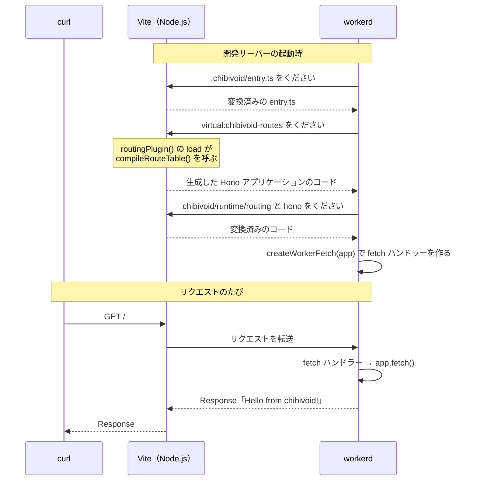

いよいよこの章から chibivoid を作り始めます。ルーティング（第 5 章）やページ（第 8 章）にはまだ手を付けず、「`chibivoidPlugin()` を Vite に登録すると、Worker が動き出す」という一番外側の骨組みだけをまず作成します。小さな章ですが、ここで準備する構造が本書を通じた土台となっていきます。

## この章のゴール

- Void と同じ構造のモノレポ（`packages/chibivoid` と `playground`）を作成する
- TypeScript のパッケージを、ビルドせずに workspace から使う方法について理解する
- `chibivoidPlugin()` が、Worker のエントリファイル（`.chibivoid/entry.ts`）の生成と仮想モジュール `virtual:chibivoid-routes` の提供をおこない、Cloudflare のプラグインを包んでいることを理解する
- リクエストが、どのファイルをどの順番で通るかを確かめる

## これから作るもの

この章を終えると、プロジェクトは次のような構成になります:

```
chibivoid/
├── .gitignore                     Git に入れないファイルの指定
├── package.json                   npm workspaces の設定
├── packages/
│   └── chibivoid/                 chibivoid 本体
│       ├── package.json
│       └── src/
│           ├── index.ts           chibivoidPlugin()
│           ├── plugin-routing.ts  仮想モジュール virtual:chibivoid-routes を提供する
│           ├── router/
│           │   └── compile.ts     エントリとルートテーブルのコードを生成する
│           └── runtime/
│               └── routing.ts     Worker の中で動く関数
└── playground/                    chibivoid を使うアプリケーション
    ├── package.json
    ├── tsconfig.json
    └── vite.config.ts             plugins: [chibivoidPlugin()]
```

`npm run dev` により `playground` を起動すると、Worker が「Hello from chibivoid!」と返すようになります。そのために `chibivoidPlugin()` は次の 3 つの仕事をします:

1. Worker のエントリとなるファイル `.chibivoid/entry.ts` を書き出す
2. Hono アプリケーションを、仮想モジュール `virtual:chibivoid-routes` として提供する
3. Cloudflare の Vite プラグインに、1. のファイルをエントリ（`main`）として渡す

リクエストは workerd の中で `.chibivoid/entry.ts` に届き、そこからインポートされた Hono アプリケーションが応答します。実際にどの順番で何が起きるのかは、「動かしてみる」にてアプリケーションを動かした後に、図を使って確かめます。

## Void をまねたモノレポを作成する

Void のリポジトリは、複数のパッケージを 1 つのリポジトリで管理するモノレポになっています。フレームワーク本体は `packages/void`（npm では `void` という名前で公開）、React のアダプターは `packages/react`（`@void/react`）にあり、動作確認用のアプリケーションが `playground/` に並んでいます。

chibivoid も同じ構造にします。ただし、Void は pnpm と [Vite+](https://viteplus.dev)（VoidZero が開発している統合ツールチェーン）でモノレポを管理していますが、本書では簡単のため Node.js に付属する npm の [workspaces](https://docs.npmjs.com/cli/using-npm/workspaces) 機能を使います。

第 3 章の `workers-basics` の外に、新しいディレクトリ `chibivoid` を作り、その直下に `package.json` を作成します:

```sh
mkdir chibivoid
cd chibivoid
```

<!-- file: code/how-void-works/ch04/package.json -->
```json:package.json
{
  "name": "chibivoid-root",
  "private": true,
  "workspaces": [
    "packages/*",
    "playground"
  ],
  "type": "module",
  "scripts": {
    "dev": "npm run dev --workspace playground",
    "build": "npm run build --workspace playground",
    "preview": "npm run preview --workspace playground"
  }
}
```
<!-- /file -->

`workspaces` に並べたディレクトリが、それぞれ 1 つのパッケージになります。モノレポのルートで `npm install` を実行すると、workspace のパッケージは `node_modules/` にシンボリックリンクとして置かれます。つまり、`playground` から `import { chibivoidPlugin } from "chibivoid"` と記述すると、`node_modules/chibivoid` のリンクをたどって、`packages/chibivoid` の中身がそのまま読み込まれます。

なお、ルートの `name` を `chibivoid-root` にしているのは、`packages/chibivoid` のパッケージ名 `chibivoid` と区別するためです。

生成物を Git に入れないための `.gitignore` も追加しておきます:

<!-- file: code/how-void-works/ch04/.gitignore -->
```text:.gitignore
node_modules
dist
.chibivoid
.wrangler
```
<!-- /file -->

`.chibivoid/` は chibivoid が生成するファイルの置き場所です。Void でも、同じ役割の `.void/` は、ドキュメントの「[Project Structure](https://void.cloud/reference/structure)」のページで「自動生成されるもの（Git では無視される）」と説明されています。

## TypeScript をビルドせずにパッケージにする

chibivoid パッケージのための `packages/chibivoid/package.json` を作成します:

```sh
mkdir -p packages/chibivoid/src/router packages/chibivoid/src/runtime
```

<!-- file: code/how-void-works/ch04/packages/chibivoid/package.json -->
```json:packages/chibivoid/package.json
{
  "name": "chibivoid",
  "version": "0.0.0",
  "private": true,
  "type": "module",
  "exports": {
    ".": "./src/index.ts",
    "./runtime/*": "./src/runtime/*.ts"
  },
  "dependencies": {
    "@cloudflare/vite-plugin": "^1.67.0",
    "hono": "^4.13.16"
  },
  "peerDependencies": {
    "vite": "^8.0.0"
  }
}
```
<!-- /file -->

ここでは [`exports`](https://nodejs.org/api/packages.html#subpath-exports) に注目してください:

- `"."`: `import ... from "chibivoid"` により読み込まれるファイル
- [`"./runtime/*"`](https://nodejs.org/api/packages.html#subpath-patterns): `import ... from "chibivoid/runtime/routing"` のように、`runtime/` 以下のファイルを読み込むことができるようにする

普通の npm パッケージであれば、TypeScript を JavaScript にビルドして `dist/` に出力し、`exports` はそれを指すようにします。Void も、Vite+ の `vp pack` コマンドにより `dist/*.mjs` をビルドしています。

chibivoid では、学習の手間を減らすためにビルドの過程を省き、`exports` が `src/*.ts` を直接指すようにしています。それでも動くのは、次の 2 つの理由からです:

1. Worker やブラウザで動くコードは、Vite が読み込む際に TypeScript を変換してくれます。workspace のパッケージ（`node_modules` の外に実体があるもの）は、Vite から見るとアプリケーションのソースコードと同じ扱いになります
2. Node.js で動くコード（`vite.config.ts` から読み込まれるプラグイン本体など）は、Node.js 24 以降の [type stripping](https://nodejs.org/api/typescript.html#type-stripping)（型注釈を取り除いてそのまま実行する機能）により動きます

ただし、type stripping は型注釈を消すだけであるため、次のルールを守る必要があります:

- `enum` や、実行時のコードを含む `namespace`、コンストラクターのパラメータプロパティ（`constructor(private x: number)`）のような、[JavaScript への変換が必要な TypeScript 独自の構文](https://nodejs.org/api/typescript.html#typescript-features)は使わない
- 相対パスのインポートには `.ts` の拡張子を付ける（`import { foo } from "./foo.ts"`）
- 型だけをインポートする場合は `import type` を使う（実行時に存在しない名前をインポートしようとしてエラーになることを防ぐ）

依存パッケージは `@cloudflare/vite-plugin` と、Worker の中でルーターとして使う `hono` です。`vite` は利用者のプロジェクトに入っているものを使うため `peerDependencies` にしています。

## Hono の基本

Void は、Worker の中で動くルーターとして [Hono](https://hono.dev) を使っています。Hono はウェブ標準の `Request`/`Response` の上で動く軽量なウェブフレームワークで、Cloudflare Workers でよく使われています。使い方はとても簡単です:

```ts
import { Hono } from "hono";

const app = new Hono();

app.get("/", (c) => c.text("Hello!"));
app.get("/users/:id", (c) => c.json({ id: c.req.param("id") }));

export default app;
```

このコードで押さえておきたいポイントは、次の 3 つです:

- `app.get(パス, ハンドラー)` によりルートを登録します。`:id` のような書き方で URL のパラメータを受け取ることができます
- ハンドラーは `c`（`Context`）を受け取り、`c.text()` や `c.json()` により `Response` を返します。`c.req` がリクエスト、`c.env` が Worker の `env` に対応します
- 最後の `export default app` により、このコードは Worker として振る舞います。第 3 章の「Cloudflare Workers とは何か」で見たように、Worker は「`fetch` メソッドをもつオブジェクト」をデフォルトエクスポートします。Hono の `app` はまさに `fetch(request, env, ctx)` というメソッドをもつオブジェクトであり、`export default { fetch: app.fetch }` と書いたのと同じように動きます

chibivoid は、`routes/` 以下のファイルからこの `app.get(...)` を並べたコードを生成することにより、ファイルベースルーティングを実現します（第 5 章）。この章では、まず固定の Hono アプリケーションのコードを生成するところから始めます。

## chibivoid 本体を作成する

他のファイルから使われる側（下の層）から順に、4 つのファイルを作成します。

### `runtime/routing.ts`: Worker の中で動く関数

まずは、一番下の層にあたる `runtime/routing.ts` を作成します:

<!-- file: code/how-void-works/ch04/packages/chibivoid/src/runtime/routing.ts -->
```ts:packages/chibivoid/src/runtime/routing.ts
// Worker エントリ（.chibivoid/entry.ts）から呼ばれる実行時の関数。
import type { ExecutionContext, Hono } from "hono";

type WorkerEnv = Record<string, unknown>;

/** Hono アプリケーションを Workers の `fetch` ハンドラーに変換する */
export function createWorkerFetch(app: Hono) {
  return (request: Request, env: WorkerEnv, ctx: ExecutionContext): Promise<Response> => {
    return Promise.resolve(app.fetch(request, env, ctx));
  };
}
```
<!-- /file -->

`createWorkerFetch()` は、Hono アプリケーションを受け取って Workers の `fetch` ハンドラーを返します。3 つ目の引数 `ctx` の型 `ExecutionContext` は Hono がエクスポートしているもので、`app.fetch()` が受け取る型と同じです。今は `app.fetch()` を呼ぶだけですが、第 7 章でここに「リクエストごとの `env` を覚えておく」処理を追加します。

`runtime/` には、Worker の中で動くコード（第 11 章からは、ブラウザで動くコードも）を置くことにします。Worker はプロジェクトのディレクトリとは切り離された環境で動くため、`node:fs` でプロジェクトのファイルを読むといった処理はここには書けません。そうした処理は、Node.js で動くプラグインの側に書きます。

### `router/compile.ts`: コードを生成する関数

次に、今作った `createWorkerFetch()` を呼び出すコードを生成する `router/compile.ts` を作成します:

<!-- file: code/how-void-works/ch04/packages/chibivoid/src/router/compile.ts -->
```ts:packages/chibivoid/src/router/compile.ts
/**
 * `.chibivoid/entry.ts`（Worker のエントリ）のソースコードを生成する。
 * 仮想モジュール `virtual:chibivoid-routes` がエクスポートする Hono アプリケーションを、
 * Workers の `fetch` ハンドラーとして公開するだけの薄いファイル。
 */
export function compileWorkerEntry(): string {
  return `// chibivoid が自動生成したファイルです。編集しないでください。
import app from "virtual:chibivoid-routes";
import { createWorkerFetch } from "chibivoid/runtime/routing";

export default {
  fetch: createWorkerFetch(app),
};
`;
}

/**
 * 仮想モジュール `virtual:chibivoid-routes` のソースコードを生成する。
 * 今はまだ固定の Hono アプリケーションを返す（第 5 章で routes/ から生成するように変える）。
 */
export function compileRouteTable(): string {
  return `import { Hono } from "hono";

const app = new Hono();
app.get("/", (c) => c.text("Hello from chibivoid!"));

export default app;
`;
}
```
<!-- /file -->

2 つの関数が、それぞれ JavaScript のソースコードを文字列で返しています:

- `compileWorkerEntry()` は、Worker のエントリ `.chibivoid/entry.ts` の中身を作成します。`virtual:chibivoid-routes` から Hono アプリケーションをインポートし、`createWorkerFetch()` により `fetch` ハンドラーにしてエクスポートします
- `compileRouteTable()` は、仮想モジュール `virtual:chibivoid-routes` の中身を作成します。今は固定の Hono アプリケーションを返します

`compile.ts` は Node.js の上で（Vite のプラグインの中で）動きますが、生成するコードは Worker の上で動きます。「Node.js で動くコード」が「Worker で動くコード」を生成する、という 2 段構えは、この先ずっと続きます。混乱しそうになった場合は、「このコードはどこで実行されるのか」を確認するようにしてください。

### `plugin-routing.ts`: 仮想モジュールを提供するプラグイン

続いて、`compileRouteTable()` が生成するコードを仮想モジュールとして提供する `plugin-routing.ts` を作成します:

<!-- file: code/how-void-works/ch04/packages/chibivoid/src/plugin-routing.ts -->
```ts:packages/chibivoid/src/plugin-routing.ts
import type { Plugin } from "vite";
import { compileRouteTable } from "./router/compile.ts";

const VIRTUAL_ROUTES_ID = "virtual:chibivoid-routes";
const RESOLVED_VIRTUAL_ROUTES_ID = "\0" + VIRTUAL_ROUTES_ID;

/**
 * ルーティングを担当するプラグイン。
 * 今はまだ、固定の Hono アプリケーションを仮想モジュール `virtual:chibivoid-routes` として提供するだけ。
 */
export function routingPlugin(): Plugin {
  return {
    name: "chibivoid:routing",
    // Vite 本体の解決処理より先に動いてほしいため "pre"
    enforce: "pre",

    resolveId(id) {
      if (id === VIRTUAL_ROUTES_ID) {
        return RESOLVED_VIRTUAL_ROUTES_ID;
      }
    },

    load(id) {
      if (id === RESOLVED_VIRTUAL_ROUTES_ID) {
        return compileRouteTable();
      }
    },
  };
}
```
<!-- /file -->

見てわかる通り、このプラグインは第 2 章の `notes` プラグインとほとんど同じかたちをしています。`virtual:chibivoid-routes` を `\0virtual:chibivoid-routes` に解決し、`load` で `compileRouteTable()` の結果を返します。

### `index.ts`: `chibivoidPlugin()`

最後に、ここまでの部品をまとめて、利用者が `vite.config.ts` で呼び出す `chibivoidPlugin()` を `index.ts` に作成します:

<!-- file: code/how-void-works/ch04/packages/chibivoid/src/index.ts -->
```ts:packages/chibivoid/src/index.ts
import { mkdirSync, readFileSync, writeFileSync } from "node:fs";
import { join } from "node:path";
import { cloudflare } from "@cloudflare/vite-plugin";
import type { Plugin } from "vite";
import { routingPlugin } from "./plugin-routing.ts";
import { compileWorkerEntry } from "./router/compile.ts";

/** Worker のコードを動かす Vite 環境の名前（Void では `void_worker`） */
export const WORKER_ENVIRONMENT_NAME = "chibivoid_worker";

/**
 * chibivoid の Vite プラグイン。
 * Void の `voidPlugin()` と同じく「プラグインの配列」を返す。
 */
export function chibivoidPlugin(): Plugin[] {
  const root = process.cwd();
  const outDir = join(root, ".chibivoid");
  mkdirSync(outDir, { recursive: true });

  // Cloudflare プラグインは設定を解決する時点で `main` のファイルを必要とする。
  // そのため、どのフックよりも前（= chibivoidPlugin() が呼ばれた瞬間）にエントリを書き出しておく。
  const entryPath = join(outDir, "entry.ts");
  writeFileSync(entryPath, compileWorkerEntry());

  return [
    routingPlugin(),
    ...cloudflare({
      // Worker 用の Vite 環境に名前を付ける
      viteEnvironment: { name: WORKER_ENVIRONMENT_NAME },
      // wrangler.jsonc に記述する代わりに、設定をここで組み立てて渡す
      config: {
        name: readWorkerName(root),
        main: entryPath,
        compatibility_date: "2026-10-01",
      },
    }),
  ];
}

/** package.json の name から Worker 名を作る */
export function readWorkerName(root: string): string {
  const pkg = JSON.parse(readFileSync(join(root, "package.json"), "utf8")) as { name?: string };
  const name = (pkg.name ?? "chibivoid-app")
    .toLowerCase()
    .replace(/[^a-z0-9-]+/g, "-")
    .replace(/^-+|-+$/g, "");
  return name || "chibivoid-app";
}
```
<!-- /file -->

`chibivoidPlugin()` は、Vite のプラグインの配列を返します。`plugins: [chibivoidPlugin()]` のように配列が入れ子になっていても、Vite はそれを上手く展開して 1 つの配列として扱ってくれます。

`chibivoidPlugin()` の中身を順に見ていきましょう。

#### 1. `process.cwd()` をアプリケーションのルートとみなす

`vite.config.ts` は、アプリケーションのディレクトリで Vite を起動した際に読み込まれるため、その時点のカレントディレクトリをアプリケーションのルートとして使います。Void と同じ挙動です。

#### 2. `.chibivoid/entry.ts` を即座に書き出す

Cloudflare のプラグインには、Worker のエントリを `main` として渡す必要があります。chibivoid はここにエントリファイルのパスを渡します。`main` が `.ts` などの拡張子で終わる場合、Cloudflare のプラグインは設定を解決する段階で、そのファイルが存在することを確認します。これは `buildStart` などのフックよりも前のタイミングです。

そのため、エントリファイルはフックの中ではなく、`chibivoidPlugin()` が呼ばれた瞬間（`vite.config.ts` が評価された時点）に書き出しています。

一方、ルートテーブルは、ファイルの追加や削除のたびに作り直す必要があるため、実ファイルではなく仮想モジュールにしています（第 6 章）。

#### 3. Cloudflare のプラグインを包む

`cloudflare()` に、第 3 章と同じように `viteEnvironment` と `config` を渡しています。第 3 章では `config` に値をそのまま記述していましたが、ここでは `package.json` や生成したエントリのパスから値を求めて組み立てています。今は `name`（`package.json` の `name` から作る）、`main`（生成したエントリ）、`compatibility_date` だけですが、第 7 章では推論したバインディングを、第 12 章では静的アセットの設定を、ここに加えていきます。

Worker 用の環境の名前は、Void の `void_worker` にならって `chibivoid_worker` にしています。

## playground を作成する

プラグインの動作確認用に、chibivoid を使う `playground` アプリケーションを作成しましょう:

```sh
mkdir playground
```

<!-- file: code/how-void-works/ch04/playground/package.json -->
```json:playground/package.json
{
  "name": "chibivoid-app",
  "private": true,
  "type": "module",
  "scripts": {
    "dev": "vite",
    "build": "vite build",
    "preview": "vite preview",
    "typecheck": "tsc --noEmit"
  },
  "dependencies": {
    "chibivoid": "*",
    "hono": "^4.13.16"
  },
  "devDependencies": {
    "@types/node": "^26.6.6",
    "typescript": "^7.0.2",
    "vite": "^8.3.6",
    "wrangler": "^4.158.0"
  }
}
```
<!-- /file -->

ここで `"chibivoid": "*"` の `*` は、「どのバージョンでもよい」という指定です。npm は、同じ名前でその指定を満たすパッケージが workspace にあれば、ダウンロードする代わりにそちらをリンクします。`hono` は chibivoid の依存でもありますが、chibivoid が生成するコードは `hono` をパッケージ名でインポートし、そのインポートはアプリケーションの側から解決されるため、アプリケーションの直接の依存にも入れておきます。

続いて、`playground/vite.config.ts` と `playground/tsconfig.json` を追加します:

<!-- file: code/how-void-works/ch04/playground/vite.config.ts -->
```ts:playground/vite.config.ts
import { chibivoidPlugin } from "chibivoid";
import { defineConfig } from "vite";

export default defineConfig({
  plugins: [chibivoidPlugin()],
});
```
<!-- /file -->

<!-- file: code/how-void-works/ch04/playground/tsconfig.json -->
```json:playground/tsconfig.json
{
  "compilerOptions": {
    "target": "ES2022",
    "lib": ["ES2022", "DOM"],
    "module": "ESNext",
    "moduleResolution": "Bundler",
    "jsx": "react-jsx",
    "strict": true,
    "noEmit": true,
    "skipLibCheck": true,
    "allowImportingTsExtensions": true,
    "verbatimModuleSyntax": true,
    "erasableSyntaxOnly": true,
    "types": ["node"]
  },
  "include": ["routes", "middleware", "pages", "src", "vite.config.ts", "../packages"]
}
```
<!-- /file -->

`include` には、これから作るディレクトリ（`routes` や `pages` など）を先に並べています。最後の `../packages` は chibivoid 本体です。chibivoid はビルドせず `.ts` のまま使うため、chibivoid のコードも playground の型チェックでまとめてチェックします。

[`erasableSyntaxOnly`](https://www.typescriptlang.org/tsconfig/#erasableSyntaxOnly) と [`verbatimModuleSyntax`](https://www.typescriptlang.org/tsconfig/#verbatimModuleSyntax) は、それぞれ「TypeScript をビルドせずにパッケージにする」で見た type stripping の 1 つ目と 3 つ目のルールを、TypeScript にチェックさせるためのオプションです。2 つ目の `.ts` の拡張子は、付け忘れても型チェックでは検出されないため、気を付けてください。

モノレポのルート（`chibivoid/`）で、依存をインストールします。本書のコマンドは、以降、特に断りがない限りモノレポのルートで実行します:

```sh
npm install
ls -l node_modules/chibivoid
# node_modules/chibivoid -> ../packages/chibivoid
```

`node_modules/chibivoid` が `packages/chibivoid` へのシンボリックリンクになっていれば成功です。

## 動かしてみる

ルート直下の `package.json` の `dev` スクリプトから playground を起動します:

```sh
npm run dev
```

開発サーバーを起動したまま、別のターミナルから `curl` でリクエストを送ってみましょう:

```
$ curl -i http://localhost:5173/
HTTP/1.1 200 OK
content-type: text/plain;charset=UTF-8

Hello from chibivoid!
```

まだ固定の文字列を返すだけですが、自分の手で作ったフレームワークが、初めてリクエストに応えました。chibivoid の記念すべき最初の一歩です！

### 何が起きたのか

`playground/.chibivoid/entry.ts` を開いてみましょう:

```ts
// chibivoid が自動生成したファイルです。編集しないでください。
import app from "virtual:chibivoid-routes";
import { createWorkerFetch } from "chibivoid/runtime/routing";

export default {
  fetch: createWorkerFetch(app),
};
```

`compileWorkerEntry()` が返した文字列が、そのままファイルになっています。開発サーバーを起動してから、リクエストに `Response` を返すまでの流れを図にすると、次のようになります:



Cloudflare のプラグインは、Worker のエントリが何をエクスポートしているかを調べるために、開発サーバーの起動時に workerd の中のモジュールランナーにエントリを読み込ませます。モジュールランナーは `.chibivoid/entry.ts` を評価し始め、そこに書かれたインポートを 1 つずつ Vite に要求します。`virtual:chibivoid-routes` が要求されると、`routingPlugin()` の `load` が呼ばれ、コードを生成して返します。評価済みのモジュールはキャッシュされるため、リクエストが来た際には、できあがった `fetch` ハンドラーが呼ばれるだけです。

`virtual:chibivoid-routes` の中身は、`compileRouteTable()` が返した文字列そのものです:

```js
import { Hono } from "hono";

const app = new Hono();
app.get("/", (c) => c.text("Hello from chibivoid!"));

export default app;
```

生成されたコードを自分の目で確かめたい場合は、`plugin-routing.ts` の `load` の中で、`return` する前の文字列を `console.log()` で出力してみてください。`vite.config.ts` がパッケージ名（`chibivoid`）から読み込んでいるプラグインのコードは、書き換えても動いている開発サーバーには反映されないため、開発サーバーをいったん止めて（Ctrl+C）起動し直します。`virtual:chibivoid-routes` は起動時に読み込まれるため、リクエストを送らなくても、開発サーバーのターミナルに文字列が表示されます。

### ビルド

開発サーバーを止めて、ビルドしてみましょう:

```
$ npm run build
vite v8.3.6 building chibivoid_worker environment for production...
dist/chibivoid_worker/.vite/manifest.json   0.15 kB │ gzip:  0.11 kB
dist/chibivoid_worker/wrangler.json         1.20 kB │ gzip:  0.63 kB
dist/chibivoid_worker/index.js             57.58 kB │ gzip: 16.05 kB │ map: 105.62 kB
✓ built in 61ms
```

`chibivoid_worker` 環境のビルド結果が `playground/dist/chibivoid_worker/` に出力されました。`index.js` には、生成したエントリと Hono アプリケーション、そして Hono 本体がバンドルされています。ビルドでも同じ `resolveId`/`load` が呼ばれるため、仮想モジュールはそのまま動きます。

## まとめ

- chibivoid は Void と同じく、`packages/chibivoid`（本体）と `playground`（アプリケーション）のモノレポにした
- `exports` で `.ts` を直接指すことで、ビルドせずにパッケージとして使うことができる（Vite の変換と Node.js の type stripping のおかげ）
- `chibivoidPlugin()` は、① Worker のエントリ `.chibivoid/entry.ts` を書き出し、② 仮想モジュール `virtual:chibivoid-routes` を提供し、③ Cloudflare のプラグインに `main` と設定を渡す
- エントリは Cloudflare のプラグインが設定の段階で必要とするため、`chibivoidPlugin()` が呼ばれた時点で書き出す
- Node.js で動くプラグインのコードが、Worker で動くコードを文字列として生成する

## Void の実装

`voidPlugin()`（`packages/void/src/index.ts`）は 1,000 行近くある関数ですが、骨格は chibivoid と同じです。`process.cwd()` をアプリケーションのルートにし、設定（`void.config.ts`）を読み、アプリケーションを解析し（`analyzeApplicationSync()`）、最後にプラグインの配列を返します。Void が返すプラグインは 20 個ほどあり、その中に `routingPlugin()`（`plugin-routing.ts`）と、Cloudflare のプラグインを包んだ `cloudflare()` が入っています。

`voidPlugin()` の途中には、TanStack Start や SvelteKit などのメタフレームワークを検出して、Void のルーティングを使わずに、リソース推論、`void/db` などのランタイム、デプロイを提供するモードへの分岐もあります。本書では、`routes/` と `pages/` を Void 自身が扱う「Void アプリケーション」のモードを作成します。

エントリの生成は、Void では `packages/void/src/router/compile.ts` の `compileWorkerEntry()` がおこないます。生成されるエントリは、`fetch` と `scheduled`（cron）のメソッドに加えて、キューを使うアプリケーションでは `queue`、メールを受信するアプリケーションでは `email` のメソッドも備える、`cloudflare:workers` の `WorkerEntrypoint` を継承したクラスになっており、`virtual:void-routes` から Hono アプリケーションの他にも多くのものをインポートしています。また `plugin-routing.ts` には、まさにこの章で説明した理由が書かれたコメントがあります:

```ts
// Generate the entry file and tsconfig eagerly (at plugin creation time,
// during voidPlugin()). The CF plugin needs the `main` file to exist at
// config resolution time, which is before any hooks like buildStart fire.
```

`createWorkerFetch()` は、Void では `packages/void/src/runtime/routing/worker.ts` にあります。環境変数のバリデーション、Void の内部エンドポイント（`/__void/ready` など）、内部用のバインディングを隠す処理、ISR（Incremental Static Regeneration）のキャッシュなどを経てから Hono アプリケーションを呼び出し、どのルートにもマッチしなかった `GET` または `HEAD` リクエストは、静的アセットにフォールバックしています。

生成コードからのインポートについては違いがあります。chibivoid は生成コードの中で `"hono"` や `"chibivoid/runtime/routing"` とパッケージ名でインポートしています。Void は、Vite プラグインのコードの中で `import.meta.resolve()` を使ってルーティングのランタイム（`packages/void/src/runtime/routing/index.ts`）などを絶対パスに解決してから、生成コードに埋め込んでいます。ルーティングのランタイムは、Void が `exports` で公開していないモジュールであり、パッケージ名ではインポートできないためです。`Hono` も、`"hono"` からではなく、このルーティングのランタイムが再エクスポートしたものをインポートしています。アプリケーションが `hono` に直接依存していなくても、ルーティングのランタイムと同じ Hono を使うためです。chibivoid では、読みやすさを優先して名前のまま記述し、`runtime/` を `exports` で公開し（「TypeScript をビルドせずにパッケージにする」）、アプリケーション側にも `hono` を依存として入れる（「playground を作成する」）ことで解決しています。
