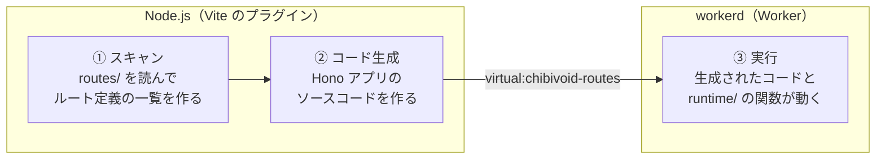

Void では、[`routes/`](https://void.cloud/guide/server-routing) にファイルを置くだけで API のエンドポイントを追加できます:

```ts
// routes/api/hello.ts → GET /api/hello
import { defineHandler } from "void";

export const GET = defineHandler(() => {
  return { message: "Hello from Void" };
});
```

この章では、このしくみを chibivoid に実装していきます。第 4 章では固定だった `virtual:chibivoid-routes` の中身を、`routes/` のファイルから生成するようにします。

## この章のゴール

- ファイルのパスを URL パターンに変換するルールを実装する（`[id]` → `:id` など）
- ファイルを実行せずに、どの HTTP メソッドがエクスポートされているかを調べる
- スキャン結果から Hono アプリのコードを生成する
- `defineHandler()` と、ハンドラーの戻り値を `Response` に変換するしくみを実装する
- `import { defineHandler } from "chibivoid"` を Worker の中で別のファイルに差し替える理由を理解する

## 全体の設計

本書で作成するファイルベースルーティングは、次の 3 段階で動きます:



この章では、この 3 つの段階をいくつかのファイルに分けて実装していきます。各段階が動く場所と担当するファイルを、次の表にまとめておきます:

| 段階 | どこで動くか | 担当するファイル |
| --- | --- | --- |
| ① スキャン | Node.js（`buildStart` フック） | `router/parse-filename.ts`、`router/route-order.ts`、`router/detect-exports.ts`、`shared/list-files.ts`、`router/scan.ts` |
| ② コード生成 | Node.js（`load` フック） | `router/compile.ts` |
| ③ 実行 | workerd | `runtime/handler.ts`、`runtime/response.ts`、`runtime/routing.ts` |

① と ② は Vite のプラグインの中で、③ は Worker の中で動きます。以降はこの区別を意識しながら読み進めていってください。

## ファイル名を URL パターンに変換する

ここでは、`routes/` からの相対パスを、Hono の URL パターンに変換するコードを作成します。基本的な変換ルールは Void と同じです:

| ファイル（`routes/` からの相対パス） | URL パターン | 説明 |
| --- | --- | --- |
| `api/hello.ts` | `/api/hello` | 拡張子を取って `/` を付ける |
| `api/users/index.ts` | `/api/users` | 末尾の `index` はディレクトリそのもの |
| `index.ts` | `/` | |
| `api/users/[id].ts` | `/api/users/:id` | `[名前]` は動的なパラメータ |
| `docs/[...slug].ts` | `/docs/:slug{.+}` | `[...名前]` は残りのパス全部（キャッチオール） |
| `(admin)/stats.ts` | `/stats` | `(名前)` はルートグループ。URL には現れない |

`:slug{.+}` は [Hono の書き方](https://hono.dev/docs/api/routing#including-slashes)で、「`slug` という名前で、1 文字以上の任意の文字列（`/` を含む）にマッチする」という意味です。

ファイル名を URL パターンに変換する `router/parse-filename.ts` を作成します:

<!-- file: code/how-void-works/ch05/packages/chibivoid/src/router/parse-filename.ts -->
```ts:packages/chibivoid/src/router/parse-filename.ts
export type RouteDefinition = {
  /** URL パターン（Hono の書式）。例: "/api/users/:id" */
  pattern: string;
  /** 動的パラメータの名前。例: ["id"] */
  params: string[];
  /** `[...slug]` のようなキャッチオールを含むか */
  catchAll: boolean;
  /** routes/（または pages/）からの相対パス。例: "api/users/[id].ts" */
  filePath: string;
  /** エクスポートされている HTTP メソッド。スキャナーが後から埋める */
  methods: string[];
};

/** ルートファイルとして扱う拡張子 */
export const ROUTE_FILE_RE = /\.(ts|tsx|js|jsx|mts|mjs)$/;

/**
 * routes/ からの相対パスを、URL パターンに変換する。
 *
 * 1. 拡張子を取る          api/users/[id].ts → api/users/[id]
 * 2. 末尾の index を取る   api/users/index   → api/users
 * 3. (group) を取り除く    (admin)/stats     → stats
 * 4. 動的セグメントを変換  [id] → :id、[...slug] → :slug{.+}
 * 5. 先頭に / を付ける
 */
export function parseRouteFilename(relativePath: string): RouteDefinition {
  const path = relativePath.replaceAll("\\", "/").replace(ROUTE_FILE_RE, "");

  const segments = path.split("/");
  if (segments.at(-1) === "index") {
    segments.pop();
  }

  const params: string[] = [];
  let catchAll = false;
  const converted = segments
    .filter((segment) => !(segment.startsWith("(") && segment.endsWith(")")))
    .map((segment) => {
      if (segment.startsWith("[...") && segment.endsWith("]")) {
        const name = segment.slice(4, -1);
        params.push(name);
        catchAll = true;
        // Hono では `:name{.+}` で「残りのパス全部」にマッチする
        return `:${name}{.+}`;
      }
      if (segment.startsWith("[") && segment.endsWith("]")) {
        const name = segment.slice(1, -1);
        params.push(name);
        return `:${name}`;
      }
      return segment;
    });

  return {
    pattern: "/" + converted.join("/"),
    params,
    catchAll,
    filePath: relativePath,
    methods: [],
  };
}
```
<!-- /file -->

`RouteDefinition` は、1 つのルートを表わすデータです。`methods`（エクスポートされている HTTP メソッド）はファイルの中身を見ないとわからないため、ここでは空にしておき、後で「`routes/` をスキャンする」で作成するスキャナーによって中身を埋めます。

## ルートの優先順位

`routes/api/users/[id].ts` と `routes/api/users/me.ts` がある場合、`/api/users/me` へのリクエストにはどちらが応えるべきでしょうか。直感的には、より具体的な `me.ts` です。

Hono は、[先に登録されたルートから順に](https://hono.dev/docs/api/routing#routing-priority)マッチするかを試します。つまり、ルートを登録する順番がそのまま優先順位になります。ファイルの一覧は名前順に並んでいるだけであるため、より具体的なルートが先に来るように並べ替える必要があります。そのための比較関数を作成します:

<!-- file: code/how-void-works/ch05/packages/chibivoid/src/router/route-order.ts -->
```ts:packages/chibivoid/src/router/route-order.ts
type SegmentKind = "static" | "param" | "rest";

/** パターンの 1 セグメントが「固定文字列」、「:param」、「残り全部」のどれかを判定する */
function segmentKind(segment: string): SegmentKind {
  if (segment === "*" || segment.endsWith("{.+}")) {
    return "rest";
  }
  return segment.startsWith(":") ? "param" : "static";
}

const RANK: Record<SegmentKind, number> = { static: 0, param: 1, rest: 2 };

/**
 * 同じ URL にマッチしうる 2 つのルートのうち、より具体的なほうが先に来るように並べる。
 * Hono は「先に登録されたもの」から順に試すため、登録順がそのまま優先順位になる。
 *
 * - キャッチオールは最後
 * - 左から 1 セグメントずつ比べ、最初に種類が違ったところで決める（固定 > :param > 残り全部）
 */
export function compareRouteSpecificity(
  a: { pattern: string; catchAll: boolean },
  b: { pattern: string; catchAll: boolean },
): number {
  if (a.catchAll !== b.catchAll) {
    return a.catchAll ? 1 : -1;
  }
  const aSegments = a.pattern.split("/");
  const bSegments = b.pattern.split("/");
  const shared = Math.min(aSegments.length, bSegments.length);
  for (let i = 0; i < shared; i++) {
    const diff = RANK[segmentKind(aSegments[i])] - RANK[segmentKind(bSegments[i])];
    if (diff !== 0) {
      return diff;
    }
  }
  // それでも決まらなければ、短いほうを先に。最後は文字列順で安定させる
  if (aSegments.length !== bSegments.length) {
    return aSegments.length - bSegments.length;
  }
  return a.pattern < b.pattern ? -1 : a.pattern > b.pattern ? 1 : 0;
}
```
<!-- /file -->

ルールは次の通りです:

1. キャッチオール（`[...slug]`）は、他のすべてのルートより後
2. それ以外は、左から 1 セグメント（`/` で区切った 1 区間）ずつ比べ、最初に種類が異なるところで決める。固定の文字列 → `:param` → 残り全部、の順に優先する

たとえば、`/api/users/me` と `/api/users/:id` は 3 番目のセグメントが異なっており、`me`（固定）が `:id`（パラメータ）より優先されます。

## エクスポートを「実行せずに」調べる

次は、各ファイルがどの HTTP メソッド（`GET`、`POST` など）をエクスポートしているかについて調べます。

一番簡単な方法は、ファイルをインポートして、エクスポートされている内容を確認することです。しかし、次の 2 つの理由から、この方法を使うことはできません:

- ルートのファイルは Worker の中で動くコードです。`cloudflare:workers` のような Workers 専用のモジュールをインポートしているかもしれず、Node.js では読み込むことができない可能性があります
- モジュールのトップレベルに、実行されては困る処理（外部への通信など）が書かれているかもしれません

そこで、ソースコードをパース（構文解析）して、エクスポート文だけを調べることとします。Vite 8 は内部で Oxc（Rust 製のツール群）のパーサーを使っており、それを `parseSync()` として公開しています。`parseSync()` は抽象構文木（AST、Abstract Syntax Tree）だけでなく、インポートとエクスポートの一覧（`module`）もまとめて返してくれるため、エクスポートを簡単に検出することができます。これを使って、エクスポートされる内容を調べる関数を作成します:

<!-- file: code/how-void-works/ch05/packages/chibivoid/src/router/detect-exports.ts -->
```ts:packages/chibivoid/src/router/detect-exports.ts
import { readFileSync } from "node:fs";
import { basename } from "node:path";
import { parseSync } from "vite";

const HTTP_METHODS = new Set(["GET", "POST", "PUT", "PATCH", "DELETE", "OPTIONS"]);

/**
 * ファイルを「実行せずに」解析して、エクスポートされている値の名前を列挙する。
 * Vite 8 が内部で使っている Oxc のパーサー（parseSync）は、
 * ESM のインポートとエクスポートの一覧（`module`）も一緒に返してくれる。
 */
export function detectExports(absPath: string): string[] {
  const code = readFileSync(absPath, "utf8");
  const { module, errors } = parseSync(basename(absPath), code);
  if (errors.length > 0) {
    return [];
  }
  const names: string[] = [];
  for (const statement of module.staticExports) {
    for (const entry of statement.entries) {
      // `export type { Foo }` のような型だけのエクスポートは実行時には存在しないため除く
      if (!entry.isType && entry.exportName.name) {
        names.push(entry.exportName.name);
      }
    }
  }
  return names;
}

/** `export const GET = ...` のような HTTP メソッド名のエクスポートだけを取り出す */
export function detectHttpExports(absPath: string): string[] {
  return detectExports(absPath).filter((name) => HTTP_METHODS.has(name));
}
```
<!-- /file -->

`export const GET = ...`、`export function POST() {}`、`export { handler as PUT }` のどの書き方でも、`exportName.name` にエクスポート名が入ります。`export type { ... }` は実行時には存在しないため除いています。

この「実行せずに解析する」という方針は、Void の様々な箇所で採用されています。たとえば、第 7 章のリソース推論でも、同じ `parseSync()` を使います。

## `routes/` をスキャンする

まずは、ディレクトリを再帰的にたどって、ファイルの一覧を返す関数を作成します。この関数を置くディレクトリを用意しておきましょう:

```sh
mkdir -p packages/chibivoid/src/shared
```

このディレクトリに、`list-files.ts` を作成します:

<!-- file: code/how-void-works/ch05/packages/chibivoid/src/shared/list-files.ts -->
```ts:packages/chibivoid/src/shared/list-files.ts
import { existsSync, readdirSync } from "node:fs";
import { join, relative } from "node:path";

/**
 * ディレクトリ配下のファイルを再帰的に列挙する（スラッシュ区切りの相対パス）。
 * `_` や `.` で始まるファイル・ディレクトリは無視する。
 */
export function listFiles(dir: string): string[] {
  if (!existsSync(dir)) {
    return [];
  }
  return readdirSync(dir, { recursive: true, withFileTypes: true })
    .filter((entry) => entry.isFile())
    .map((entry) => relative(dir, join(entry.parentPath, entry.name)).replaceAll("\\", "/"))
    .filter((file) => !file.split("/").some((segment) => /^[_.]/.test(segment)))
    .sort();
}
```
<!-- /file -->

`listFiles()` は、`_` や `.` で始まるファイルやディレクトリを無視します。そのため、ルートのファイルの隣にヘルパーを置きたい場合は、`_utils.ts` のように、`_` で始まる名前を付けます。

次に、ここまでの部品を組み合わせて、`routes/` をスキャンする `router/scan.ts` を作成します:

<!-- file: code/how-void-works/ch05/packages/chibivoid/src/router/scan.ts -->
```ts:packages/chibivoid/src/router/scan.ts
import { join } from "node:path";
import { listFiles } from "../shared/list-files.ts";
import { detectHttpExports } from "./detect-exports.ts";
import { parseRouteFilename, ROUTE_FILE_RE, type RouteDefinition } from "./parse-filename.ts";
import { compareRouteSpecificity } from "./route-order.ts";

export type ProjectPaths = {
  routesDir: string;
};

export type ScanResult = {
  routes: RouteDefinition[];
};

/** routes/ をスキャンして、ルート定義の一覧を、より具体的なルートが先に来るように並べて返す */
export function scanRoutes(routesDir: string): RouteDefinition[] {
  return listFiles(routesDir)
    .filter((file) => ROUTE_FILE_RE.test(file))
    .map((file) => ({
      ...parseRouteFilename(file),
      methods: detectHttpExports(join(routesDir, file)),
    }))
    .sort(compareRouteSpecificity);
}

export function scanApp(paths: ProjectPaths): ScanResult {
  return {
    routes: scanRoutes(paths.routesDir),
  };
}
```
<!-- /file -->

`scanRoutes()` は、ファイルごとに「パスから作成した `RouteDefinition`」と「エクスポートから調べた `methods`」を合わせ、より具体的なルートが先に来るように並べて返します。`scanApp()` はアプリ全体のスキャン結果をまとめる関数で、第 6 章以降でミドルウェアやページのスキャンを追加していきます。

## Worker の中で動く関数

生成するコードやルートのファイルから呼び出す関数を用意します。

### `defineHandler()`: 型を付けるだけの関数

まずは、利用者がルートを記述する際に使う `defineHandler()` を作成します:

<!-- file: code/how-void-works/ch05/packages/chibivoid/src/runtime/handler.ts -->
```ts:packages/chibivoid/src/runtime/handler.ts
// Worker の中で使われる軽量なランタイム。
// `import { defineHandler } from "chibivoid"` は、Worker ではこのファイルに解決される。
import type { Context } from "hono";

/** ハンドラーが受け取るコンテキスト（Hono の Context） */
export type CloudContext = Context;

/**
 * ルートハンドラーを定義する。
 * 実行時は何もしない恒等関数で、引数 c に型を付けるためだけに存在する。
 */
export function defineHandler<R>(handler: (c: CloudContext) => R): (c: CloudContext) => R {
  return handler;
}
```
<!-- /file -->

`defineHandler()` は、受け取った関数をそのまま返す恒等関数（identity function）であり、実行時には特に何もしません。この関数は、次のように、ハンドラーの引数に型を付けるために使います:

```ts
export const GET = defineHandler((c) => {
  // c の型が Hono の Context だとわかるため、c.req.param() などが補完される
});
```

関数を直接 `export const GET = (c) => ...` と記述すると、`c` には型が付きません。一方、`defineHandler()` で包むと、TypeScript が引数 `c` の型を推論してくれます。第 8 章では、ハンドラーの戻り値の型も、`defineHandler()` が返す関数の型から取り出すことができるようにします。

### 戻り値を `Response` に変換する

Void のハンドラーは、`Response` を返すだけでなく、オブジェクトや文字列をそのまま返すこともできます。次に、こうした戻り値を `Response` に変換する関数を作成します:

<!-- file: code/how-void-works/ch05/packages/chibivoid/src/runtime/response.ts -->
```ts:packages/chibivoid/src/runtime/response.ts
/**
 * ハンドラーの戻り値をウェブ標準の Response に変換する。
 *
 * - Response            → そのまま
 * - null/undefined      → 204 No Content
 * - 文字列              → text/html
 * - それ以外（オブジェクトなど） → JSON
 */
export function convertReturnValue(value: unknown): Response {
  if (value instanceof Response) {
    return value;
  }
  if (value === null || value === undefined) {
    return new Response(null, { status: 204 });
  }
  if (typeof value === "string") {
    return new Response(value, { headers: { "Content-Type": "text/html; charset=utf-8" } });
  }
  return Response.json(value);
}
```
<!-- /file -->

変換のルールをまとめると、次のようになります:

| 戻り値 | レスポンス |
| --- | --- |
| `Response` | そのまま |
| `null`/`undefined` | 204 No Content |
| 文字列 | `text/html` |
| オブジェクト、配列、数値など | JSON |

このルールは Void の `convertReturnValue()`（`packages/void/src/runtime/handler/response.ts`）と同じです。

### ルートを遅延ロードする関数

最後に、第 4 章で作成した `runtime/routing.ts` を、次の内容に置き換えます。`createWorkerFetch()` はそのままで、2 つの関数を追加しています:

<!-- file: code/how-void-works/ch05/packages/chibivoid/src/runtime/routing.ts -->
```ts:packages/chibivoid/src/runtime/routing.ts
// 生成されたルートテーブル（virtual:chibivoid-routes）と Worker エントリから呼ばれる実行時の関数。
import type { Context, ExecutionContext, Hono } from "hono";
import { convertReturnValue } from "./response.ts";

type RouteModule = Record<string, ((c: Context) => unknown) | undefined>;

/**
 * `() => import(...)` を包んで、モジュールを遅延ロードする関数を作る。
 * cache が true なら 2 回目以降は同じモジュールを返す。
 * 開発中は毎回インポートし直すことで、ファイルの変更がすぐ反映されるようにする。
 */
export function createModuleLoader<T>(load: () => Promise<T>, cache: boolean): () => Promise<T> {
  let loaded: Promise<T> | undefined;
  return () => {
    if (!cache) {
      return load();
    }
    loaded ??= load();
    return loaded;
  };
}

/** routes/ のファイルの `export const GET = ...` を呼び出す Hono ハンドラーを作る */
export function createHttpRouteHandler(load: () => Promise<RouteModule>, method: string) {
  return async (c: Context): Promise<Response> => {
    const handler = (await load())[method];
    if (!handler) {
      return c.text("Method Not Allowed", 405);
    }
    return convertReturnValue(await handler(c));
  };
}

type WorkerEnv = Record<string, unknown>;

/** Hono アプリを Workers の `fetch` ハンドラーに変換する */
export function createWorkerFetch(app: Hono) {
  return (request: Request, env: WorkerEnv, ctx: ExecutionContext): Promise<Response> => {
    return Promise.resolve(app.fetch(request, env, ctx));
  };
}
```
<!-- /file -->

`createModuleLoader()` は、`() => import("...")` を包んで、最初に呼ばれた際にモジュールを読み込む関数を返します。ルートのファイルを最初からすべてインポートせず、リクエストが来た際に初めて読み込む（遅延ロード）ためです。Worker は起動の速さが大切であるため、使わないルートのコードを評価しないで済むのは大きな利点です。

`cache` が `true` であれば、一度読み込んだモジュールを使い回します。開発中（`cache` が `false`）は毎回インポートし直すため、ファイルを書き換えて Vite がそのモジュールを無効化した後は、次の `import()` により新しい内容が読み込まれます。

`createHttpRouteHandler()` は、Hono のハンドラーを作成します。このハンドラーは、リクエストが来るとモジュールを読み込んで、指定されたメソッド名のエクスポート（`GET` など）を呼び、戻り値を `convertReturnValue()` により `Response` に変換します。

## Hono アプリのコードを生成する

スキャン結果から、`virtual:chibivoid-routes` のソースコードを生成します。`router/compile.ts` を次のように書き換えます:

<!-- file: code/how-void-works/ch05/packages/chibivoid/src/router/compile.ts -->
```ts:packages/chibivoid/src/router/compile.ts
import type { ProjectPaths, ScanResult } from "./scan.ts";

export type CompileOptions = ProjectPaths & {
  /** `vite dev` 用にコンパイルするか */
  dev: boolean;
};

/** 生成コードに埋め込む文字列リテラルを作る（JSON.stringify にクォートとエスケープを任せる） */
const str = (value: string) => JSON.stringify(value);

/**
 * `.chibivoid/entry.ts`（Worker のエントリ）のソースコードを生成する。
 * 仮想モジュール `virtual:chibivoid-routes` がエクスポートする Hono アプリを、
 * Workers の `fetch` ハンドラーとして公開するだけの薄いファイル。
 */
export function compileWorkerEntry(): string {
  return `// chibivoid が自動生成したファイルです。編集しないでください。
import app from "virtual:chibivoid-routes";
import { createWorkerFetch } from "chibivoid/runtime/routing";

export default {
  fetch: createWorkerFetch(app),
};
`;
}

/**
 * スキャン結果から、仮想モジュール `virtual:chibivoid-routes` のソースコードを生成する。
 * 中身は「ファイルベースのルートを登録した Hono アプリ」をデフォルトエクスポートする ES モジュール。
 */
export function compileRouteTable(scan: ScanResult, options: CompileOptions): string {
  const imports: string[] = [
    `import { Hono } from "hono";`,
    `import { createModuleLoader, createHttpRouteHandler } from "chibivoid/runtime/routing";`,
  ];
  const body: string[] = ["const app = new Hono();"];
  // 本番ではロードしたモジュールをキャッシュし、開発中は毎回インポートし直す
  const cache = !options.dev;

  // サーバールート: ファイルは「最初にリクエストが来た際」に読み込む（遅延ロード）
  scan.routes.forEach((route, i) => {
    const loader = `loadRoute${i}`;
    const file = `${options.routesDir}/${route.filePath}`;
    body.push(`const ${loader} = createModuleLoader(() => import(${str(file)}), ${cache});`);
    for (const method of route.methods) {
      body.push(
        `app.${method.toLowerCase()}(${str(route.pattern)}, createHttpRouteHandler(${loader}, ${str(method)}));`,
      );
    }
  });

  return [...imports, "", ...body, "", "export default app;", ""].join("\n");
}
```
<!-- /file -->

ルートごとに、次の行を出力しています:

1. `createModuleLoader()` によりローダーを作成する行
2. エクスポートされているメソッドごとに `app.get(...)`/`app.post(...)` を呼ぶ行

ファイルのパスや URL パターンは、`JSON.stringify()` により文字列リテラルにしています。`"` や `\` のように、文字列リテラルの中でエスケープが必要な文字を含むパスでも、クォートとエスケープが正しくおこなわれるためです。

playground に、あとで「ルートを作成して動かす」で作る 3 つのルート（`api/hello.ts`、`api/users/[id].ts`、`api/users/me.ts`）がある場合、開発サーバーで生成されるコードは次のようになります（パスは環境によって変わります）:

```js
import { Hono } from "hono";
import { createModuleLoader, createHttpRouteHandler } from "chibivoid/runtime/routing";

const app = new Hono();
const loadRoute0 = createModuleLoader(() => import("/path/to/chibivoid/playground/routes/api/hello.ts"), false);
app.get("/api/hello", createHttpRouteHandler(loadRoute0, "GET"));
const loadRoute1 = createModuleLoader(() => import("/path/to/chibivoid/playground/routes/api/users/me.ts"), false);
app.get("/api/users/me", createHttpRouteHandler(loadRoute1, "GET"));
const loadRoute2 = createModuleLoader(() => import("/path/to/chibivoid/playground/routes/api/users/[id].ts"), false);
app.get("/api/users/:id", createHttpRouteHandler(loadRoute2, "GET"));

export default app;
```

`/api/users/me` が `/api/users/:id` より先に登録されていることに注目してください。また、`createModuleLoader()` の 2 つ目の引数（`cache`）は `false` です。`vite build` により生成されるコードでは、これが `true` になります。

仮想モジュールはディスク上の場所をもたないため、`import("./routes/...")` のような相対パスには、基準になるディレクトリがありません。そのため、ルートのファイルは絶対パスでインポートしています。

## プラグインにつなぐ

`plugin-routing.ts` を書き換えて、スキャンとコード生成をつなぎます:

<!-- file: code/how-void-works/ch05/packages/chibivoid/src/plugin-routing.ts -->
```ts:packages/chibivoid/src/plugin-routing.ts
import { join } from "node:path";
import { fileURLToPath } from "node:url";
import { normalizePath, type Plugin } from "vite";
import { compileRouteTable } from "./router/compile.ts";
import { scanApp, type ProjectPaths, type ScanResult } from "./router/scan.ts";

const VIRTUAL_ROUTES_ID = "virtual:chibivoid-routes";
const RESOLVED_VIRTUAL_ROUTES_ID = "\0" + VIRTUAL_ROUTES_ID;

/** Worker で使う軽量なランタイム（defineHandler など）の実ファイル */
const HANDLER_PATH = fileURLToPath(new URL("./runtime/handler.ts", import.meta.url));

/**
 * ファイルベースルーティングを担当するプラグイン。
 * - routes/ をスキャンする
 * - スキャン結果から仮想モジュール `virtual:chibivoid-routes`（Hono アプリ）を生成する
 */
export function routingPlugin(root: string): Plugin {
  const paths: ProjectPaths = {
    routesDir: normalizePath(join(root, "routes")),
  };
  let scan: ScanResult | undefined;
  let dev = false;

  function rescan(): ScanResult {
    scan = scanApp(paths);
    return scan;
  }

  return {
    name: "chibivoid:routing",
    // Vite 本体の解決処理より先に動いてほしいため "pre"
    enforce: "pre",

    config(_config, env) {
      // `vite dev` の場合だけ true（`vite preview` は本番ビルドを動かすため false）
      dev = env.command === "serve" && !env.isPreview;
    },

    buildStart() {
      rescan();
    },

    resolveId(id) {
      if (id === VIRTUAL_ROUTES_ID) {
        return RESOLVED_VIRTUAL_ROUTES_ID;
      }
      // `import { defineHandler } from "chibivoid"` は Vite プラグイン本体（index.ts）を指す。
      // そのまま Worker にバンドルすると vite や wrangler まで引き込んでしまうため、
      // サーバー側の環境では軽量な runtime/handler.ts に差し替える。
      if (id === "chibivoid" && this.environment.config.consumer === "server") {
        return HANDLER_PATH;
      }
    },

    load(id) {
      if (id !== RESOLVED_VIRTUAL_ROUTES_ID) {
        return;
      }
      if (this.environment.config.consumer === "client") {
        throw new Error(`${VIRTUAL_ROUTES_ID} はサーバー専用のモジュールです`);
      }
      return compileRouteTable(scan ?? rescan(), { ...paths, dev });
    },
  };
}
```
<!-- /file -->

第 4 章からの主な変更点は、次の 4 つです。

### 1. `config` フックで開発サーバーかどうかを記録する

[`env.command`](https://vite.dev/config/#conditional-config) は、`vite dev` と `vite preview` の場合は `"serve"`、`vite build` の場合は `"build"` になります。`vite preview` は本番ビルドを動かすため、`isPreview` も見て、開発サーバーの場合だけ `dev = true` にしています。この `dev` は、生成するコードの `cache` フラグに使います。

### 2. `buildStart` でスキャンする

`buildStart` は、開発サーバーの起動時とビルドの開始時に呼ばれます。ここで `routes/` をスキャンし、結果を変数 `scan` に保存しておきます。`load` はその結果からコードを生成します。

### 3. クライアント側からの読み込みを拒否する

`virtual:chibivoid-routes` には、サーバーでしか使わないコードや情報（ファイルの絶対パスなど）が含まれます。そのため、ブラウザ用の環境（`consumer` が `"client"`）から読み込まれた場合は、エラーにします。Void も、`client` 環境からの読み込みをエラーにしています。

### 4. `chibivoid` のインポートを差し替える

ルートのファイルでは、`import { defineHandler } from "chibivoid"` と記述します。`chibivoid` の `exports` の `"."` は `src/index.ts`、つまり Vite のプラグイン本体です。`index.ts` は `@cloudflare/vite-plugin` をインポートしており、その先には Wrangler やファイルシステムを使うコードが大量につながっています。

この後の「ルートを作成して動かす」でルートのファイルを作成した後で、試しに `resolveId` の差し替えをコメントアウトしてビルドしてみると、次のようなエラーになるはずです:

```
✓ 428 modules transformed.
✗ Build failed in 4.57s
error during build:
Build failed with 1 error:

[UNRESOLVED_IMPORT] Could not resolve './node.js' in ../node_modules/blake3-wasm/esm/index.js
    ...
    │ Help: '../node_modules/blake3-wasm/esm/index.js' is imported by the following path:
    │         - ../node_modules/blake3-wasm/esm/index.js
    │         - ../node_modules/@cloudflare/vite-plugin/node_modules/wrangler/wrangler-dist/cli.js
    │         - ../node_modules/@cloudflare/vite-plugin/dist/index.mjs
    │         - ../packages/chibivoid/src/index.ts
    │         - routes/api/hello.ts
    │         - \0virtual:chibivoid-routes
    │         - .chibivoid/entry.ts
    │         - \0virtual:cloudflare/worker-entry
...
```

`defineHandler()` を使いたかっただけにもかかわらず、Wrangler の CLI まで Worker にバンドルしようとして失敗しています。試した場合は、コメントアウトを外しておいてください。そのままにしておくと、開発サーバーでもルートのレスポンスが 500 Internal Server Error になります。

`resolveId` の差し替えが効くのは、プラグインに `enforce: "pre"` を付けているためです。第 2 章で見たように、インポートの解決先を探す Vite の組み込みプラグイン（`builtin:vite-resolve`）は、`enforce` を付けないプラグインより先に動きます。`chibivoid` は実在するパッケージであるため、`enforce: "pre"` がないと、`routingPlugin()` の `resolveId` が呼ばれる前に Vite が `src/index.ts` に解決してしまいます。

そこで、`resolveId` では、サーバー側の環境（`consumer` が `"server"`）において `chibivoid` がインポートされた場合に、軽量な `runtime/handler.ts` に差し替えています。この節の最後で追加するように、`index.ts` は `defineHandler()` を `runtime/handler.ts` から再エクスポートするだけであるため、差し替えても利用者のコードは同じように動きます。差し替えた後のビルド結果は 60 KB ほどで、Wrangler は含まれていません。

ここでは、`resolveId` は `\0` 付きの ID ではなく、実在するファイルの絶対パスを返しています。Vite では、通常のファイルのモジュール ID は、そのファイルの絶対パスです。この ID に対して `load` で値を返すプラグインはないため、第 2 章の「プラグインとフック」で見たように、最後に Vite がこのパスのファイルを読み込みます。その後は普通のファイルと同じように、TypeScript から JavaScript に変換されます。つまり、`resolveId` が `\0` 付きの ID を返せば仮想モジュールを作成でき、実在するファイルのパスを返せばインポートの解決先を別のファイルに差し替えることができます。

この差し替えは、Void の `packages/void/AGENTS.md`（AI エージェントやコントリビューター向けの設計メモ）でも、重要な設計判断（Key Design Decisions）の 1 つ「Import redirection」として説明されています。これがないと、ルートのファイルからプラグイン全体（`vite` や `@cloudflare/vite-plugin` など）が Worker のバンドルに引き込まれてしまう、という内容です。

最後に、`index.ts` で `routingPlugin()` に `root` を渡すようにし、再エクスポートを追加します:

<!-- diff: code/how-void-works/ch04/packages/chibivoid/src/index.ts code/how-void-works/ch05/packages/chibivoid/src/index.ts -->
```diff ts:packages/chibivoid/src/index.ts
@@ -23,7 +23,7 @@
   writeFileSync(entryPath, compileWorkerEntry());
 
   return [
-    routingPlugin(),
+    routingPlugin(root),
     ...cloudflare({
       // Worker 用の Vite 環境に名前を付ける
       viteEnvironment: { name: WORKER_ENVIRONMENT_NAME },
@@ -46,3 +46,8 @@
     .replace(/^-+|-+$/g, "");
   return name || "chibivoid-app";
 }
+
+// アプリのコードから `import { defineHandler } from "chibivoid"` と記述することができるように再エクスポートする。
+// （Worker の中ではこの index.ts ではなく runtime/handler.ts に差し替えられる）
+export { defineHandler } from "./runtime/handler.ts";
+export type { CloudContext } from "./runtime/handler.ts";
```
<!-- /diff -->

TypeScript から見ると `chibivoid` は `src/index.ts` であるため、エディターの補完や型チェックはこの再エクスポートを通じて機能します。一方、実行時の Worker の中では、`chibivoid` のインポートが `runtime/handler.ts` に差し替わります。

## ルートを作成して動かす

playground にルートを 3 つ作成します。ルートを置くためのディレクトリを用意しておきましょう:

```sh
mkdir -p playground/routes/api/users
```

まず、`/api/hello` に応えるルートを作成します:

<!-- file: code/how-void-works/ch05/playground/routes/api/hello.ts -->
```ts:playground/routes/api/hello.ts
import { defineHandler } from "chibivoid";

export const GET = defineHandler(() => {
  return { message: "Hello from chibivoid!" };
});
```
<!-- /file -->

次に、URL の一部をパラメータ `id` として受け取るルートを作成します:

<!-- file: code/how-void-works/ch05/playground/routes/api/users/[id].ts -->
```ts:playground/routes/api/users/[id].ts
import { defineHandler } from "chibivoid";

export const GET = defineHandler((c) => {
  return { id: c.req.param("id") };
});
```
<!-- /file -->

最後に、`/api/users/me` に応えるルートを作成します。この URL は `[id].ts` のパターンにもマッチするため、優先順位の確認に使います:

<!-- file: code/how-void-works/ch05/playground/routes/api/users/me.ts -->
```ts:playground/routes/api/users/me.ts
import { defineHandler } from "chibivoid";

// /api/users/[id].ts より具体的であるため、こちらが優先される
export const GET = defineHandler(() => {
  return { id: "me", name: "あなた" };
});
```
<!-- /file -->

開発サーバーを起動します:

```sh
npm run dev
```

開発サーバーを起動したまま、別のターミナルから `curl` でリクエストを送ってみましょう:

```sh
curl http://localhost:5173/api/hello
# {"message":"Hello from chibivoid!"}

curl http://localhost:5173/api/users/42
# {"id":"42"}

curl http://localhost:5173/api/users/me
# {"id":"me","name":"あなた"}

curl -i -X POST http://localhost:5173/api/hello
# HTTP/1.1 404 Not Found （POST はエクスポートしていないため登録されていない）
```

`/api/users/me` には `me.ts` が応えており、優先順位の並べ替えが効いていることがわかります。これで、`routes/` に置いたファイルが、そのまま API のエンドポイントとして動くようになりました。

## まとめ

- ファイルベースルーティングは「① スキャン（Node.js）→ ② コード生成（Node.js）→ ③ 実行（Worker）」の 3 段階で動く
- ファイル名からは URL パターンを、ファイルの中身からはエクスポートされた HTTP メソッドを取り出す。中身は実行せずに `parseSync()` により解析する
- Hono は登録順にマッチするため、より具体的なルートを先に登録する
- ルートのファイルは遅延ロードし、ハンドラーの戻り値は `convertReturnValue()` により `Response` に変換する
- `defineHandler()` は型を付けるための恒等関数。`chibivoid` のインポートは、サーバー側では軽量な `runtime/handler.ts` に差し替える

## Void の実装

| chibivoid | Void | 主な違い |
| --- | --- | --- |
| `router/parse-filename.ts` | `packages/void/src/router/parse-filename.ts` | `.dev`/`.prod` の接尾辞により、開発中だけ、または本番だけのルートを作成できる。WebSocket ルート（`.ws.ts`）の解析もある |
| `router/route-order.ts` | `packages/void/src/router/route-order.ts` | ほぼ同じアルゴリズム。加えて「セグメントがすべて固定のルートを最優先する」 |
| `router/detect-exports.ts` | `packages/void/src/router/detect-exports.ts` | `parseSync()` の AST（`program.body`）を自分でたどってエクスポートを調べている |
| `router/scan.ts` | `packages/void/src/router/scan.ts`、`packages/void/src/application-analysis.ts` | ルート以外に cron、キュー、メール、WebSocket などもスキャンし、アプリ全体の解析結果として共有している |
| `router/compile.ts` | `packages/void/src/router/compile.ts` の `compileRouteTable()` | 認証、WebSocket、キュー、cron、メール、マイグレーション、Void の内部エンドポイント（`/__void/*`）など、多くの機能のコードも生成する |
| `runtime/routing.ts` | `packages/void/src/runtime/routing/index.ts` | `createModuleLoader()` と `createHttpRouteHandler()` はほぼ同じかたち。リライトなどのための `createRoutingRuntime()` もある |
| `runtime/response.ts` | `packages/void/src/runtime/handler/response.ts` | 同じルール |
| `runtime/handler.ts` | `packages/void/src/runtime/handler/index.ts` | `defineHandler.withValidator()` により入力のバリデーションもできる |

Void のテストも見ておきましょう。`packages/void/test/unit/parse-filename.test.ts` と `route-order.test.ts` には、この章で扱った変換ルールと優先順位が、入力と期待する出力の組として並んでいます。Void のコードを読む際は、まずテストを読むと、その関数が何をするものなのかがわかりやすくなります。
