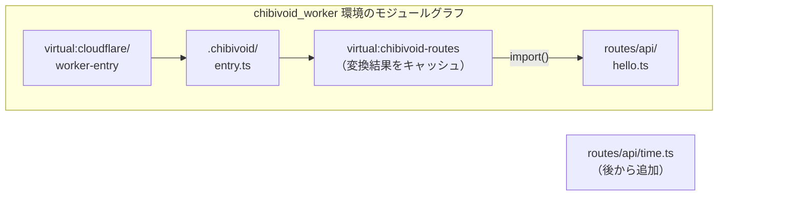

第 5 章までで、`routes/` にファイルを置くだけで API のエンドポイントを追加できるようになりました。ところが実は、今の chibivoid では、開発サーバーを起動したまま新しいルートを追加しても、再起動するまで新しいルートが反映されません。そこでこの章では、ファイルの変更を監視して、開発サーバーを再起動することなくルートの追加・削除が反映されるようにします。後半では、ログの出力のように、すべてのリクエストで動かしたい処理を記述するためのミドルウェアを実装します。

## この章のゴール

- 仮想モジュールが「古いまま」になる理由を理解する
- ファイルの変更を監視して、必要な場合にだけルートテーブルを作り直すようにする
- Worker 用の環境のモジュールランナーに「読み直し」を伝える方法を理解する
- `middleware/` ディレクトリのグローバルミドルウェアを実装する

## 追加したルートが反映されない

まずは、第 5 章のコードのままで何が起きるのかを確かめましょう。開発サーバーを起動したまま、別のターミナルから新しいルートを追加してみます:

```sh
cat > playground/routes/api/time.ts << 'EOF'
import { defineHandler } from "chibivoid";

export const GET = defineHandler(() => ({ now: new Date().toISOString() }));
EOF

curl -i http://localhost:5173/api/time
# HTTP/1.1 404 Not Found
```

追加したルートへのリクエストは 404 になりました。開発サーバーを再起動すれば新しいルートが反映されますが、ファイルを追加するたびに再起動するのは不便です。

一方、既存のルートの中身を書き換えた場合は、再起動しなくても反映されます:

```sh
# playground/routes/api/hello.ts の "Hello from chibivoid!" を "Hello again!" に書き換えてから
curl http://localhost:5173/api/hello
# {"message":"Hello again!"}
```

確かめ終えた後は、追加したルートを `rm playground/routes/api/time.ts` で消し、`hello.ts` のメッセージも `"Hello from chibivoid!"` に戻しておいてください。「動かしてみる」で、ルートの追加をもう一度試します。

ルートの追加は反映されず、既存のルートの書き換えは反映されました。この違いはどこから来るのでしょうか。

## なぜ仮想モジュールは古いままなのか

追加したルートが反映されない理由は、第 2 章の `notes` プラグイン（「モジュールグラフと無効化」）で見たものと同じです:

- `virtual:chibivoid-routes` の中身は、開発サーバーの起動時（`buildStart`）のスキャン結果から生成され、Vite のモジュールグラフにキャッシュされます
- `routes/api/time.ts` を追加しても、それをインポートしているモジュールはまだありません。Vite から見ると、新しいファイルと `virtual:chibivoid-routes` の間に関係はないため、キャッシュはそのまま使われます

一方、中身の書き換えが反映されるのは、`routes/api/hello.ts` がすでに `virtual:chibivoid-routes` から動的にインポートされており、Vite がそのモジュールを知っているためです。第 5 章の「Hono アプリケーションのコードを生成する」で見たように、開発サーバーで生成される `virtual:chibivoid-routes` には、ルートごとに次のような行が含まれています:

```js
const loadRoute0 = createModuleLoader(() => import("/path/to/chibivoid/playground/routes/api/hello.ts"), false);
app.get("/api/hello", createHttpRouteHandler(loadRoute0, "GET"));
// ...（他のルートも同じかたち）
```

`createModuleLoader()` に渡している `() => import(...)` が、ここでいう動的インポートです。Vite は、仮想モジュールのコードを変換する際に、インポート文と同じようにこの `import()` のパスも読み取り、`virtual:chibivoid-routes` が `hello.ts` をインポートしていることをモジュールグラフに記録します。起動時のスキャン結果から生成されたこのコードには、後から追加した `time.ts` の `import()` は含まれていません。

`time.ts` を追加した後のモジュールグラフを、第 2 章と同じように図にすると、次のようになります:



後から追加した `time.ts` は、どこからもインポートされていないため、モジュールグラフに入っていません。

`/api/hello` に一度アクセスしてから `hello.ts` を書き換えると、Vite は `hello.ts` を無効化し、それをインポートしているモジュールを図の右から左へ順にたどって、更新を受け入れるモジュール（第 2 章の「HMR と依存の事前バンドル」で触れた HMR の境界）を探します。ここでは、Cloudflare のプラグインが内部で生成している `virtual:cloudflare/worker-entry`（`.chibivoid/entry.ts` をインポートして、Worker のエントリとして実際に読み込まれるモジュール）が境界になり、ターミナルに `hmr update virtual:cloudflare/worker-entry` と表示されます。Worker 側のモジュールランナーはそこから評価し直すため、`virtual:chibivoid-routes` も評価し直されます。ただし、このとき `load` は呼ばれず、Vite にキャッシュされたコードがそのまま使われるため、ルートテーブルの中身は変わりません。それでも、`hello.ts` 自体は無効化されているため、次のリクエストでは新しい `hello.ts` が読み込まれます。なお、開発サーバーの起動後に `/api/hello` に一度もアクセスしていない場合は、`hello.ts` がまだ読み込まれていないため、このログは表示されず、最初のリクエストで書き換えた後の `hello.ts` が読み込まれます。

では、ルートテーブルを作り直す必要があるのは、どのような場合でしょうか。変更の種類ごとに整理すると、次のようになります:

| 変更 | ルートテーブルの作り直し |
| --- | --- |
| ルートのファイルを追加・削除した | 必要（登録するルートが変わる） |
| ファイルの中身を変えて、エクスポートするメソッドが変わった（`POST` を追加したなど） | 必要（`app.post(...)` の行が増える） |
| ハンドラーの中身だけを変えた | 不要（Vite の通常の更新で反映される） |

つまり、スキャン結果が変わった場合だけ、ルートテーブルを作り直せば十分です。

## ファイルを監視してルートテーブルを作り直す

`plugin-routing.ts` に `configureServer` フックを追加し、スキャン結果が変わった場合にルートテーブルを作り直すようにします。後で「グローバルミドルウェアを実装する」で作るミドルウェア用の `middleware/` ディレクトリも、ここで監視対象に入れておきます:

<!-- diff: code/how-void-works/ch05/packages/chibivoid/src/plugin-routing.ts code/how-void-works/ch06/packages/chibivoid/src/plugin-routing.ts -->
```diff ts:packages/chibivoid/src/plugin-routing.ts
@@ -12,12 +12,14 @@
 
 /**
  * ファイルベースルーティングを担当するプラグイン。
- * - routes/ をスキャンする
+ * - routes/、middleware/ をスキャンする
  * - スキャン結果から仮想モジュール `virtual:chibivoid-routes`（Hono アプリケーション）を生成する
+ * - ファイルの変更を監視して、スキャン結果が変わった場合は仮想モジュールを作り直す
  */
 export function routingPlugin(root: string): Plugin {
   const paths: ProjectPaths = {
     routesDir: normalizePath(join(root, "routes")),
+    middlewareDir: normalizePath(join(root, "middleware")),
   };
   let scan: ScanResult | undefined;
   let dev = false;
@@ -62,5 +64,37 @@
       }
       return compileRouteTable(scan ?? rescan(), { ...paths, dev });
     },
+
+    configureServer(server) {
+      const watched = [paths.routesDir, paths.middlewareDir];
+      const isWatched = (file: string) => watched.some((dir) => file.startsWith(dir + "/"));
+
+      const onFileEvent = (rawFile: string) => {
+        const file = normalizePath(rawFile);
+        if (!isWatched(file)) {
+          return;
+        }
+        // スキャン結果が変わった場合だけ仮想モジュールを作り直す。
+        // （ハンドラーの中身を書き換えただけなら、Vite の通常の HMR に任せる）
+        const before = JSON.stringify(scan);
+        const after = JSON.stringify(rescan());
+        if (before === after) {
+          return;
+        }
+        for (const environment of Object.values(server.environments)) {
+          const mod = environment.moduleGraph.getModuleById(RESOLVED_VIRTUAL_ROUTES_ID);
+          if (mod) {
+            environment.moduleGraph.invalidateModule(mod);
+          }
+          // Worker 側のモジュールランナーとブラウザの両方に「全部読み直して」と伝える
+          environment.hot.send({ type: "full-reload" });
+        }
+        server.config.logger.info(`[chibivoid] ルートを再生成しました`, { timestamp: true });
+      };
+
+      server.watcher.on("add", onFileEvent);
+      server.watcher.on("unlink", onFileEvent);
+      server.watcher.on("change", onFileEvent);
+    },
   };
 }
```
<!-- /diff -->

ファイルの追加（`add`）、削除（`unlink`）、変更（`change`）のどのイベントでも、同じ `onFileEvent()` が呼ばれます。`onFileEvent()` の流れを追ってみましょう:

1. イベントが起きたファイルが `routes/` と `middleware/` のどちらの下にもなければ、何もしない
2. 変更前のスキャン結果とスキャンし直した結果を `JSON.stringify()` により文字列にして比べる。同じであれば何もしない（ハンドラーの中身だけの変更は、Vite の通常の更新に任せる）
3. 違っていれば、すべての環境のモジュールグラフから `virtual:chibivoid-routes` を探して無効化する
4. 各環境に `{ type: "full-reload" }` を送る

### なぜすべての環境を対象にするのか

第 2 章の `notes` プラグインは、`server.environments.client` だけを対象にしていました。しかし、`virtual:chibivoid-routes` は、ブラウザ用の `client` 環境ではなく、Worker 用の `chibivoid_worker` 環境で読み込まれています。そこで、どの環境で読み込まれているかを気にしなくて済むように、`server.environments` のすべての環境に対して同じ処理をおこなっています。Void も同じ書き方をしています。

### `full-reload` を送ると Worker 側で何が起きるのか

`environment.hot.send({ type: "full-reload" })` の意味は、環境によって異なります:

- `client` 環境: ブラウザにページ全体の再読み込みを指示する
- `chibivoid_worker` 環境: workerd の中のモジュールランナーに、評価済みのモジュールをすべて捨てて評価し直すように指示する

Worker 側では、`full-reload` を受け取ったモジュールランナーが評価済みのモジュールを捨て、すぐに Worker のエントリから評価し直します。その際に `virtual:chibivoid-routes` が Vite に要求されますが、すでに無効化されているため、`load` がもう一度呼ばれ、新しいスキャン結果から Hono アプリケーションが作り直されます。

たとえばなんらかのルートを追加すると、開発サーバーのターミナルには次のように表示されます:

```
11:07:22 AM [vite] [chibivoid] ルートを再生成しました
[vite] program reload
```

1 行目は `onFileEvent()` が出力したログで、2 行目の `program reload` は Worker 側の読み直しを表わしています。

## グローバルミドルウェアを実装する

続いて、ミドルウェアを実装しましょう。ミドルウェアは、ルートのハンドラーの前後で動く関数です。ログ出力、認証、ヘッダーの付与など、多くのルートに共通する処理を記述するために使います。

Void では、`middleware/` に置いたファイルが[グローバルミドルウェア](https://void.cloud/guide/server-routing#global-middleware)（すべてのリクエストで動くミドルウェア）になります。グローバルミドルウェアは、ファイル名の先頭に付けた数字の小さい順に実行されます:

```
middleware/
  01.logger.ts   ← 1 番目
  02.auth.ts     ← 2 番目
```

それぞれのファイルは、Hono のミドルウェアをデフォルトエクスポートします。Void は Worker の中で動くルーターとして Hono を使っており（第 4 章の「Hono の基本」）、ミドルウェアもルートと同じ Hono アプリケーションに登録されるためです。そこで、まずは Hono のミドルウェアのしくみを確認しておきましょう。

Hono のミドルウェアは、`(c, next) => Promise<void | Response>` という型の関数で、`app.use()` により Hono アプリケーションに登録して使います。ミドルウェアの中で `await next()` を呼ぶと、次のミドルウェア（最後はルートのハンドラー）が実行され、その実行が終わると、`await next()` の後ろに記述した処理が動きます:

```ts
app.use(async (c, next) => {
  console.log("前"); // ハンドラーより前に動く
  await next(); // ← ここでハンドラーが動く
  console.log("後"); // ハンドラーの後に動く。c.res からレスポンスを参照できる
});
```

なお、`next()` を呼ばずに `Response` を返すと、その先のミドルウェアやハンドラーは動かず、返した `Response` がそのままレスポンスになります。

複数のミドルウェアを登録すると、`await next()` より前の部分（前半）は[登録した順](https://hono.dev/docs/guides/middleware#execution-order)に、後の部分（後半）はその逆の順に実行されます:


chibivoid では、`middleware/` のファイルをファイル名の数字の小さい順に `app.use()` により登録することで、Void と同じ順番でミドルウェアが実行されるようにします。ここからは、スキャン、コード生成、型を付けるための関数の順に実装していきます。

### `middleware/` をスキャンする

まずは、`router/scan.ts` に `middleware/` のスキャンを追加します:

<!-- diff: code/how-void-works/ch05/packages/chibivoid/src/router/scan.ts code/how-void-works/ch06/packages/chibivoid/src/router/scan.ts -->
```diff ts:packages/chibivoid/src/router/scan.ts
@@ -6,10 +6,17 @@
 
 export type ProjectPaths = {
   routesDir: string;
+  middlewareDir: string;
+};
+
+export type MiddlewareDefinition = {
+  /** middleware/ からの相対パス。例: "01.logger.ts" */
+  filePath: string;
 };
 
 export type ScanResult = {
   routes: RouteDefinition[];
+  middleware: MiddlewareDefinition[];
 };
 
 /** routes/ をスキャンして、ルート定義の一覧を、より具体的なルートが先に来るように並べて返す */
@@ -23,8 +30,16 @@
     .sort(compareRouteSpecificity);
 }
 
+/** middleware/ をスキャンする。`01.logger.ts` のような数字の接頭辞の順に並べる */
+export function scanMiddleware(middlewareDir: string): MiddlewareDefinition[] {
+  return listFiles(middlewareDir)
+    .filter((file) => ROUTE_FILE_RE.test(file) && !file.includes("/"))
+    .map((filePath) => ({ filePath }));
+}
+
 export function scanApp(paths: ProjectPaths): ScanResult {
   return {
     routes: scanRoutes(paths.routesDir),
+    middleware: scanMiddleware(paths.middlewareDir),
   };
 }
```
<!-- /diff -->

`listFiles()` はファイルを名前順に並べて返すため、`01.`、`02.` のように 0 埋めした数字を付けておけば、その数字の順に並びます。なお、`scanMiddleware()` は、`/` を含むパスを除くことで、`middleware/` の直下のファイルだけを対象にしています。

### ミドルウェアを登録するコードを生成する

次に、`router/compile.ts` を変更し、ルートより先にミドルウェアを登録するコードを生成します:

<!-- diff: code/how-void-works/ch05/packages/chibivoid/src/router/compile.ts code/how-void-works/ch06/packages/chibivoid/src/router/compile.ts -->
```diff ts:packages/chibivoid/src/router/compile.ts
@@ -37,7 +37,15 @@
   // 本番ではロードしたモジュールをキャッシュし、開発中は毎回インポートし直す
   const cache = !options.dev;
 
-  // サーバールート: ファイルは「最初にリクエストが来た際」に読み込む（遅延ロード）
+  // 1. グローバルミドルウェア: すべてのリクエストで動くため、最初に読み込んで登録する
+  scan.middleware.forEach((middleware, i) => {
+    imports.push(
+      `import middleware${i} from ${str(`${options.middlewareDir}/${middleware.filePath}`)};`,
+    );
+    body.push(`app.use(middleware${i});`);
+  });
+
+  // 2. サーバールート: ファイルは「最初にリクエストが来た際」に読み込む（遅延ロード）
   scan.routes.forEach((route, i) => {
     const loader = `loadRoute${i}`;
     const file = `${options.routesDir}/${route.filePath}`;
```
<!-- /diff -->

ルートのファイルは遅延ロードしていましたが、ミドルウェアは静的なインポート文により読み込んでいる点に注意してください。ミドルウェアはすべてのリクエストで必ず動き、読み込みを遅延させる意味がないためです。また、`app.use(...)` は、ルートの登録（`app.get(...)` など）よりも前に呼ぶ必要があります。Hono は、リクエストにマッチしたミドルウェアとルートのハンドラーを区別せず、登録した順に実行します。ルートのハンドラーは `next()` を呼ばずにレスポンスを返すため、ルートより後に登録したミドルウェアは、そのルートへのリクエストでは呼ばれません。

### `defineMiddleware()`: ミドルウェアに型を付ける関数

続いて、ミドルウェアに型を付けるための `defineMiddleware()` を、`runtime/handler.ts` に追加します。`defineMiddleware()` も、`defineHandler()` と同じく、実行時には何もしない恒等関数です:

<!-- diff: code/how-void-works/ch05/packages/chibivoid/src/runtime/handler.ts code/how-void-works/ch06/packages/chibivoid/src/runtime/handler.ts -->
```diff ts:packages/chibivoid/src/runtime/handler.ts
@@ -1,6 +1,6 @@
 // Worker の中で使われる軽量なランタイム。
 // `import { defineHandler } from "chibivoid"` は、Worker ではこのファイルに解決される。
-import type { Context } from "hono";
+import type { Context, MiddlewareHandler, Next } from "hono";
 
 /** ハンドラーが受け取るコンテキスト（Hono の Context） */
 export type CloudContext = Context;
@@ -12,3 +12,10 @@
 export function defineHandler<R>(handler: (c: CloudContext) => R): (c: CloudContext) => R {
   return handler;
 }
+
+/** Hono のミドルウェアに型を付ける（これも恒等関数） */
+export function defineMiddleware(
+  middleware: (c: CloudContext, next: Next) => Promise<void | Response>,
+): MiddlewareHandler {
+  return middleware;
+}
```
<!-- /diff -->

アプリケーションのコードから `import { defineMiddleware } from "chibivoid"` と記述することができるように、`index.ts` からも再エクスポートします:

<!-- diff: code/how-void-works/ch05/packages/chibivoid/src/index.ts code/how-void-works/ch06/packages/chibivoid/src/index.ts -->
```diff ts:packages/chibivoid/src/index.ts
@@ -49,5 +49,5 @@
 
 // アプリケーションのコードから `import { defineHandler } from "chibivoid"` と記述することができるように再エクスポートする。
 // （Worker の中ではこの index.ts ではなく runtime/handler.ts に差し替えられる）
-export { defineHandler } from "./runtime/handler.ts";
+export { defineHandler, defineMiddleware } from "./runtime/handler.ts";
 export type { CloudContext } from "./runtime/handler.ts";
```
<!-- /diff -->

### ミドルウェアを作成する

最後に、playground にミドルウェアを 1 つ作成してみます。まずミドルウェアを置くためのディレクトリを用意しておきましょう:

```sh
mkdir -p playground/middleware
```

処理にかかった時間を `X-Response-Time` ヘッダーに付け、リクエストのログを出力するミドルウェアを作成します:

<!-- file: code/how-void-works/ch06/playground/middleware/01.logger.ts -->
```ts:playground/middleware/01.logger.ts
import { defineMiddleware } from "chibivoid";

// すべてのリクエストで動くミドルウェア
export default defineMiddleware(async (c, next) => {
  const start = Date.now();
  await next();
  c.header("X-Response-Time", `${Date.now() - start}ms`);
  console.log(`${c.req.method} ${c.req.path} → ${c.res.status}`);
});
```
<!-- /file -->

## 動かしてみる

`vite.config.ts` から読み込まれるプラグインのコードを変更したため、開発サーバーをいったん止めて起動し直します（以降の章でも、プラグインのコードを変更した後は同様です）。その後、別のターミナルから `curl` でリクエストを送ってみましょう（次の出力では、`content-length` や `Date` などのヘッダーを省略しています）:

```
$ curl -i http://localhost:5173/api/hello
HTTP/1.1 200 OK
content-type: application/json
x-response-time: 10ms

{"message":"Hello from chibivoid!"}
```

レスポンスに `x-response-time` ヘッダーが付き、開発サーバーのターミナルには `GET /api/hello → 200` と表示されるはずです。

続いて、開発サーバーを起動したまま、ルートを追加、変更、削除してみましょう。ファイルの変更が検知されてルートテーブルが作り直されるまでには少し時間がかかるため、ファイルを操作した後は、少し待ってから `curl` を実行してください（まとめて貼り付けて実行すると、ルートテーブルが作り直される前にリクエストが届くことがあります）:

```sh
# 1. ルートを追加する
cat > playground/routes/api/time.ts << 'EOF'
import { defineHandler } from "chibivoid";

export const GET = defineHandler(() => ({ now: new Date().toISOString() }));
EOF
curl http://localhost:5173/api/time
# {"now":"2026-11-06T11:07:20.205Z"}

# 2. 既存のルートに POST を追加する
cat >> playground/routes/api/hello.ts << 'EOF'

export const POST = defineHandler(async (c) => {
  const body = await c.req.json<{ name: string }>();
  return { message: `Hello, ${body.name}!` };
});
EOF
curl -X POST -H 'content-type: application/json' -d '{"name":"Void"}' http://localhost:5173/api/hello
# {"message":"Hello, Void!"}

# 3. ルートを削除する
rm playground/routes/api/time.ts
curl -i http://localhost:5173/api/time
# HTTP/1.1 404 Not Found
```

どの変更も、開発サーバーを再起動することなく反映されました。なお、`hello.ts` に追加した `POST` は、この章の完成形には含まれていないため、試し終えた後は消しておいてください。

## まとめ

- 仮想モジュールが、ディレクトリのスキャン結果のように、モジュールグラフに記録されないものから作られている場合は、自分で監視して無効化する
- ルートテーブルを作り直すのは、スキャン結果が変わった場合だけ。ハンドラーの中身の変更は Vite の通常の更新に任せる
- 仮想モジュールの無効化と `full-reload` の送信は、すべての環境に対しておこなう。`full-reload` を受け取った Worker 側のモジュールランナーは、評価済みのモジュールを捨てて読み直す
- グローバルミドルウェアは `middleware/` に置く。生成されるコードは、ミドルウェアをファイル名の数字の順に、ルートより先に `app.use()` により登録する

## Void の実装

`packages/void/src/plugin-routing.ts` の `configureServer` にある `handleFileChange()` が、この章の `onFileEvent()` にあたります。考え方は同じですが、次のような違いがあります:

- 作り直すかどうかの判定: スキャン結果だけでなく、認証の設定ファイルなど、本書で扱わないファイルの変更も見ています。比較には、入力を JSON にする `routeInputsKey()` などを使っています
- `full-reload` を送る条件: ルートテーブルについては、ファイルの追加・削除（構造の変化）の場合だけ送り、中身の変更では無効化だけにしています。コメントには、中身の変更のたびに読み直すと React の SSR でモジュールが二重に読み込まれることがある、と理由が書かれています
- ページの仮想モジュール: `pages/` の構造が変わった場合は、Pages 用の仮想モジュール（第 8・9 章で作成するもの）もまとめて無効化しています

ミドルウェアについては、`packages/void/src/router/scan.ts` の `parseMiddlewareDefinitions()` が先頭の数字を `order` として取り出して並べ、`compile.ts` の `compileRouteTable()` が `import middleware0 from "..."` と `app.use(middleware0)` を生成しています。生成されるコードは、chibivoid とほとんど同じです。ただし、Void は先頭の数字を数値として比べるため、`01.` のように桁数をそろえる必要はありません。

生成されるルートテーブルでは、利用者のミドルウェアより前に、リクエストの情報を `AsyncLocalStorage` に保存する `requestMiddleware` など、Void 自身のミドルウェアもいくつか登録されます。
