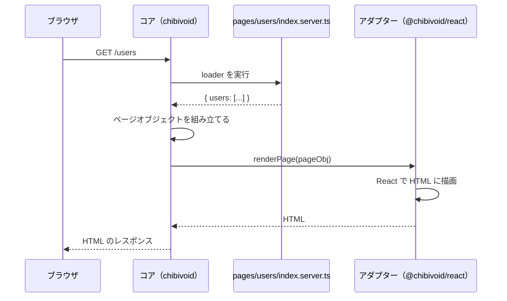

この章からは、第 5 章で作成した API ルートと並ぶ、Void のもう 1 つの主要な機能である Pages を作っていきます。Pages では、`pages/` に置いた UI コンポーネントがそのままページになり、その隣に置いた `.server.ts` ファイルが、そのページのデータを用意します。たとえば、ユーザーの一覧を表示する `/users` ページは、次の 2 つのファイルで構成されます:

```tsx
// pages/users/index.tsx → /users ページの UI
import type { Props } from './index.server';

export default function UsersPage({ users }: Props) {
  return <ul>{users.map((u) => <li key={u.id}>{u.name}</li>)}</ul>;
}
```

```ts
// pages/users/index.server.ts → /users ページのデータ（サーバーだけで動く）
export const loader = defineHandler(async () => {
  return { users: await listUsers() };
});
export type Props = InferProps<typeof loader>;
```

Pages は、第 8 章から第 10 章までの 3 つの章に分けて作ります。この章では、ページをサーバーで HTML に描画して返すところ、つまりサーバーサイドレンダリングの部分を実装します。ブラウザで JavaScript を動かすハイドレーションと画面遷移については第 9 章で、フォームの送信については第 10 章で、それぞれ扱います。

## この章のゴール

- コンポーネントと loader の組、ページオブジェクト（page object）、コアとアダプターの分担という、Pages の設計を支える 3 つの考え方を理解する
- `pages/` をスキャンして、ページとレイアウトの一覧を作成する
- loader の結果をページオブジェクトにまとめ、React により HTML に描画して返す
- `InferProps` を使って、loader の戻り値の型をコンポーネントの props の型として取り出す

## Pages の設計

Void の公式ドキュメント「[Pages Routing](https://void.cloud/guide/pages-routing/overview)」のページによると、Pages のしくみは [Inertia.js](https://inertiajs.com/) から着想を得ています。Inertia.js は、ルーティングとデータの取得をサーバー側でおこないつつ、UI を React や Vue のコンポーネントにより作成するためのライブラリです。Void の Pages は、次の 3 つの考え方により設計されています。

### 1. コンポーネントと loader の組

1 つのページは、基本的に UI を表わすコンポーネントとデータを用意する `loader` の組からなります。たとえば、`pages/about.tsx` が `/about` ページの UI になり、`pages/about.server.ts` がエクスポートする `loader` がそのページのデータを用意します。`loader` はサーバーだけで動くため、KV やデータベースに直接アクセスすることができます。`.server.ts` がないページは、データなしで描画されます。また、URL の決め方は、`[id]` や `index` の扱いも含めて `routes/` とまったく同じです（第 5 章の「ステップ 1: ファイル名を URL パターンに変換する」）。

### 2. ページオブジェクト

サーバーは `loader` の結果を、「どのコンポーネントをどの props で描画するか」を表わす JSON にまとめます。この JSON をページオブジェクトと呼びます。たとえば、`/users` ページのページオブジェクトは次のようになります:

```json
{
  "component": "users/index",
  "props": { "users": [{ "id": 1, "name": "Ada" }] },
  "params": {},
  "url": "/users"
}
```

最初のアクセスでは、サーバーはページオブジェクトをもとに HTML を描画し、ページオブジェクト自体も HTML に埋め込んで返します。ブラウザ側の React は、埋め込まれたページオブジェクトを読み、サーバーが描画したものと同じ UI を再現します。また、その後の画面遷移では、サーバーは HTML ではなく、ページオブジェクトだけを JSON で返します。このように、サーバーとブラウザは、ページオブジェクトを通してページのデータをやり取りします。なお、この章では、HTML を描画し、ページオブジェクトを埋め込んで返すところまでを実装します。ブラウザ側で UI を再現する処理と、JSON を返す処理は、第 9 章で実装します。

### 3. コアとアダプターの分担

Void の Pages は、React、Vue、Svelte、Solid に対応しています。そのため、Pages の実装は、これらのフレームワークに依存しない部分（コア）と、依存する部分（アダプター）とに分かれています。コアとアダプターがそれぞれ担当する処理と chibivoid の対応するパッケージを、次の表にまとめておきます:

| 担当 | 何をするか | chibivoid のパッケージ |
| --- | --- | --- |
| コア | `pages/` のスキャン、ルートの登録、loader の実行、ページオブジェクトの組み立て | `chibivoid`（`packages/chibivoid`） |
| アダプター | コンポーネントの HTML への描画、ブラウザでの実行 | `@chibivoid/react`（`packages/react`） |

コアは「ページを HTML にする関数」をアダプターから受け取って呼び出すだけで、React については何も知りません。この関数の受け渡しには、アダプターが提供する仮想モジュール `virtual:chibivoid-pages-renderer` を使います。`/users` へのリクエストを例に、コアとアダプターの関係を図にすると、次のようになります:



Void でも、コアの共通部分は `packages/void/src/pages/` に、各フレームワークのアダプターは `packages/react`、`packages/vue`、`packages/svelte`、`packages/solid` に、それぞれ置かれています。

## コア: `pages/` をスキャンする

まずは、コア側から作っていきましょう。Pages の処理をまとめるディレクトリを作成しておきます:

```sh
mkdir -p packages/chibivoid/src/pages
```

chibivoid は、`pages/` に置かれたファイルを次のように扱います:

| ファイル | 扱い |
| --- | --- |
| `index.tsx`、`about.tsx`、`users/[id].tsx` | ページのコンポーネント。拡張子は `.tsx` または `.jsx` |
| `index.server.ts`、`users/[id].server.ts` | 同じ名前のページと対になる、サーバー側のファイル。本書では、Void のドキュメントにならってコンパニオン（companion）と呼ぶ |
| `layout.tsx`、`users/layout.tsx` | そのディレクトリ以下のページを包むレイアウト |
| `_` や `.` で始まるファイルやディレクトリ | 無視する。ページから使うコンポーネントなどを置くことができる |

次に、このルールに従って `pages/` をスキャンする `pages/scan.ts` を作成します:

<!-- file: code/how-void-works/ch08/packages/chibivoid/src/pages/scan.ts -->
```ts:packages/chibivoid/src/pages/scan.ts
import { existsSync } from 'node:fs';
import { join } from 'node:path';
import { detectExports } from '../router/detect-exports.ts';
import { parseRouteFilename } from '../router/parse-filename.ts';
import { compareRouteSpecificity } from '../router/route-order.ts';
import { listFiles } from '../shared/list-files.ts';

export type PageDefinition = {
  /** URL パターン。例: "/users/:id" */
  pattern: string;
  params: string[];
  catchAll: boolean;
  /** ページを識別する ID（拡張子を除いたパス）。例: "users/[id]" */
  componentId: string;
  /** コンポーネントファイル（pages/ からの相対パス）。例: "users/[id].tsx" */
  componentPath: string;
  /** 対になるサーバーファイル。例: "users/[id].server.ts"（なければ null） */
  serverPath: string | null;
  /** サーバーファイルがエクスポートしているもの（"loader"/"action"） */
  methods: string[];
};

export type LayoutDefinition = {
  /** レイアウトを識別する ID。例: "layout"、"users/layout" */
  id: string;
  /** pages/ からの相対パス。例: "users/layout.tsx" */
  filePath: string;
  /** レイアウトが置かれたディレクトリ。例: ""、"users" */
  directory: string;
};

export type PageScanResult = {
  pages: PageDefinition[];
  layouts: LayoutDefinition[];
};

/** ページコンポーネントとして扱う拡張子（chibivoid は React だけに対応する） */
const COMPONENT_RE = /\.(tsx|jsx)$/;
/** `.server.ts` などのコンパニオンファイル */
const SERVER_RE = /\.server\.(ts|tsx|js|jsx|mts|mjs)$/;
const SERVER_EXTENSIONS = ['ts', 'tsx', 'js', 'jsx', 'mts', 'mjs'];
const PAGE_METHODS = new Set(['loader', 'action']);

/** pages/ をスキャンして、ページとレイアウトの一覧を返す */
export function scanPages(pagesDir: string): PageScanResult {
  const pages: PageDefinition[] = [];
  const layouts: LayoutDefinition[] = [];

  for (const file of listFiles(pagesDir)) {
    if (SERVER_RE.test(file) || !COMPONENT_RE.test(file)) {
      continue;
    }
    const componentId = file.replace(COMPONENT_RE, '');
    const segments = componentId.split('/');
    if (segments.at(-1) === 'layout') {
      layouts.push({ id: componentId, filePath: file, directory: segments.slice(0, -1).join('/') });
      continue;
    }

    // URL パターンの作り方は routes/ とまったく同じ
    const route = parseRouteFilename(file);
    const serverPath =
      SERVER_EXTENSIONS.map((ext) => `${componentId}.server.${ext}`).find((candidate) =>
        existsSync(join(pagesDir, candidate)),
      ) ?? null;
    const methods = serverPath
      ? detectExports(join(pagesDir, serverPath)).filter((name) => PAGE_METHODS.has(name))
      : [];

    pages.push({
      pattern: route.pattern,
      params: route.params,
      catchAll: route.catchAll,
      componentId,
      componentPath: file,
      serverPath,
      methods,
    });
  }

  pages.sort(compareRouteSpecificity);
  return { pages, layouts };
}

/**
 * ページに適用されるレイアウトの ID を、外側から順に返す。
 * 例: "users/[id]" → ["layout", "users/layout"]（存在するものだけ）
 */
export function resolveLayoutIds(page: PageDefinition, layouts: LayoutDefinition[]): string[] {
  const directories = [''];
  const segments = page.componentId.split('/').slice(0, -1);
  for (let i = 1; i <= segments.length; i++) {
    directories.push(segments.slice(0, i).join('/'));
  }
  return directories.flatMap((directory) =>
    layouts.filter((layout) => layout.directory === directory).map((layout) => layout.id),
  );
}
```
<!-- /file -->

このコードで押さえておきたいポイントは、次の 4 つです:

- `componentId` は、拡張子を除いたパス（`users/[id]` など）です。この ID は、ページオブジェクトの `component` に入り、どのコンポーネントを描画するかを表わします
- URL パターンの作り方と並べ方は、`routes/` のルートと同じです。第 5 章の「ステップ 1: ファイル名を URL パターンに変換する」の `parseRouteFilename()` と、第 5 章の「ステップ 2: ルートの優先順位」の `compareRouteSpecificity()` をそのまま使っています
- コンパニオンがエクスポートしているもの（`loader` と、第 10 章で使う `action`）を、第 5 章の「ステップ 3: エクスポートを『実行せずに』調べる」で作成した `detectExports()` により調べています
- `resolveLayoutIds()` は、ページを包むレイアウトの ID を外側から順に返します。たとえば `users/[id]` であれば、`pages/layout.tsx` と `pages/users/layout.tsx` のうち存在するものの ID（`layout`、`users/layout`）を返します

## コア: コンポーネントの対応表を生成する

アダプターがページを描画するには、`componentId` から実際のコンポーネントを読み込む方法が必要です。そこで、`componentId` とコンポーネントの対応表を JavaScript のコードとして生成する `pages/manifest.ts` を作成します:

<!-- file: code/how-void-works/ch08/packages/chibivoid/src/pages/manifest.ts -->
```ts:packages/chibivoid/src/pages/manifest.ts
import { resolveLayoutIds, type PageScanResult } from './scan.ts';

/**
 * ページとレイアウトのコンポーネントを「動的インポートする関数」の表と、
 * 各ページに適用するレイアウトの表を、JavaScript のソースコードとして生成する。
 * サーバー用のレンダラーとブラウザ用のエントリの両方に埋め込まれる。
 *
 *   const components = { "users/index": () => import("/abs/pages/users/index.tsx"), ... };
 *   const layoutTree = { "users/index": ["layout"], ... };
 */
export function generateComponentManifest(scan: PageScanResult, pagesDir: string): string {
  const load = (filePath: string) => `() => import(${JSON.stringify(`${pagesDir}/${filePath}`)})`;
  const lines: string[] = ['const components = {'];
  for (const page of scan.pages) {
    lines.push(`  ${JSON.stringify(page.componentId)}: ${load(page.componentPath)},`);
  }
  for (const layout of scan.layouts) {
    lines.push(`  ${JSON.stringify(layout.id)}: ${load(layout.filePath)},`);
  }
  lines.push('};');
  lines.push('const layoutTree = {');
  for (const page of scan.pages) {
    const layoutIds = resolveLayoutIds(page, scan.layouts);
    lines.push(`  ${JSON.stringify(page.componentId)}: ${JSON.stringify(layoutIds)},`);
  }
  lines.push('};');
  return lines.join('\n');
}
```
<!-- /file -->

「ページを作成する」で作る playground のページ構成の場合、生成されるコードは次のようになります（パスは環境によって変わります）:

```js
const components = {
  "index": () => import("/path/to/chibivoid/playground/pages/index.tsx"),
  "about": () => import("/path/to/chibivoid/playground/pages/about.tsx"),
  "users/index": () => import("/path/to/chibivoid/playground/pages/users/index.tsx"),
  "users/[id]": () => import("/path/to/chibivoid/playground/pages/users/[id].tsx"),
  "layout": () => import("/path/to/chibivoid/playground/pages/layout.tsx"),
};
const layoutTree = {
  "index": ["layout"],
  "about": ["layout"],
  "users/index": ["layout"],
  "users/[id]": ["layout"],
};
```

`components` は、各コンポーネントを動的にインポートする関数の表です。最初からすべてのページを読み込むのではなく、必要になったページのコンポーネントだけを読み込みます。一方、`layoutTree` は各ページに適用するレイアウトの ID を外側から順に並べた表です。これらの対応表は、サーバー用のレンダラー（`virtual:chibivoid-pages-renderer`）と、第 9 章で作成するブラウザ用のエントリの両方に埋め込みます。ブラウザ側では、コンポーネントを動的インポートにしておくことで、ページごとに JavaScript のファイルを分けることができます。これをコード分割（code splitting）と呼びます。

## コア: Pages 用プラグインの共通部分

次に、アダプターが `virtual:chibivoid-pages-renderer` を提供するための Vite プラグインのうち、どのフレームワークでも共通する部分を `pages/plugin.ts` としてコアに用意します:

<!-- file: code/how-void-works/ch08/packages/chibivoid/src/pages/plugin.ts -->
```ts:packages/chibivoid/src/pages/plugin.ts
import { normalizePath, type Plugin, type UserConfig } from 'vite';
import { scanPages, type PageScanResult } from './scan.ts';

export const RENDERER_ID = 'virtual:chibivoid-pages-renderer';

type CreatePagesPluginOptions = {
  /** プラグイン名。例: "chibivoid-react:pages" */
  name: string;
  /** サーバーで HTML を描画する仮想モジュールのコードを返す */
  generateRenderer: (scan: PageScanResult, isDev: boolean) => string;
  /** フレームワークごとの Vite 設定 */
  config?: (context: { isDev: boolean }) => UserConfig | undefined;
};

/**
 * Pages 機能の「共通部分」を担う Vite プラグインを作る。
 * pages/ のスキャンと仮想モジュールの配信・更新はここでやり、
 * 生成するコードの中身（React 用か Vue 用かなど）はアダプターに任せる。
 */
export function createPagesPlugin(pagesDir: string, options: CreatePagesPluginOptions): Plugin {
  const normalizedPagesDir = normalizePath(pagesDir);
  let scan: PageScanResult = { pages: [], layouts: [] };
  let isDev = false;

  return {
    name: options.name,

    config(_config, env) {
      isDev = env.command === 'serve' && !env.isPreview;
      return options.config?.({ isDev });
    },

    buildStart() {
      scan = scanPages(pagesDir);
    },

    resolveId(id) {
      if (id === RENDERER_ID) {
        return '\0' + id;
      }
    },

    load(id) {
      if (id === '\0' + RENDERER_ID) {
        return options.generateRenderer(scan, isDev);
      }
    },

    configureServer(server) {
      // ページが追加・削除された場合は、仮想モジュールを作り直してもらう
      const onStructureChange = (file: string) => {
        if (!normalizePath(file).startsWith(normalizedPagesDir + '/')) {
          return;
        }
        scan = scanPages(pagesDir);
        for (const environment of Object.values(server.environments)) {
          const mod = environment.moduleGraph.getModuleById('\0' + RENDERER_ID);
          if (mod) {
            environment.moduleGraph.invalidateModule(mod);
          }
        }
      };
      server.watcher.on('add', onStructureChange);
      server.watcher.on('unlink', onStructureChange);
    },
  };
}
```
<!-- /file -->

`createPagesPlugin()` は、`pages/` のスキャン、仮想モジュールの解決と読み込み、ファイルの追加・削除への追従といった、どのフレームワークでも同じ処理を担当します。そのため、アダプターは `pages/` のパス、プラグイン名、仮想モジュールの中身を生成する関数（`generateRenderer`）、そしてフレームワークごとの Vite の設定を渡すだけで済みます。

続いて、アダプターの Vite プラグイン（Node.js 側）から使う API を `pages/index.ts` からまとめてエクスポートします:

<!-- file: code/how-void-works/ch08/packages/chibivoid/src/pages/index.ts -->
```ts:packages/chibivoid/src/pages/index.ts
// フレームワークアダプター（@chibivoid/react など）の Vite プラグインが使う、Node.js 側の API。
export { createPagesPlugin, RENDERER_ID } from './plugin.ts';
export { generateComponentManifest } from './manifest.ts';
export { scanPages, resolveLayoutIds } from './scan.ts';
export type { PageDefinition, LayoutDefinition, PageScanResult } from './scan.ts';
```
<!-- /file -->

## コア: ページオブジェクトのプロトコル

次は、ページへのリクエストを処理する中心部分です。ページオブジェクトの型と、ページへの `GET` リクエストを処理する `handlePageGet()` などを `pages/protocol.ts` に定義します:

<!-- file: code/how-void-works/ch08/packages/chibivoid/src/pages/protocol.ts -->
```ts:packages/chibivoid/src/pages/protocol.ts
import type { Context } from 'hono';

/**
 * サーバーからクライアントへ渡す「ページオブジェクト」。
 * HTML に埋め込まれ、ブラウザ側でも同じものを使って描画する（第 9 章）。
 */
export type PageObject = {
  /** 描画するページコンポーネントの ID。例: "users/[id]" */
  component: string;
  /** loader が返した値（コンポーネントの props になる） */
  props: Record<string, unknown>;
  /** URL パラメータ。例: { id: "1" } */
  params: Record<string, string>;
  /** このページの URL（パス + クエリ） */
  url: string;
};

/** HTML に差し込む <script> などのタグ */
export type AssetTags = {
  /** <head> の中に入れるもの */
  head: string;
  /** <body> の最後に入れるもの */
  body: string;
};

/** フレームワークアダプターが提供する「ページを HTML 文字列にする関数」 */
export type RenderPage = (pageObj: PageObject, assetTags: AssetTags) => Promise<string>;

export type PageHandler = (c: Context) => unknown;

export type PageRouteOptions = {
  componentId: string;
  render: RenderPage;
  assets: (request: Request, env: unknown) => Promise<AssetTags>;
};

/** `<script type="application/json">` に安全に埋め込めるように JSON をエスケープする */
export function serializePageData(pageObj: PageObject): string {
  return JSON.stringify(pageObj).replace(/[<>&\u2028\u2029]/g, (char) => {
    return `\\u${char.charCodeAt(0).toString(16).padStart(4, '0')}`;
  });
}

/** loader を実行して props を得る。Response（リダイレクトなど）が返された場合はそのまま返す */
async function runLoader(
  loader: PageHandler | undefined,
  c: Context,
): Promise<Response | Record<string, unknown>> {
  if (!loader) {
    return {};
  }
  const result = await loader(c);
  if (result instanceof Response) {
    return result;
  }
  return (result ?? {}) as Record<string, unknown>;
}

function createPageObject(
  c: Context,
  componentId: string,
  props: Record<string, unknown>,
): PageObject {
  const url = new URL(c.req.url);
  return {
    component: componentId,
    props,
    params: c.req.param(),
    url: url.pathname + url.search,
  };
}

/** GET: loader を実行し、ページを HTML で返す */
export async function handlePageGet(
  loader: PageHandler | undefined,
  c: Context,
  options: PageRouteOptions,
): Promise<Response> {
  const props = await runLoader(loader, c);
  if (props instanceof Response) {
    return props;
  }
  const pageObj = createPageObject(c, options.componentId, props);
  const html = await options.render(pageObj, await options.assets(c.req.raw, c.env));
  return new Response(html, { headers: { 'Content-Type': 'text/html; charset=utf-8' } });
}
```
<!-- /file -->

`handlePageGet()` は、次の流れでページへの `GET` リクエストを処理します:

1. `loader` を実行して props を得る。`loader` が `c.notFound()` やリダイレクトなどの `Response` を返した場合は、その `Response` をそのまま返す
2. ページオブジェクトを組み立てる。`params` には Hono の `c.req.param()` から得た URL パラメータを入れる
3. ページオブジェクトをアダプターの `render` に渡して HTML に描画し、レスポンスとして返す

`AssetTags` は、HTML に差し込む `<script>` などのタグを表わす型です。ブラウザで動く JavaScript を読み込ませるためのもので、第 9 章で使います。この章の時点では、中身はまだ空です。

`serializePageData()` は、ページオブジェクトを HTML の `<script type="application/json">` の中に埋め込むための関数です。では、なぜ `JSON.stringify()` の結果をそのまま埋め込んではいけないのでしょうか。たとえば、ユーザー名が `</script><script>alert(1)</script>` だったとします。これをそのまま埋め込むと、ブラウザは最初の `</script>` でスクリプトが終わったと解釈し、続く `<script>alert(1)</script>` を実行してしまいます。このような攻撃をクロスサイトスクリプティング（XSS）と呼びます。そこで、`serializePageData()` は `<`、`>`、`&` などを `\u003c` のような JSON のエスケープ表現に置き換えています。これにより、JSON としては同じ値のまま、HTML としては無害な文字列になります。

### ルートテーブルにページを登録する

ここからは、ページをルートテーブルに登録していきます。まずは、`router/scan.ts` を変更し、アプリ全体のスキャン結果にページを加えます:

<!-- diff: code/how-void-works/ch07/packages/chibivoid/src/router/scan.ts code/how-void-works/ch08/packages/chibivoid/src/router/scan.ts -->
```diff ts:packages/chibivoid/src/router/scan.ts
@@ -1,4 +1,5 @@
 import { join } from 'node:path';
+import { scanPages, type PageScanResult } from '../pages/scan.ts';
 import { listFiles } from '../shared/list-files.ts';
 import { detectHttpExports } from './detect-exports.ts';
 import { parseRouteFilename, ROUTE_FILE_RE, type RouteDefinition } from './parse-filename.ts';
@@ -7,6 +8,7 @@
 export type ProjectPaths = {
   routesDir: string;
   middlewareDir: string;
+  pagesDir: string;
 };
 
 export type MiddlewareDefinition = {
@@ -17,6 +19,7 @@
 export type ScanResult = {
   routes: RouteDefinition[];
   middleware: MiddlewareDefinition[];
+  pages: PageScanResult;
 };
 
 /** routes/ をスキャンして、ルート定義の一覧を、より具体的なルートが先に来るように並べて返す */
@@ -41,5 +44,6 @@
   return {
     routes: scanRoutes(paths.routesDir),
     middleware: scanMiddleware(paths.middlewareDir),
+    pages: scanPages(paths.pagesDir),
   };
 }
```
<!-- /diff -->

次に、`runtime/routing.ts` にページの `GET` ハンドラーを作成する `createPageGetHandler()` を追加します。このハンドラーは、`.server.ts` を遅延ロードし、そのモジュールの `loader` を `handlePageGet()` に渡します:

<!-- diff: code/how-void-works/ch07/packages/chibivoid/src/runtime/routing.ts code/how-void-works/ch08/packages/chibivoid/src/runtime/routing.ts -->
```diff ts:packages/chibivoid/src/runtime/routing.ts
@@ -1,5 +1,6 @@
 // 生成されたルートテーブル（virtual:chibivoid-routes）と Worker エントリから呼ばれる実行時の関数。
 import type { Context, ExecutionContext, Hono } from 'hono';
+import { handlePageGet, type PageHandler, type PageRouteOptions } from '../pages/protocol.ts';
 import { withRuntimeEnv } from './env.ts';
 import { convertReturnValue } from './response.ts';
 
@@ -32,6 +33,21 @@
   };
 }
 
+type PageServerModule = { loader?: PageHandler };
+
+type PageRouteConfig = PageRouteOptions & {
+  /** `.server.ts` を読み込む関数（なければ undefined） */
+  load?: () => Promise<PageServerModule>;
+};
+
+/** ページの GET ハンドラー */
+export function createPageGetHandler(config: PageRouteConfig) {
+  return async (c: Context): Promise<Response> => {
+    const mod = config.load ? await config.load() : {};
+    return handlePageGet(mod.loader, c, config);
+  };
+}
+
 type WorkerEnv = Record<string, unknown>;
 
 /**
```
<!-- /diff -->

続いて、`router/compile.ts` を変更し、ページのルートを登録するコードを生成するようにします:

<!-- diff: code/how-void-works/ch07/packages/chibivoid/src/router/compile.ts code/how-void-works/ch08/packages/chibivoid/src/router/compile.ts -->
```diff ts:packages/chibivoid/src/router/compile.ts
@@ -1,3 +1,4 @@
+import type { PageScanResult } from '../pages/scan.ts';
 import type { ProjectPaths, ScanResult } from './scan.ts';
 
 export type CompileOptions = ProjectPaths & {
@@ -31,7 +32,7 @@
 export function compileRouteTable(scan: ScanResult, options: CompileOptions): string {
   const imports: string[] = [
     `import { Hono } from "hono";`,
-    `import { createModuleLoader, createHttpRouteHandler } from "chibivoid/runtime/routing";`,
+    `import { createModuleLoader, createHttpRouteHandler, createPageGetHandler } from "chibivoid/runtime/routing";`,
   ];
   const body: string[] = ['const app = new Hono();'];
   // 本番ではロードしたモジュールをキャッシュし、開発中は毎回インポートし直す
@@ -55,5 +56,33 @@
     }
   });
 
+  // 3. ページ
+  if (scan.pages.pages.length > 0) {
+    compilePageRoutes(imports, body, scan.pages, options);
+  }
+
   return [...imports, '', ...body, '', 'export default app;', ''].join('\n');
 }
+
+function compilePageRoutes(
+  imports: string[],
+  body: string[],
+  pages: PageScanResult,
+  options: CompileOptions,
+): void {
+  // ページの描画方法はフレームワークアダプター（@chibivoid/react など）が提供する
+  imports.push(`import { renderPage } from "virtual:chibivoid-pages-renderer";`);
+  // HTML に差し込むタグ（クライアントの JavaScript など）。今はまだ空（第 9 章で埋める）
+  body.push(`const getAssetTags = async () => ({ head: "", body: "" });`);
+
+  pages.pages.forEach((page, i) => {
+    let load = 'undefined';
+    if (page.serverPath) {
+      load = `loadPage${i}`;
+      const file = `${options.pagesDir}/${page.serverPath}`;
+      body.push(`const ${load} = createModuleLoader(() => import(${str(file)}), ${!options.dev});`);
+    }
+    const routeOptions = `{ componentId: ${str(page.componentId)}, load: ${load}, render: renderPage, assets: getAssetTags }`;
+    body.push(`app.get(${str(page.pattern)}, createPageGetHandler(${routeOptions}));`);
+  });
+}
```
<!-- /diff -->

「ページを作成する」で作る playground のページ構成の場合、開発サーバーで生成されるコードのうち、ページに関する部分は次のようになります:

```js
import { renderPage } from "virtual:chibivoid-pages-renderer";
// ...（ミドルウェアと API ルート）
const getAssetTags = async () => ({ head: "", body: "" });
const loadPage0 = createModuleLoader(() => import("/path/to/chibivoid/playground/pages/index.server.ts"), false);
app.get("/", createPageGetHandler({ componentId: "index", load: loadPage0, render: renderPage, assets: getAssetTags }));
app.get("/about", createPageGetHandler({ componentId: "about", load: undefined, render: renderPage, assets: getAssetTags }));
const loadPage2 = createModuleLoader(() => import("/path/to/chibivoid/playground/pages/users/index.server.ts"), false);
app.get("/users", createPageGetHandler({ componentId: "users/index", load: loadPage2, render: renderPage, assets: getAssetTags }));
// ...
```

コアが生成するルートテーブル（`virtual:chibivoid-routes`）が、アダプターが提供する仮想モジュール（`virtual:chibivoid-pages-renderer`）をインポートしている点に注目してください。このように、仮想モジュールが別の仮想モジュールをインポートすることで、コアとアダプターがつながります。

また、ページが追加・削除された際にルートテーブルを作り直すようにするため、`plugin-routing.ts` で `pages/` も監視対象に加えます:

<!-- diff: code/how-void-works/ch07/packages/chibivoid/src/plugin-routing.ts code/how-void-works/ch08/packages/chibivoid/src/plugin-routing.ts -->
```diff ts:packages/chibivoid/src/plugin-routing.ts
@@ -12,7 +12,7 @@
 
 /**
  * ファイルベースルーティングを担当するプラグイン。
- * - routes/、middleware/ をスキャンする
+ * - routes/、middleware/、pages/ をスキャンする
  * - スキャン結果から仮想モジュール `virtual:chibivoid-routes`（Hono アプリ）を生成する
  * - ファイルの変更を監視して、スキャン結果が変わった場合は仮想モジュールを作り直す
  */
@@ -20,6 +20,7 @@
   const paths: ProjectPaths = {
     routesDir: normalizePath(join(root, 'routes')),
     middlewareDir: normalizePath(join(root, 'middleware')),
+    pagesDir: normalizePath(join(root, 'pages')),
   };
   let scan: ScanResult | undefined;
   let dev = false;
@@ -66,7 +67,7 @@
     },
 
     configureServer(server) {
-      const watched = [paths.routesDir, paths.middlewareDir];
+      const watched = [paths.routesDir, paths.middlewareDir, paths.pagesDir];
       const isWatched = (file: string) => watched.some((dir) => file.startsWith(dir + '/'));
 
       const onFileEvent = (rawFile: string) => {
@@ -75,7 +76,7 @@
           return;
         }
         // スキャン結果が変わった場合だけ仮想モジュールを作り直す。
-        // （ハンドラーの中身を書き換えただけなら、Vite の通常の HMR に任せる）
+        // （コンポーネントやハンドラーの中身を書き換えただけなら、Vite の通常の HMR に任せる）
         const before = JSON.stringify(scan);
         const after = JSON.stringify(rescan());
         if (before === after) {
```
<!-- /diff -->

最後に、アダプターから `chibivoid/pages` と `chibivoid/pages-protocol` をインポートできるように、`package.json` の `exports` に `./pages`（Node.js 側の API）と `./pages-protocol`（Worker 側の API）を追加します:

<!-- diff: code/how-void-works/ch07/packages/chibivoid/package.json code/how-void-works/ch08/packages/chibivoid/package.json -->
```diff json:packages/chibivoid/package.json
@@ -6,6 +6,8 @@
   "exports": {
     ".": "./src/index.ts",
     "./kv": "./src/runtime/kv.ts",
+    "./pages": "./src/pages/index.ts",
+    "./pages-protocol": "./src/pages/protocol.ts",
     "./runtime/*": "./src/runtime/*.ts"
   },
   "dependencies": {
```
<!-- /diff -->

## コア: loader の戻り値の型を取り出す

ページのコンポーネントは、loader が返した値を props として受け取ります。しかし、コンポーネントの props の型を手で記述すると、loader を変更した際に loader の戻り値の型と props の型が食い違ってしまうおそれがあります。そこで、loader の戻り値の型から props の型を作成する `InferProps` を用意します。あわせて、`defineHandler()` が返す関数の型に loader の戻り値の型をもたせるように変更します:

<!-- diff: code/how-void-works/ch07/packages/chibivoid/src/runtime/handler.ts code/how-void-works/ch08/packages/chibivoid/src/runtime/handler.ts -->
```diff ts:packages/chibivoid/src/runtime/handler.ts
@@ -19,11 +19,19 @@
 export type CloudContext = Context<{ Bindings: CloudBindings }>;
 
 /**
- * ルートハンドラーを定義する。
- * 実行時は何もしない恒等関数で、引数 c に型を付けるためだけに存在する。
+ * 戻り値の型 R を「型の上だけに存在するプロパティ」`__output` の型としてもつハンドラー。
+ * 実行時にはただの関数だが、型の計算（InferProps やルートの型生成）がこのプロパティを読む。
  */
-export function defineHandler<R>(handler: (c: CloudContext) => R): (c: CloudContext) => R {
-  return handler;
+export type TypedHandler<R> = ((c: CloudContext) => unknown) & { readonly __output: R };
+
+/**
+ * ルートハンドラー・loader を定義する。
+ * 実行時は何もしない恒等関数で、型を付けるためだけに存在する。
+ */
+export function defineHandler<R>(
+  handler: (c: CloudContext) => R | Promise<R>,
+): TypedHandler<Exclude<Awaited<R>, Response>> {
+  return handler as TypedHandler<Exclude<Awaited<R>, Response>>;
 }
 
 /** Hono のミドルウェアに型を付ける（これも恒等関数） */
@@ -32,3 +40,6 @@
 ): MiddlewareHandler {
   return middleware;
 }
+
+/** loader の戻り値の型を取り出す: `type Props = InferProps<typeof loader>` */
+export type InferProps<T> = T extends { readonly __output: infer R } ? R : never;
```
<!-- /diff -->

ここでは、幽霊型（phantom type）と呼ばれるテクニックを使っています:

- `defineHandler()` の戻り値の型を `TypedHandler` にします。`TypedHandler<R>` は、「関数であり、かつ `__output: R` というプロパティをもつ」ことを表わす型です
- しかし、実行時には `defineHandler()` は受け取った関数をそのまま返すだけであり、`__output` というプロパティは存在しません。このプロパティは型の上にだけ存在するため、「幽霊」と呼ばれます
- `InferProps<typeof loader>` は、`loader` の型から `__output` の型を取り出します

たとえば、`/users` ページの `loader` の場合、型は次のように計算されます:

```ts
export const loader = defineHandler(async () => {
  return { users: await listUsers() };   // Promise<{ users: User[] }>
});
// typeof loader は TypedHandler<{ users: User[] }>
export type Props = InferProps<typeof loader>;   // { users: User[] }
```

`Exclude<Awaited<R>, Response>` は、「`loader` の戻り値を `await` した結果の型から、`c.notFound()` などで返した `Response` を除いた型」を表わします。`loader` が `Response` を返した場合、`handlePageGet()` はその `Response` をそのまま返すため、props には `Response` 以外の値だけが渡されます。

この「型の上だけに存在するプロパティに型をもたせる」技法は、第 11 章で API ルートの型を生成する際にも使います。

最後に、アプリのコードからインポートできるように、`index.ts` からもこれらの型を再エクスポートしておきます:

<!-- diff: code/how-void-works/ch07/packages/chibivoid/src/index.ts code/how-void-works/ch08/packages/chibivoid/src/index.ts -->
```diff ts:packages/chibivoid/src/index.ts
@@ -56,4 +56,4 @@
 // アプリのコードから `import { defineHandler } from 'chibivoid'` と記述することができるように再エクスポートする。
 // （Worker の中ではこの index.ts ではなく runtime/handler.ts に差し替えられる）
 export { defineHandler, defineMiddleware } from './runtime/handler.ts';
-export type { CloudContext } from './runtime/handler.ts';
+export type { CloudContext, InferProps, TypedHandler } from './runtime/handler.ts';
```
<!-- /diff -->

## React アダプターを作成する

次は、React のアダプターである `@chibivoid/react` を作っていきましょう。まずは、パッケージのディレクトリを作成しておきます:

```sh
mkdir -p packages/react/src/runtime
```

パッケージの `package.json` を作成します:

<!-- file: code/how-void-works/ch08/packages/react/package.json -->
```json:packages/react/package.json
{
  "name": "@chibivoid/react",
  "version": "0.0.0",
  "private": true,
  "type": "module",
  "exports": {
    ".": "./src/runtime/index.ts",
    "./plugin": "./src/plugin.ts",
    "./pages-server": "./src/runtime/pages-server.tsx"
  },
  "dependencies": {
    "@vitejs/plugin-react": "^6.2.1"
  },
  "peerDependencies": {
    "chibivoid": "*",
    "react": "^19.0.0",
    "react-dom": "^19.0.0",
    "vite": "^8.0.0"
  }
}
```
<!-- /file -->

`exports` では、次の 3 つを公開しています:

- `./plugin`: Node.js で動く Vite のプラグイン
- `./pages-server`: サーバー（Worker）でページを描画する部分
- `.`: アプリのコンポーネントから使う API（`Link` など）

### `plugin.ts`: React 用の Vite プラグイン

続いて、アダプターの Vite プラグインを `plugin.ts` に実装します:

<!-- file: code/how-void-works/ch08/packages/react/src/plugin.ts -->
```ts:packages/react/src/plugin.ts
import { join } from 'node:path';
import react from '@vitejs/plugin-react';
import { WORKER_ENVIRONMENT_NAME } from 'chibivoid';
import { createPagesPlugin, generateComponentManifest } from 'chibivoid/pages';
import { normalizePath, type PluginOption, type UserConfig } from 'vite';

/** chibivoid の React アダプター。`plugins: [chibivoidPlugin(), chibivoidReact()]` のように使う */
export function chibivoidReact(): PluginOption[] {
  const pagesDir = normalizePath(join(process.cwd(), 'pages'));

  return [
    react(),
    createPagesPlugin(pagesDir, {
      name: 'chibivoid-react:pages',

      // サーバー（Worker）で HTML を描画するモジュール
      generateRenderer(scan) {
        return `import { renderReactPage } from "@chibivoid/react/pages-server";
${generateComponentManifest(scan, pagesDir)}
export function renderPage(pageObj, assetTags) {
  return renderReactPage({ pageObj, assetTags, components, layoutTree });
}
`;
      },

      config({ isDev }): UserConfig | undefined {
        if (isDev) {
          // React の依存を最初から事前バンドルしておき、後から見つかった場合のやり直しを防ぐ
          return {
            environments: {
              [WORKER_ENVIRONMENT_NAME]: {
                optimizeDeps: { include: ['react', 'react-dom/server', 'react/jsx-dev-runtime'] },
              },
            },
          };
        }
        return undefined;
      },
    }),
  ];
}
```
<!-- /file -->

`chibivoidReact()` は、次の 2 つを配列で返しています:

1. `react()`: Vite 公式の React プラグイン（[`@vitejs/plugin-react`](https://github.com/vitejs/vite-plugin-react)）です。Vite に組み込まれた Oxc がおこなう JSX の変換を、React 向けに設定します。また、第 9 章で使う React Fast Refresh を提供します
2. `createPagesPlugin()`: 「コア: Pages 用プラグインの共通部分」で用意した共通部分に、React 用の `generateRenderer` を渡して作成したプラグインです

`generateRenderer` は、`virtual:chibivoid-pages-renderer` の中身として、次のようなコードを生成します:

```js
import { renderReactPage } from "@chibivoid/react/pages-server";
const components = { /* コンポーネントの対応表 */ };
const layoutTree = { /* ... */ };
export function renderPage(pageObj, assetTags) {
  return renderReactPage({ pageObj, assetTags, components, layoutTree });
}
```

この仮想モジュールは、コアが期待する `renderPage(pageObj, assetTags)` をエクスポートしています。`renderPage()` の中では、受け取ったページオブジェクトを、「コア: コンポーネントの対応表を生成する」の対応表とともに `renderReactPage()` に渡しています。

`config` では開発中に限り、Worker 用の環境（`chibivoid_worker`）の依存の事前バンドルに React を含めるように指定しています（`react/jsx-dev-runtime` は、開発中に JSX の変換結果がインポートするモジュールです）。Worker のエントリからは、仮想モジュールを通してしか React にたどり着くことができず、起動時の依存スキャンでは React が見つかりません。そのため、何も指定しないと、読み込みの途中で事前バンドルがやり直されてしまいます（第 2 章の「HMR と依存の事前バンドル」）。環境の名前には、`chibivoidPlugin()` と食い違わないように、`chibivoid` がエクスポートしている定数 `WORKER_ENVIRONMENT_NAME` を使っています。

### ページを組み立てる

ここからは `runtime/` の下に、ページを描画するためのコードを作成していきます。まずは、今表示しているページのページオブジェクトを子孫のコンポーネントに渡すための React のコンテキストを `runtime/context.ts` に定義します:

<!-- file: code/how-void-works/ch08/packages/react/src/runtime/context.ts -->
```ts:packages/react/src/runtime/context.ts
import { createContext } from 'react';
import type { PageObject } from 'chibivoid/pages-protocol';

/** 今表示しているページのページオブジェクト */
export const PageContext = createContext<PageObject | null>(null);
```
<!-- /file -->

次に、ページとレイアウトのコンポーネントを読み込んで組み立てる `runtime/page-view.tsx` を作成します。このファイルは、第 9 章でブラウザ側のハイドレーションにも使います:

<!-- file: code/how-void-works/ch08/packages/react/src/runtime/page-view.tsx -->
```tsx:packages/react/src/runtime/page-view.tsx
// ページの組み立て部分。第 9 章ではブラウザでのハイドレーションにも使う。
import type { ComponentType, ReactNode } from 'react';
import type { PageObject } from 'chibivoid/pages-protocol';
import { PageContext } from './context.ts';

type ComponentModule = { default: ComponentType<any> };
export type ComponentMap = Record<string, () => Promise<ComponentModule>>;
export type LayoutTree = Record<string, string[]>;

/** ページ 1 枚を描画するのに必要な、ページとレイアウトのコンポーネント */
export type PageModules = {
  Page: ComponentType<Record<string, unknown>>;
  layouts: ComponentType<{ children: ReactNode }>[];
};

/** ページオブジェクトの component ID から、ページとレイアウトのコンポーネントを読み込む */
export async function loadPageModules(
  page: PageObject,
  components: ComponentMap,
  layoutTree: LayoutTree,
): Promise<PageModules> {
  const load = async (id: string) => {
    const loader = components[id];
    if (!loader) {
      throw new Error(`pages: コンポーネント "${id}" が見つかりません`);
    }
    return (await loader()).default;
  };
  const [Page, ...layouts] = await Promise.all([
    load(page.component),
    ...(layoutTree[page.component] ?? []).map(load),
  ]);
  return { Page, layouts };
}

/** <Layout><Layout><Page {...props} /></Layout></Layout> を組み立てる */
export function PageView(props: { page: PageObject; modules: PageModules }) {
  const { page, modules } = props;
  let element: ReactNode = <modules.Page {...page.props} />;
  // 内側のレイアウトから順に包んでいく
  for (const Layout of [...modules.layouts].reverse()) {
    element = <Layout>{element}</Layout>;
  }
  return <PageContext value={page}>{element}</PageContext>;
}
```
<!-- /file -->

このファイルでは、次の 2 つを定義しています:

- `loadPageModules()`: ページオブジェクトの `component` と「コア: コンポーネントの対応表を生成する」の `layoutTree` をもとに、ページとレイアウトのコンポーネントを読み込む関数です
- `PageView`: `<Layout><Page {...props} /></Layout>` のように、ページをレイアウトで包んだ React の要素を作成するコンポーネントです。レイアウトが複数ある場合は、上位のディレクトリにあるレイアウト（`pages/layout.tsx` など）がより外側に来るように、内側のレイアウトから順に包んでいます。また、`PageContext` により、ページオブジェクト全体を子孫のコンポーネントから読むことができるようにしています

### サーバーで HTML に描画する

続いて、Worker の中でページを HTML 文字列に描画する `runtime/pages-server.tsx` を作成します:

<!-- file: code/how-void-works/ch08/packages/react/src/runtime/pages-server.tsx -->
```tsx:packages/react/src/runtime/pages-server.tsx
// Worker の中で、ページを HTML 文字列に描画する。
import { renderToReadableStream } from 'react-dom/server';
import { serializePageData, type AssetTags, type PageObject } from 'chibivoid/pages-protocol';
import { loadPageModules, PageView, type ComponentMap, type LayoutTree } from './page-view.tsx';

export async function renderReactPage(options: {
  pageObj: PageObject;
  assetTags: AssetTags;
  components: ComponentMap;
  layoutTree: LayoutTree;
}): Promise<string> {
  const { pageObj, assetTags, components, layoutTree } = options;
  const modules = await loadPageModules(pageObj, components, layoutTree);

  // Workers ではウェブ標準のストリームを返す renderToReadableStream を使う
  const stream = await renderToReadableStream(<PageView page={pageObj} modules={modules} />);
  // 簡単のため、全部描画し終わるのを待ってから文字列にする（Void はストリーミングで返す）
  await stream.allReady;
  const appHtml = await new Response(stream).text();

  return `<!doctype html>
<html>
<head>
<meta charset="utf-8">
<meta name="viewport" content="width=device-width, initial-scale=1">
${assetTags.head}
</head>
<body>
<script id="__CHIBIVOID_PAGE_DATA__" type="application/json">${serializePageData(pageObj)}</script>
<div id="app">${appHtml}</div>
${assetTags.body}
</body>
</html>`;
}
```
<!-- /file -->

`react-dom/server` の [`renderToReadableStream()`](https://react.dev/reference/react-dom/server/renderToReadableStream) は、React の要素を HTML のストリーム（ウェブ標準の `ReadableStream`）に描画する関数です。ここでは、Node.js 用の `renderToPipeableStream()` ではなく、`renderToReadableStream()` を使っています。第 3 章の「Cloudflare Workers とは何か」で見たように、Worker はウェブ標準の API により記述するためです。

`react-dom/server` をインポートした際にどのファイルが読み込まれるかは、パッケージの [`exports` に書かれた条件](https://nodejs.org/api/packages.html#conditional-exports)によって決まります。Cloudflare のプラグインは、Worker 用の環境の解決条件に `workerd` を入れているため、`react-dom/server` は Workers 向けのビルドに解決されます。これは、第 2 章の「Environment API: 複数の実行環境をまとめて扱う」で触れた、環境ごとにインポートの解決ルールが異なることの実例です。

chibivoid では簡単のため、`stream.allReady` により描画が終わるのを待ってから HTML 全体を 1 つの文字列にしています。描画した HTML は `<div id="app">` の中に、ページオブジェクトは `<script id="__CHIBIVOID_PAGE_DATA__">` の中に、それぞれ入れています。この 2 つは、第 9 章でブラウザ側の React が使います。

### `Link` と `useParams()`

最後に、アプリのコンポーネントから使う API として、`Link` と `useParams()` を作成します。`Link` は、ページ間のリンクを表わすコンポーネントです。第 9 章では、リンクのクリックをブラウザ側で処理し、ページ全体を読み込み直さずに画面を切り替えるように変更しますが、この章ではまだ普通の `<a>` を返すだけです:

<!-- file: code/how-void-works/ch08/packages/react/src/runtime/link.tsx -->
```tsx:packages/react/src/runtime/link.tsx
import type { AnchorHTMLAttributes } from 'react';

export type LinkProps = AnchorHTMLAttributes<HTMLAnchorElement> & { href: string };

/** ページ間のリンク。今はまだ普通の <a>（第 9 章でクライアント遷移にする） */
export function Link(props: LinkProps) {
  return <a {...props} />;
}
```
<!-- /file -->

`useParams()` は、`pages/users/[id].tsx` の `id` のような URL パラメータをコンポーネントの中から読むためのフックです。Void でも `@void/react` などの各アダプターが同じ名前のフックをエクスポートしています。chibivoid では `runtime/index.ts` の中で定義し、`Link` とあわせてエクスポートします:

<!-- file: code/how-void-works/ch08/packages/react/src/runtime/index.ts -->
```ts:packages/react/src/runtime/index.ts
// `import { Link } from '@chibivoid/react'` でアプリから使う API。
import { useContext } from 'react';
import { PageContext } from './context.ts';

export { Link } from './link.tsx';

/** URL パラメータ（例: pages/users/[id].tsx の id） */
export function useParams(): Record<string, string> {
  return useContext(PageContext)?.params ?? {};
}
```
<!-- /file -->

ページオブジェクトの `params` には、「コア: ページオブジェクトのプロトコル」で見たように、コアが Hono の `c.req.param()` から得た URL パラメータが入っています。`useParams()` は、`PageView` が `PageContext` に渡したページオブジェクトからこの `params` を取り出します。そのため、loader から props として受け渡さなくても、ページやレイアウトの中のどのコンポーネントからでも URL パラメータを読むことができます。たとえば、`pages/users/[id].tsx` の中で `const { id } = useParams()` と記述すると、`/users/1` へのアクセスでは `id` が `"1"` になります。

これで、「コア: `pages/` をスキャンする」から作成してきたコアと React アダプターがそろい、chibivoid 側の実装は完了となります。この後は playground にページを書いて、実際に動かしてみましょう。

## ページを作成する

まずは、playground の依存に `@chibivoid/react` と React（型定義を含む）を追加します:

<!-- diff: code/how-void-works/ch07/playground/package.json code/how-void-works/ch08/playground/package.json -->
```diff json:playground/package.json
@@ -9,11 +9,16 @@
     "typecheck": "tsc --noEmit"
   },
   "dependencies": {
+    "@chibivoid/react": "*",
     "chibivoid": "*",
-    "hono": "^4.13.16"
+    "hono": "^4.13.16",
+    "react": "^19.3.1",
+    "react-dom": "^19.3.1"
   },
   "devDependencies": {
     "@types/node": "^26.6.6",
+    "@types/react": "^19.3.0",
+    "@types/react-dom": "^19.3.0",
     "typescript": "^7.0.2",
     "vite": "^8.3.6",
     "wrangler": "^4.158.0"
```
<!-- /diff -->

次に、`vite.config.ts` の `plugins` に `chibivoidReact()` を追加します:

<!-- diff: code/how-void-works/ch07/playground/vite.config.ts code/how-void-works/ch08/playground/vite.config.ts -->
```diff ts:playground/vite.config.ts
@@ -1,6 +1,7 @@
+import { chibivoidReact } from '@chibivoid/react/plugin';
 import { chibivoidPlugin } from 'chibivoid';
 import { defineConfig } from 'vite';
 
 export default defineConfig({
-  plugins: [chibivoidPlugin()],
+  plugins: [chibivoidPlugin(), chibivoidReact()],
 });
```
<!-- /diff -->

依存を追加したため、モノレポのルートで依存をインストールし直しておきましょう:

```sh
npm install
```

### ユーザーのデータを KV に保存する

ページで表示するデータとして、ユーザーの一覧を KV に保存するモジュールを playground の `src/` に作成します。まずはディレクトリを作成しておきます:

```sh
mkdir -p playground/src
```

次に、`src/users.ts` を作成します。KV にユーザーの一覧がまだ保存されていない場合は、初期データ（`SEED`）として 2 人のユーザーを返します:

<!-- file: code/how-void-works/ch08/playground/src/users.ts -->
```ts:playground/src/users.ts
import { kv } from 'chibivoid/kv';

export type User = { id: number; name: string };

const SEED: User[] = [
  { id: 1, name: 'Ada' },
  { id: 2, name: 'Linus' },
];

export async function listUsers(): Promise<User[]> {
  return (await kv.get<User[]>('users')) ?? SEED;
}

export async function findUser(id: number): Promise<User | null> {
  return (await listUsers()).find((user) => user.id === id) ?? null;
}

export async function addUser(name: string): Promise<User> {
  const users = await listUsers();
  const user = { id: Math.max(0, ...users.map((u) => u.id)) + 1, name };
  await kv.put('users', [...users, user]);
  return user;
}
```
<!-- /file -->

第 7 章の「問題 1: ソースコードからバインディングを推論する」で見たように、`src/` も推論の対象のディレクトリであるため、このファイルが `chibivoid/kv` をインポートしていることも検出されます。

### レイアウトとページ

いよいよページを作成していきましょう。まずはページを置くディレクトリを作成します:

```sh
mkdir -p playground/pages/users
```

次に、すべてのページを包むレイアウトを作成します。`children` にはページの内容が入ります:

<!-- file: code/how-void-works/ch08/playground/pages/layout.tsx -->
```tsx:playground/pages/layout.tsx
import type { ReactNode } from 'react';
import { Link } from '@chibivoid/react';

export default function Layout({ children }: { children: ReactNode }) {
  return (
    <div>
      <nav>
        <Link href="/">Home</Link> | <Link href="/users">Users</Link> |{' '}
        <Link href="/about">About</Link>
      </nav>
      <hr />
      <main>{children}</main>
    </div>
  );
}
```
<!-- /file -->

続いて、トップページとその loader を作成します:

<!-- file: code/how-void-works/ch08/playground/pages/index.server.ts -->
```ts:playground/pages/index.server.ts
import { defineHandler, type InferProps } from 'chibivoid';

export const loader = defineHandler(() => {
  return { title: 'chibivoid へようこそ', renderedAt: new Date().toISOString() };
});

export type Props = InferProps<typeof loader>;
```
<!-- /file -->

<!-- file: code/how-void-works/ch08/playground/pages/index.tsx -->
```tsx:playground/pages/index.tsx
import type { Props } from './index.server.ts';

export default function Home({ title, renderedAt }: Props) {
  return (
    <div>
      <h1>{title}</h1>
      <p>サーバーで描画した時刻: {renderedAt}</p>
    </div>
  );
}
```
<!-- /file -->

コンポーネントが、`import type { Props } from './index.server.ts'` のように型だけをインポートしている点に注目してください。`import type` は JavaScript に変換される際に完全に消えるため、KV へのアクセスなど、サーバーだけで動くべき `.server.ts` のコードがブラウザ向けのコードに紛れ込むことはありません。その一方で、props の型はサーバー側の `loader` の戻り値の型と常に一致します。

また、`.server.ts` のないページとして、About ページも作成しておきます:

<!-- file: code/how-void-works/ch08/playground/pages/about.tsx -->
```tsx:playground/pages/about.tsx
export default function About() {
  return (
    <div>
      <h1>About</h1>
      <p>このページには .server.ts がありません。</p>
    </div>
  );
}
```
<!-- /file -->

さらに、ユーザーの一覧ページを作成します:

<!-- file: code/how-void-works/ch08/playground/pages/users/index.server.ts -->
```ts:playground/pages/users/index.server.ts
import { defineHandler, type InferProps } from 'chibivoid';
import { listUsers } from '../../src/users.ts';

export const loader = defineHandler(async () => {
  return { users: await listUsers() };
});

export type Props = InferProps<typeof loader>;
```
<!-- /file -->

<!-- file: code/how-void-works/ch08/playground/pages/users/index.tsx -->
```tsx:playground/pages/users/index.tsx
import { Link } from '@chibivoid/react';
import type { Props } from './index.server.ts';

export default function Users({ users }: Props) {
  return (
    <div>
      <h1>Users</h1>
      <ul>
        {users.map((user) => (
          <li key={user.id}>
            <Link href={`/users/${user.id}`}>{user.name}</Link>
          </li>
        ))}
      </ul>
    </div>
  );
}
```
<!-- /file -->

最後に、ユーザーの詳細ページを作成します:

<!-- file: code/how-void-works/ch08/playground/pages/users/[id].server.ts -->
```ts:playground/pages/users/[id].server.ts
import { defineHandler, type InferProps } from 'chibivoid';
import { findUser } from '../../src/users.ts';

export const loader = defineHandler(async (c) => {
  const user = await findUser(Number(c.req.param('id')));
  if (!user) {
    return c.notFound();
  }
  return { user };
});

export type Props = InferProps<typeof loader>;
```
<!-- /file -->

<!-- file: code/how-void-works/ch08/playground/pages/users/[id].tsx -->
```tsx:playground/pages/users/[id].tsx
import { Link } from '@chibivoid/react';
import type { Props } from './[id].server.ts';

export default function UserPage({ user }: Props) {
  return (
    <div>
      <h1>{user.name}</h1>
      <p>ID: {user.id}</p>
      <Link href="/users">← 一覧へ</Link>
    </div>
  );
}
```
<!-- /file -->

詳細ページの loader は、ユーザーが見つからない場合に `c.notFound()` により 404 の `Response` を返します。`handlePageGet()` はこの `Response` をそのまま返すため、ページは描画されません。

また、`defineHandler()` は `Response` を除いた型を `__output` に入れるため（「コア: loader の戻り値の型を取り出す」）、`InferProps` により取り出す props の型は `{ user: User }` になります。そのため、コンポーネントの側で `user` が `null` かどうかを確かめる必要はありません。

## 動かしてみる

この章では、chibivoid 本体のプラグインのコードと playground の `vite.config.ts` を変更しました。そのため、開発サーバーを起動している場合は、いったん止めてから起動し直してください:

```sh
npm run dev
```

開発サーバーを起動したまま、別のターミナルから `curl` でトップページを取得してみましょう:

```html
$ curl http://localhost:5173/
<!doctype html>
<html>
<head>
<meta charset="utf-8">
<meta name="viewport" content="width=device-width, initial-scale=1">

</head>
<body>
<script id="__CHIBIVOID_PAGE_DATA__" type="application/json">{"component":"index","props":{"title":"chibivoid へようこそ","renderedAt":"2026-11-06T11:11:01.835Z"},"params":{},"url":"/"}</script>
<div id="app"><div><nav><a href="/">Home</a> | <a href="/users">Users</a> |<!-- --> <a href="/about">About</a></nav><hr/><main><div><h1>chibivoid へようこそ</h1><p>サーバーで描画した時刻: <!-- -->2026-11-06T11:11:01.835Z</p></div></main></div></div>

</body>
</html>
```

Worker の中で React のコンポーネントが HTML に描画されました。レイアウトの `<main>` の中にページの内容が入っていることがわかります。

ブラウザでも `http://localhost:5173/` を開いてみましょう。リンクをクリックすると、そのたびにページ全体が読み込み直されるはずです。これは、ブラウザで動く JavaScript がまだなく、`Link` も普通の `<a>` を返すだけであるためです。この様子は、開発者ツールのネットワークタブで確認することができます。

他のページについても、`curl` で確かめておきましょう:

```sh
curl -s http://localhost:5173/users/2 | grep -o '<main>.*</main>'
# <main><div><h1>Linus</h1><p>ID: <!-- -->2</p><a href="/users">← 一覧へ</a></div></main>

curl -s -o /dev/null -w "%{http_code}\n" http://localhost:5173/users/999
# 404
```

`/users/2` には詳細ページが描画され、存在しないユーザーの `/users/999` には、loader が返した 404 のレスポンスがそのまま返されています。これで、`pages/` に置いたコンポーネントが、サーバーで描画されるページとして動くようになりました。

## まとめ

- Pages では、コンポーネントと `.server.ts` がエクスポートする loader の組によりページを作る。URL の決め方は `routes/` と同じ
- サーバーは loader の結果をページオブジェクト（`component`、`props`、`params`、`url`）にまとめ、HTML に描画して返す。ページオブジェクト自体も HTML に埋め込んでおく
- フレームワークに依存しない部分（スキャン、ルートの登録、loader の実行）はコアが、描画はアダプターが担当する。両者は、アダプターが提供する仮想モジュール `virtual:chibivoid-pages-renderer` によりつながる
- `InferProps` は、`defineHandler()` の戻り値の型に付けた幽霊型のプロパティ `__output` から loader の戻り値の型を取り出す

## Void の実装

| chibivoid | Void | 主な違い |
| --- | --- | --- |
| `pages/scan.ts` | `packages/void/src/pages/scan.ts` | `.vue`、`.svelte`、`.md` にも対応。`.island.tsx` で作るアイランドのページ、名前付きレイアウト（`_layouts/`）、`export const ssr = false` や `prerender` などのページ設定も読む |
| `pages/manifest.ts` | `packages/void/src/pages/manifest.ts` | 対応表に加えて、URL からページを探す `matchRoute()` も生成する。固定の URL は表引き、動的な URL は正規表現で探す |
| `pages/plugin.ts` | `packages/void/src/pages/plugin.ts` | `createPagesPlugin(pagesDir, { name, generateRenderer, generateClient, config })` という、ほぼ同じ API をもつ。`generateClient` は第 9 章で chibivoid にも追加する |
| `pages/protocol.ts` | `packages/void/src/pages/protocol.ts` | ページオブジェクトに `shared`（全ページ共通のデータ）、`head`（タイトルなど）、`deferred`（遅延 props）もある。HTML をストリーミングで返す |
| `pages/protocol.ts` の `serializePageData()` | `packages/void/src/pages/serialize.ts` | `JSON.stringify()` ではなく devalue で文字列にするため、`Date` や `Map` などの値も型を保ったまま受け渡すことができる |
| `runtime/routing.ts` の `createPageGetHandler()` | `packages/void/src/runtime/routing/pages.ts` | 同じ名前の関数がある |
| `@chibivoid/react` の `plugin.ts` | `packages/react/src/plugin.ts`、`plugin-pages.ts` | `generateRendererModule()` が、chibivoid とほぼ同じ構造の `renderPage()` を生成する |
| `@chibivoid/react` の `runtime/pages-server.tsx` | `packages/react/src/runtime/pages-server.ts` | `stream.allReady` により描画が終わるのを待たずに、HTML の前半、React のストリーム、後半をつなげてストリーミングで返す。遅延 props にも対応する |
| `runtime/handler.ts` の `TypedHandler` | `packages/void/src/runtime/handler/index.ts` | `TypedHandler<V, R>` は `__output` に加えて、入力のバリデーションスキーマの型をもつ `__validators` も備える |

Void の `PageObject` の型（`pages/protocol.ts`）を見ると、chibivoid の 4 つのフィールドに加えて、第 10 章で追加する `errors` などのフィールドが並んでいます。Void の Pages は、この章で作成したものと同じ基本的なしくみの上に、遅延 props、`<head>` の管理、アイランド、事前レンダリングなどの機能を追加したものです。
