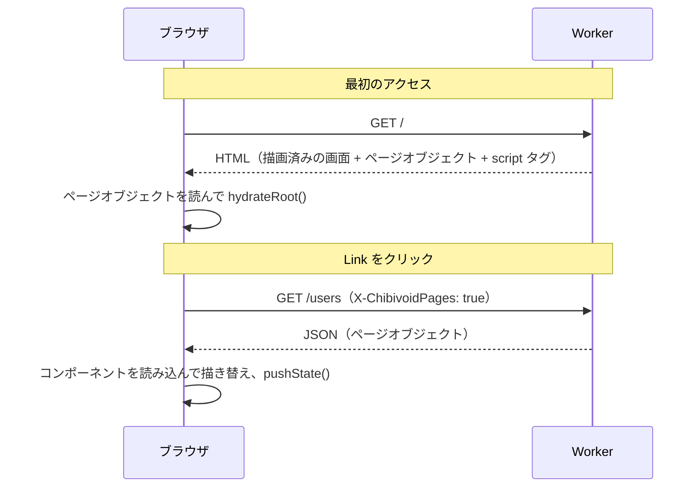

第 8 章で作成したページでは、サーバーがリクエストのたびに HTML を返すだけで、ブラウザ側では JavaScript が動いていませんでした。そのため、ページに置いたボタンはクリックに反応せず、リンクをクリックするたびにページ全体が読み込み直されます。この章では、ブラウザ側で React を動かすハイドレーション（hydration）と、リンクがクリックされた際に、遷移先のページのデータを JSON で取得して画面を切り替えるクライアント遷移（client-side navigation）を実装していきます。

## この章のゴール

- サーバーが描画した HTML をハイドレーションするために必要なものを整理する
- ブラウザ用のエントリ `virtual:chibivoid-pages-client` を作成し、開発中の HTML から読み込ませる
- `X-ChibivoidPages` ヘッダーを使って、同じ URL から、リクエストに応じて HTML とページオブジェクト（JSON）を返し分ける
- `Link` のクリックをインターセプトして、ページ全体を読み込み直さずに画面を切り替える

## ハイドレーションとは何か

サーバーで描画した HTML は、画面の表示としては完成していますが、それだけではユーザーの操作に対して反応しません。`onClick` のようなイベントハンドラーは HTML に含まれないため、たとえばボタンをクリックした場合でも、何も起きません。

ハイドレーションは、サーバーが描画した HTML をブラウザ側で React が引き継ぎ、クリックなどの操作に反応するようにするための処理です。React では、[`hydrateRoot(要素, <App />)`](https://react.dev/reference/react-dom/client/hydrateRoot) によりハイドレーションをおこないます。このとき、イベントハンドラーはコンポーネントのコードの中にしかないため、React はブラウザでもコンポーネントを実行して描画結果を計算します。ただし、その結果から DOM を作成するのではなく、既存の DOM と先頭から順に対応付けて、対応する要素にイベントハンドラーなどを結び付けます。DOM を作り直すわけではないため、表示がちらつくことはありません。

その代わり、ブラウザ側での描画結果は、サーバーが描画した HTML と一致していなければなりません。要素やテキストが一致しない場合、React は `Hydration failed` で始まるエラーを出力し、既存の DOM を捨ててブラウザ側で DOM を作り直します。これでは、DOM を作り直さずに済むというハイドレーションの利点が失われてしまいます。ブラウザでもサーバーと同じものを描画するには、次の 3 つが必要です:

| 必要なもの | どう用意するか |
| --- | --- |
| 同じコンポーネント | `components` の対応表（第 8 章の「コア: コンポーネントの対応表を生成する」）をブラウザ用のエントリにも埋め込み、ページオブジェクトの `component` の ID から読み込む |
| 同じ props | サーバーが HTML に埋め込んだページオブジェクト（`#__CHIBIVOID_PAGE_DATA__`）を読む |
| ブラウザで動く JavaScript | HTML に `<script>` タグを差し込んで、ブラウザ用のエントリを読み込ませる |

ブラウザ側では、第 8 章の「React アダプターを作成する」で HTML に埋め込んでおいたページオブジェクトを読むことで、どのコンポーネントを、どの props で描画するかを知ることができます。

## コア: ブラウザ用のエントリ

まずは、ブラウザでアプリの処理を始める JavaScript、つまりブラウザ用のエントリを仮想モジュール `virtual:chibivoid-pages-client` として用意します。サーバー用のレンダラー（`virtual:chibivoid-pages-renderer`）と同じく、この仮想モジュールの中身はアダプターが生成し、コアの `createPagesPlugin()` が配信します。そこで、`pages/plugin.ts` を変更し、アダプターから受け取った `generateClient` によりブラウザ用のエントリの中身を生成するようにします:

<!-- diff: code/how-void-works/ch08/packages/chibivoid/src/pages/plugin.ts code/how-void-works/ch09/packages/chibivoid/src/pages/plugin.ts -->
```diff ts:packages/chibivoid/src/pages/plugin.ts
@@ -2,12 +2,15 @@
 import { scanPages, type PageScanResult } from "./scan.ts";
 
 export const RENDERER_ID = "virtual:chibivoid-pages-renderer";
+export const CLIENT_ENTRY_ID = "virtual:chibivoid-pages-client";
 
 type CreatePagesPluginOptions = {
   /** プラグイン名。例: "chibivoid-react:pages" */
   name: string;
   /** サーバーで HTML を描画する仮想モジュールのコードを返す */
   generateRenderer: (scan: PageScanResult, isDev: boolean) => string;
+  /** ブラウザ用のエントリのコードを返す */
+  generateClient: (scan: PageScanResult) => string;
   /** フレームワークごとの Vite 設定 */
   config?: (context: { isDev: boolean }) => UserConfig | undefined;
 };
@@ -35,7 +38,7 @@
     },
 
     resolveId(id) {
-      if (id === RENDERER_ID) {
+      if (id === RENDERER_ID || id === CLIENT_ENTRY_ID) {
         return "\0" + id;
       }
     },
@@ -44,19 +47,24 @@
       if (id === "\0" + RENDERER_ID) {
         return options.generateRenderer(scan, isDev);
       }
+      if (id === "\0" + CLIENT_ENTRY_ID) {
+        return options.generateClient(scan);
+      }
     },
 
     configureServer(server) {
-      // ページが追加・削除された場合は、仮想モジュールを作り直してもらう
+      // ページが追加・削除された場合は、2 つの仮想モジュールを作り直してもらう
       const onStructureChange = (file: string) => {
         if (!normalizePath(file).startsWith(normalizedPagesDir + "/")) {
           return;
         }
         scan = scanPages(pagesDir);
         for (const environment of Object.values(server.environments)) {
-          const mod = environment.moduleGraph.getModuleById("\0" + RENDERER_ID);
-          if (mod) {
-            environment.moduleGraph.invalidateModule(mod);
+          for (const id of ["\0" + RENDERER_ID, "\0" + CLIENT_ENTRY_ID]) {
+            const mod = environment.moduleGraph.getModuleById(id);
+            if (mod) {
+              environment.moduleGraph.invalidateModule(mod);
+            }
           }
         }
       };
```
<!-- /diff -->

ページが追加・削除された際には、ブラウザ用のエントリに埋め込む対応表も変わります。そのため `configureServer` では、`virtual:chibivoid-pages-renderer` だけでなく、ブラウザ用のエントリの仮想モジュールも無効化するようにしています。

また、`RENDERER_ID` と同じく、ブラウザ用のエントリの ID である `CLIENT_ENTRY_ID` もアダプターから使うことができるように（第 12 章）、`pages/index.ts` からエクスポートしておきます:

<!-- diff: code/how-void-works/ch08/packages/chibivoid/src/pages/index.ts code/how-void-works/ch09/packages/chibivoid/src/pages/index.ts -->
```diff ts:packages/chibivoid/src/pages/index.ts
@@ -1,5 +1,5 @@
 // フレームワークアダプター（@chibivoid/react など）の Vite プラグインが使う、Node.js 側の API。
-export { createPagesPlugin, RENDERER_ID } from "./plugin.ts";
+export { createPagesPlugin, CLIENT_ENTRY_ID, RENDERER_ID } from "./plugin.ts";
 export { generateComponentManifest } from "./manifest.ts";
 export { scanPages, resolveLayoutIds } from "./scan.ts";
 export type { PageDefinition, LayoutDefinition, PageScanResult } from "./scan.ts";
```
<!-- /diff -->

### HTML からブラウザ用のエントリを読み込ませる

次に、サーバーが返す HTML に、このエントリを読み込む `<script>` タグを差し込みます。第 8 章の「コア: ページオブジェクトのプロトコル」では、HTML に差し込むタグ（`AssetTags`）を空のままにしていました。ここでは、このアセットタグを返す関数を作成する `createPagesAssetTags()` を新しいファイル `runtime/routing-assets.ts` に実装します:

<!-- file: code/how-void-works/ch09/packages/chibivoid/src/runtime/routing-assets.ts -->
```ts:packages/chibivoid/src/runtime/routing-assets.ts
import type { AssetTags } from "../pages/protocol.ts";

/** ブラウザ用のエントリの仮想モジュール ID（pages/plugin.ts と同じ値） */
const CLIENT_ENTRY_ID = "virtual:chibivoid-pages-client";

/**
 * ページの HTML に入れる <script> タグを作る関数を返す。
 * 開発中は、Vite の開発サーバーが配信する URL をそのまま指す。
 */
export function createPagesAssetTags(options: { dev: boolean }) {
  return async (_request: Request, _env: unknown): Promise<AssetTags> => {
    if (!options.dev) {
      // 本番ビルドへの対応は第 12 章でおこなう
      return { head: "", body: "" };
    }
    return {
      // HMR などを担当する Vite のクライアント
      head: '<script type="module" src="/@vite/client"></script>',
      // 仮想モジュールは /@id/ の下で配信される。先頭の \0 は URL では __x00__ になる
      body: `<script type="module" src="/@id/__x00__${CLIENT_ENTRY_ID}"></script>`,
    };
  };
}
```
<!-- /file -->

開発中は、Vite のドキュメントの「[Backend Integration](https://vite.dev/guide/backend-integration)」のページで説明されている方法にならって、HTML に次の 2 つの `<script>` タグを入れます:

- `/@vite/client`: 第 2 章の「初めての Vite プロジェクト」で見た Vite のクライアントです。通常は Vite が `index.html` に自動で差し込みますが、chibivoid の HTML は Worker が作成しているため、明示的に入れる必要があります
- `/@id/__x00__virtual:chibivoid-pages-client`: ブラウザ用のエントリです。第 2 章の「仮想モジュールを作成する」で見たように、仮想モジュールは `/@id/` の下で配信され、ID の先頭の `\0` は URL では `__x00__` になります

一方、本番ビルドでは、ハッシュの付いたファイル名を指す必要があるため、別の方法を使います。本番ビルドへの対応は第 12 章で扱うため、ここでは空のタグを返すようにしておきます。

生成されるルートテーブルは、実行時に使う関数を `chibivoid/runtime/routing` からインポートしています。そこで、`createPagesAssetTags()` を `runtime/routing.ts` から再エクスポートします:

<!-- diff: code/how-void-works/ch08/packages/chibivoid/src/runtime/routing.ts code/how-void-works/ch09/packages/chibivoid/src/runtime/routing.ts -->
```diff ts:packages/chibivoid/src/runtime/routing.ts
@@ -4,6 +4,8 @@
 import { withRuntimeEnv } from "./env.ts";
 import { convertReturnValue } from "./response.ts";
 
+export { createPagesAssetTags } from "./routing-assets.ts";
+
 type RouteModule = Record<string, ((c: Context) => unknown) | undefined>;
 
 /**
```
<!-- /diff -->

そして、`router/compile.ts` を変更し、これまで空のタグを返していた `getAssetTags` を `createPagesAssetTags()` により作成するようにします:

<!-- diff: code/how-void-works/ch08/packages/chibivoid/src/router/compile.ts code/how-void-works/ch09/packages/chibivoid/src/router/compile.ts -->
```diff ts:packages/chibivoid/src/router/compile.ts
@@ -32,7 +32,7 @@
 export function compileRouteTable(scan: ScanResult, options: CompileOptions): string {
   const imports: string[] = [
     `import { Hono } from "hono";`,
-    `import { createModuleLoader, createHttpRouteHandler, createPageGetHandler } from "chibivoid/runtime/routing";`,
+    `import { createModuleLoader, createHttpRouteHandler, createPageGetHandler, createPagesAssetTags } from "chibivoid/runtime/routing";`,
   ];
   const body: string[] = ["const app = new Hono();"];
   // 本番ではロードしたモジュールをキャッシュし、開発中は毎回インポートし直す
@@ -74,8 +74,8 @@
 ): void {
   // ページの描画方法はフレームワークアダプター（@chibivoid/react など）が提供する
   imports.push(`import { renderPage } from "virtual:chibivoid-pages-renderer";`);
-  // HTML に差し込むタグ（クライアントの JavaScript など）。今はまだ空（第 9 章で埋める）
-  body.push(`const getAssetTags = async () => ({ head: "", body: "" });`);
+  // HTML に差し込むタグ（クライアントの JavaScript など）
+  body.push(`const getAssetTags = createPagesAssetTags({ dev: ${options.dev} });`);
 
   pages.pages.forEach((page, i) => {
     let load = "undefined";
```
<!-- /diff -->

## コア: 同じ URL から HTML と JSON を返し分ける

次は、クライアント遷移です。リンクがクリックされた際は、ページ全体を読み込み直すのではなく、次の流れで画面を切り替えます:

1. 遷移先のページのページオブジェクトだけを JSON で取得する
2. 必要なコンポーネントを読み込む
3. React により画面を描き替える
4. [`history.pushState()`](https://developer.mozilla.org/en-US/docs/Web/API/History_API) によりアドレスバーの URL を変更する

では、ページオブジェクトはどの URL から取得すればよいでしょうか。Void は、ページと同じ URL からページオブジェクトを返します。そこで chibivoid でも同じく、たとえば `/users` に `X-ChibivoidPages: true` というヘッダーを付けてリクエストを送ると、`/users` のページオブジェクトが JSON で返されるようにします。ヘッダーがない場合は、これまで通り HTML を返します。最初のアクセスからクライアント遷移までの流れを図にすると、次のようになります:



このしくみを実装するために、`pages/protocol.ts` を変更します:

<!-- diff: code/how-void-works/ch08/packages/chibivoid/src/pages/protocol.ts code/how-void-works/ch09/packages/chibivoid/src/pages/protocol.ts -->
```diff ts:packages/chibivoid/src/pages/protocol.ts
@@ -2,7 +2,7 @@
 
 /**
  * サーバーからクライアントへ渡す「ページオブジェクト」。
- * HTML に埋め込まれ、ブラウザ側でも同じものを使って描画する（第 9 章）。
+ * 初回は HTML に埋め込まれ、クライアント遷移では JSON として返される。
  */
 export type PageObject = {
   /** 描画するページコンポーネントの ID。例: "users/[id]" */
@@ -41,6 +41,30 @@
   });
 }
 
+/** クライアント遷移（fetch）からのリクエストかどうか */
+function isPagesRequest(c: Context): boolean {
+  return c.req.header("X-ChibivoidPages") === "true";
+}
+
+/**
+ * ページオブジェクトを、リクエストに応じて JSON か HTML で返す。
+ * 同じ URL でも中身が変わるため、キャッシュのために `Vary: X-ChibivoidPages` を付ける。
+ */
+async function respondWithPage(
+  c: Context,
+  pageObj: PageObject,
+  options: PageRouteOptions,
+): Promise<Response> {
+  const headers = new Headers({ Vary: "X-ChibivoidPages" });
+  if (isPagesRequest(c)) {
+    headers.set("X-ChibivoidPages", "true");
+    return Response.json(pageObj, { headers });
+  }
+  const html = await options.render(pageObj, await options.assets(c.req.raw, c.env));
+  headers.set("Content-Type", "text/html; charset=utf-8");
+  return new Response(html, { headers });
+}
+
 /** loader を実行して props を得る。Response（リダイレクトなど）が返された場合はそのまま返す */
 async function runLoader(
   loader: PageHandler | undefined,
@@ -70,7 +94,7 @@
   };
 }
 
-/** GET: loader を実行し、ページを HTML で返す */
+/** GET: loader を実行し、ページを返す */
 export async function handlePageGet(
   loader: PageHandler | undefined,
   c: Context,
@@ -80,7 +104,5 @@
   if (props instanceof Response) {
     return props;
   }
-  const pageObj = createPageObject(c, options.componentId, props);
-  const html = await options.render(pageObj, await options.assets(c.req.raw, c.env));
-  return new Response(html, { headers: { "Content-Type": "text/html; charset=utf-8" } });
+  return respondWithPage(c, createPageObject(c, options.componentId, props), options);
 }
```
<!-- /diff -->

新しく追加した `respondWithPage()` は、リクエストの `X-ChibivoidPages` ヘッダーを見て、JSON と HTML のどちらで返すかを選びます。また、JSON のレスポンスには、リクエストと同じ `X-ChibivoidPages: true` ヘッダーを付けています。これにより、ブラウザ側は受け取ったレスポンスが本当にページオブジェクトであるかどうかを確かめることができます（「コア: ブラウザ側のナビゲーションエンジン」）。

### `Vary: X-ChibivoidPages` が必要な理由

`respondWithPage()` が JSON と HTML の両方のレスポンスに付けている [`Vary: X-ChibivoidPages`](https://developer.mozilla.org/en-US/docs/Web/HTTP/Reference/Headers/Vary) は、キャッシュのためのヘッダーです。

ブラウザや CDN のキャッシュは、基本的に URL ごとにレスポンスを保存します。ところが、`/users` はリクエストのヘッダーによって HTML を返したり JSON を返したりします。もしキャッシュが `/users` の HTML を保存しており、`X-ChibivoidPages: true` 付きのリクエストにその HTML を返してしまうと、ブラウザ側は JSON を期待しているにもかかわらず、HTML を受け取ることになります。

`Vary: X-ChibivoidPages` は、「このレスポンスはリクエストの `X-ChibivoidPages` ヘッダーの値によって変わるため、キャッシュする際はヘッダーの値も区別してください」という意味です。

## コア: ブラウザ側のナビゲーションエンジン

ブラウザ側でページオブジェクトを取得し、履歴を操作する処理は、どのフレームワークでも同じです。そこで、この処理をフレームワークに依存しないナビゲーションエンジン（navigation engine）として、コアの `pages/client.ts` に実装します:

<!-- file: code/how-void-works/ch09/packages/chibivoid/src/pages/client.ts -->
```ts:packages/chibivoid/src/pages/client.ts
// ブラウザで動く、フレームワーク非依存のナビゲーションエンジン。
// React、Vue、Svelte、Solid のアダプターが共通で使う想定の部分。
import type { PageObject } from "./protocol.ts";

export type { PageObject };

export type VisitOptions = {
  /** false の場合は履歴を操作しない（戻る・進むボタンの場合） */
  history?: boolean;
};

export type Router = {
  /** URL のページをサーバーから取ってきて、画面を差し替える */
  visit(url: string, options?: VisitOptions): Promise<PageObject | undefined>;
};

/** サーバーが HTML に埋め込んだ、最初のページオブジェクトを読む */
export function readInitialPage(): PageObject {
  const element = document.getElementById("__CHIBIVOID_PAGE_DATA__");
  if (!element?.textContent) {
    throw new Error("pages: #__CHIBIVOID_PAGE_DATA__ が見つかりません");
  }
  return JSON.parse(element.textContent) as PageObject;
}

function currentUrl(): string {
  return location.pathname + location.search;
}

export function createRouter(options: {
  initialPage: PageObject;
  /** 新しいページオブジェクトが届いた際に呼ばれる（アダプターが画面を描き直す） */
  onPage: (page: PageObject) => Promise<void>;
}): Router {
  let latestVisit = 0;

  async function visit(url: string, visitOptions: VisitOptions = {}) {
    const { history: updateHistory = true } = visitOptions;
    const visitId = ++latestVisit;

    // 「HTML ではなくページオブジェクト（JSON）をください」という合図のヘッダー
    const response = await fetch(url, {
      headers: { "X-ChibivoidPages": "true", Accept: "application/json" },
    });
    if (visitId !== latestVisit) {
      // 待っている間に別の遷移が始まったため、この結果は捨てる
      return undefined;
    }
    if (response.headers.get("X-ChibivoidPages") !== "true") {
      // ページ以外（API のエラーなど）が返ってきた場合は、通常の画面遷移に切り替える
      location.href = response.url;
      return undefined;
    }

    const page = (await response.json()) as PageObject;
    await options.onPage(page);

    if (updateHistory) {
      if (page.url !== currentUrl()) {
        history.pushState({ chibivoidPage: true }, "", page.url);
      } else {
        history.replaceState({ chibivoidPage: true }, "", page.url);
      }
      window.scrollTo(0, 0);
    }
    return page;
  }

  history.replaceState({ chibivoidPage: true }, "");
  // ブラウザの「戻る」、「進む」では、その URL のページを取り直す
  window.addEventListener("popstate", () => {
    void visit(currentUrl(), { history: false });
  });

  return { visit };
}
```
<!-- /file -->

`readInitialPage()` は、サーバーが HTML に埋め込んだ、最初のページオブジェクトを読む関数です。

一方、`createRouter()` は、クライアント遷移をおこなうルーターを作成する関数です。ルーターの `visit()` は、次の流れで引数に渡された URL のページに遷移します:

1. `X-ChibivoidPages: true` ヘッダーを付けて `fetch()` によりリクエストを送る
2. レスポンスを待っている間に別の `visit()` が始まっていた場合は、このレスポンスを捨てる。これにより、レスポンスが届く前に次のリンクがクリックされた場合は、古いほうの結果で画面が上書きされることはない
3. レスポンスに `X-ChibivoidPages: true` ヘッダーが付いていない場合は、404 のレスポンスや API ルートのレスポンスなど、ページ以外のものが返ってきたと判断する。この場合は、レスポンスの URL を `location.href` に代入して、通常の画面遷移に切り替える
4. `onPage(page)` を呼び出して、画面の描き替えをアダプターに任せる
5. `history.pushState()` によりアドレスバーの URL を変更し、ページの先頭までスクロールする。ただし、遷移先の URL が今の URL と同じ場合は、履歴を増やさないように `history.replaceState()` を使う

また、ブラウザの「戻る」、「進む」ボタンが押されると、`popstate` イベントが発生します。この時点でアドレスバーの URL はすでに変わっているため、ルーターはその URL のページオブジェクトを取得し直して画面を描き替えます。その際は `visit()` に `{ history: false }` を渡して、履歴を操作しないようにしています。

ナビゲーションエンジンはフレームワークに依存しないため、アダプターから使うことができるように `chibivoid/pages-client` として公開します:

<!-- diff: code/how-void-works/ch08/packages/chibivoid/package.json code/how-void-works/ch09/packages/chibivoid/package.json -->
```diff json:packages/chibivoid/package.json
@@ -8,6 +8,7 @@
     "./kv": "./src/runtime/kv.ts",
     "./pages": "./src/pages/index.ts",
     "./pages-protocol": "./src/pages/protocol.ts",
+    "./pages-client": "./src/pages/client.ts",
     "./runtime/*": "./src/runtime/*.ts"
   },
   "dependencies": {
```
<!-- /diff -->

## アダプター: ブラウザで React を動かす

### ブラウザ用のエントリを生成する

ここからは、React のアダプターである `@chibivoid/react` を変更していきます。まずは、Vite プラグインを実装している `plugin.ts` を変更します:

<!-- diff: code/how-void-works/ch08/packages/react/src/plugin.ts code/how-void-works/ch09/packages/react/src/plugin.ts -->
```diff ts:packages/react/src/plugin.ts
@@ -4,6 +4,18 @@
 import { createPagesPlugin, generateComponentManifest } from "chibivoid/pages";
 import { normalizePath, type PluginOption, type UserConfig } from "vite";
 
+/**
+ * サーバーで描画した HTML には、@vitejs/plugin-react が通常 index.html に差し込む
+ * 「React Refresh（HMR）の準備コード」が入らない。そのため開発中は自分で差し込む。
+ */
+const REACT_REFRESH_PREAMBLE = `<script type="module">
+import RefreshRuntime from "/@react-refresh";
+RefreshRuntime.injectIntoGlobalHook(window);
+window.$RefreshReg$ = () => {};
+window.$RefreshSig$ = () => (type) => type;
+window.__vite_plugin_react_preamble_installed__ = true;
+</script>`;
+
 /** chibivoid の React アダプター。`plugins: [chibivoidPlugin(), chibivoidReact()]` のように使う */
 export function chibivoidReact(): PluginOption[] {
   const pagesDir = normalizePath(join(process.cwd(), "pages"));
@@ -14,20 +26,32 @@
       name: "chibivoid-react:pages",
 
       // サーバー（Worker）で HTML を描画するモジュール
-      generateRenderer(scan) {
+      generateRenderer(scan, isDev) {
         return `import { renderReactPage } from "@chibivoid/react/pages-server";
 ${generateComponentManifest(scan, pagesDir)}
+const preamble = ${JSON.stringify(isDev ? REACT_REFRESH_PREAMBLE : "")};
 export function renderPage(pageObj, assetTags) {
-  return renderReactPage({ pageObj, assetTags, components, layoutTree });
+  return renderReactPage({ pageObj, assetTags, components, layoutTree, preamble });
 }
 `;
       },
 
+      // ブラウザでハイドレーションとクライアント遷移を始めるモジュール
+      generateClient(scan) {
+        return `import { startReactPages } from "@chibivoid/react/pages-client";
+${generateComponentManifest(scan, pagesDir)}
+startReactPages({ components, layoutTree });
+`;
+      },
+
       config({ isDev }): UserConfig | undefined {
         if (isDev) {
           // React の依存を最初から事前バンドルしておき、後から見つかった場合のやり直しを防ぐ
           return {
             environments: {
+              client: {
+                optimizeDeps: { include: ["react", "react-dom/client", "react/jsx-dev-runtime"] },
+              },
               [WORKER_ENVIRONMENT_NAME]: {
                 optimizeDeps: { include: ["react", "react-dom/server", "react/jsx-dev-runtime"] },
               },
```
<!-- /diff -->

変更点は、次の 3 つです。

#### 1. `generateClient`

`generateClient` は、ブラウザ用のエントリの中身として、次のようなコードを生成します:

```js
import { startReactPages } from "@chibivoid/react/pages-client";
const components = { /* 第 8 章と同じ対応表 */ };
const layoutTree = { /* ... */ };
startReactPages({ components, layoutTree });
```

サーバーとブラウザで同じ対応表を使うため、ブラウザ側でも同じ `componentId` からサーバーと同じコンポーネントを読み込むことができます。最後に呼び出している `startReactPages()` については、この節の後半で説明します。

#### 2. React Refresh の準備コード

`@vitejs/plugin-react` は、開発中にコンポーネントの状態を保ったまま変更したコンポーネントを差し替える React Fast Refresh を提供しています。React Fast Refresh を使うには、ページの最初に小さな準備コード（preamble）を実行しておく必要があります。通常は `@vitejs/plugin-react` が、`index.html` を変換するための `transformIndexHtml` フックにより、この準備コードを自動で差し込みます。しかし、chibivoid の HTML は Worker が作成しているため、Vite による `index.html` の変換を経由しません。そこで、開発中に限り準備コードをレンダラーに渡して `<head>` に入れるようにしています。

準備コードがない場合は、ブラウザのコンソールに `@vitejs/plugin-react can't detect preamble. Something is wrong.` というエラーが表示され、ページが正しく動きません。

#### 3. クライアント側の依存の事前バンドル

第 8 章では Worker 用の環境だけに指定していた React の依存の事前バンドルを、`client` 環境にも指定しています。ブラウザ側も、エントリが仮想モジュールで `index.html` もないため、第 8 章の「React アダプターを作成する」と同じく、起動時の依存スキャンでは React が見つかりません（第 2 章の「HMR と依存の事前バンドル」）。

また、`package.json` の `exports` に、ブラウザでハイドレーションとクライアント遷移をおこなう部分である `./pages-client` を追加します:

<!-- diff: code/how-void-works/ch08/packages/react/package.json code/how-void-works/ch09/packages/react/package.json -->
```diff json:packages/react/package.json
@@ -6,7 +6,8 @@
   "exports": {
     ".": "./src/runtime/index.ts",
     "./plugin": "./src/plugin.ts",
-    "./pages-server": "./src/runtime/pages-server.tsx"
+    "./pages-server": "./src/runtime/pages-server.tsx",
+    "./pages-client": "./src/runtime/pages-client.tsx"
   },
   "dependencies": {
     "@vitejs/plugin-react": "^6.2.1"
```
<!-- /diff -->

### ルーターを React に渡す

次に、`Link` などのコンポーネントからルーターを使うことができるように、React のコンテキストを通してルーターを渡します。まずは、`runtime/context.ts` に `RouterContext` を追加します。サーバーで描画する際はルーターがないため、`RouterContext` の値は `null` になります:

<!-- diff: code/how-void-works/ch08/packages/react/src/runtime/context.ts code/how-void-works/ch09/packages/react/src/runtime/context.ts -->
```diff ts:packages/react/src/runtime/context.ts
@@ -1,5 +1,8 @@
 import { createContext } from "react";
-import type { PageObject } from "chibivoid/pages-protocol";
+import type { PageObject, Router } from "chibivoid/pages-client";
+
+/** クライアント遷移に使うルーター（サーバーでの描画中は null） */
+export const RouterContext = createContext<Router | null>(null);
 
 /** 今表示しているページのページオブジェクト */
 export const PageContext = createContext<PageObject | null>(null);
```
<!-- /diff -->

続いて、`PageView` が `router` を受け取り、`RouterContext` を通して子孫のコンポーネントに渡すようにします:

<!-- diff: code/how-void-works/ch08/packages/react/src/runtime/page-view.tsx code/how-void-works/ch09/packages/react/src/runtime/page-view.tsx -->
```diff tsx:packages/react/src/runtime/page-view.tsx
@@ -1,7 +1,7 @@
-// ページの組み立て部分。第 9 章ではブラウザでのハイドレーションにも使う。
+// サーバーでの描画とブラウザでのハイドレーションの両方で使う、ページの組み立て部分。
 import type { ComponentType, ReactNode } from "react";
-import type { PageObject } from "chibivoid/pages-protocol";
-import { PageContext } from "./context.ts";
+import type { PageObject, Router } from "chibivoid/pages-client";
+import { PageContext, RouterContext } from "./context.ts";
 
 type ComponentModule = { default: ComponentType<any> };
 export type ComponentMap = Record<string, () => Promise<ComponentModule>>;
@@ -34,12 +34,16 @@
 }
 
 /** <Layout><Layout><Page {...props} /></Layout></Layout> を組み立てる */
-export function PageView(props: { page: PageObject; modules: PageModules }) {
-  const { page, modules } = props;
+export function PageView(props: { page: PageObject; modules: PageModules; router: Router | null }) {
+  const { page, modules, router } = props;
   let element: ReactNode = <modules.Page {...page.props} />;
   // 内側のレイアウトから順に包んでいく
   for (const Layout of [...modules.layouts].reverse()) {
     element = <Layout>{element}</Layout>;
   }
-  return <PageContext value={page}>{element}</PageContext>;
+  return (
+    <RouterContext value={router}>
+      <PageContext value={page}>{element}</PageContext>
+    </RouterContext>
+  );
 }
```
<!-- /diff -->

また、サーバーでページを HTML に描画する `runtime/pages-server.tsx` を変更し、`PageView` に `router={null}` を渡すとともに、準備コードを `<head>` に入れるようにします:

<!-- diff: code/how-void-works/ch08/packages/react/src/runtime/pages-server.tsx code/how-void-works/ch09/packages/react/src/runtime/pages-server.tsx -->
```diff tsx:packages/react/src/runtime/pages-server.tsx
@@ -8,12 +8,15 @@
   assetTags: AssetTags;
   components: ComponentMap;
   layoutTree: LayoutTree;
+  preamble: string;
 }): Promise<string> {
-  const { pageObj, assetTags, components, layoutTree } = options;
+  const { pageObj, assetTags, components, layoutTree, preamble } = options;
   const modules = await loadPageModules(pageObj, components, layoutTree);
 
   // Workers ではウェブ標準のストリームを返す renderToReadableStream を使う
-  const stream = await renderToReadableStream(<PageView page={pageObj} modules={modules} />);
+  const stream = await renderToReadableStream(
+    <PageView page={pageObj} modules={modules} router={null} />,
+  );
   // 簡単のため、全部描画し終わるのを待ってから文字列にする（Void はストリーミングで返す）
   await stream.allReady;
   const appHtml = await new Response(stream).text();
@@ -23,7 +26,7 @@
 <head>
 <meta charset="utf-8">
 <meta name="viewport" content="width=device-width, initial-scale=1">
-${assetTags.head}
+${preamble}${assetTags.head}
 </head>
 <body>
 <script id="__CHIBIVOID_PAGE_DATA__" type="application/json">${serializePageData(pageObj)}</script>
```
<!-- /diff -->

### ハイドレーションとクライアント遷移を開始する

いよいよ、ブラウザ側の処理の本体である `runtime/pages-client.tsx` を作成します。ここで定義する `startReactPages()` は、ブラウザ用のエントリから呼び出されます:

<!-- file: code/how-void-works/ch09/packages/react/src/runtime/pages-client.tsx -->
```tsx:packages/react/src/runtime/pages-client.tsx
// ブラウザで、サーバーが描画した HTML を React に引き継がせ（ハイドレーション）、
// 以後のページ遷移をクライアント側でおこなう。
import { flushSync } from "react-dom";
import { hydrateRoot } from "react-dom/client";
import { createRouter, readInitialPage } from "chibivoid/pages-client";
import { loadPageModules, PageView, type ComponentMap, type LayoutTree } from "./page-view.tsx";

export async function startReactPages(options: {
  components: ComponentMap;
  layoutTree: LayoutTree;
}): Promise<void> {
  const { components, layoutTree } = options;

  // 1. サーバーが HTML に埋め込んだページオブジェクトを読み、同じコンポーネントを読み込む
  const initialPage = readInitialPage();
  const initialModules = await loadPageModules(initialPage, components, layoutTree);

  // 2. ルーター: 新しいページオブジェクトが届いた際に、そのページを描画し直す
  const router = createRouter({
    initialPage,
    async onPage(page) {
      const modules = await loadPageModules(page, components, layoutTree);
      // 画面の更新を同期的に確定させてから、履歴の更新やスクロールに進む
      flushSync(() => {
        root.render(<PageView page={page} modules={modules} router={router} />);
      });
    },
  });

  // 3. サーバーと同じものを描画して、既存の DOM を React に引き継がせる
  const root = hydrateRoot(
    document.getElementById("app")!,
    <PageView page={initialPage} modules={initialModules} router={router} />,
  );
}
```
<!-- /file -->

`startReactPages()` は、次の 3 つの段階で処理を進めます:

1. 最初のページを描画する準備: HTML に埋め込まれたページオブジェクトを読み、そのページとレイアウトのコンポーネントを読み込みます。この読み込みは、`hydrateRoot()` を呼び出す前に済ませておく必要があります。コンポーネントがそろっていない状態で描画すると、サーバーが描画した HTML と食い違ってしまうためです
2. ルーターの作成: 新しいページオブジェクトが届くと、ルーターは `onPage()` を呼び出します。`onPage()` は、コンポーネントを読み込んでから `root.render()` によりそのページを描画し直します。このとき、React は前回の描画結果と比べて変わったところだけを DOM に反映します。そのため、レイアウトのように遷移の前後で共通のコンポーネントはそのまま残り、ページのコンポーネントだけが入れ替わります。また、`flushSync()` は、状態の更新をその場で DOM に反映させるための React の関数です。これにより、画面の更新が確定してからナビゲーションエンジンが履歴の操作とスクロールをおこなうため、処理の順番が狂うことはありません
3. ハイドレーション: サーバーと同じページオブジェクトとコンポーネントを `PageView` に渡し、`hydrateRoot()` によりサーバーが描画した HTML を React に引き継がせます。`hydrateRoot()` が返す `root` は、`createRoot()` により作成したものと同じく、`render()` により描画する内容を差し替えることができます。2. の `onPage()` は、この `root` を使っています。`onPage()` が呼ばれるのは `hydrateRoot()` の後であるため、`root` の宣言より前に記述していても問題はありません

### `Link` でクリックをインターセプトする

第 8 章の「React アダプターを作成する」では普通の `<a>` を返すだけだった `runtime/link.tsx` を、次の内容に置き換えます:

<!-- file: code/how-void-works/ch09/packages/react/src/runtime/link.tsx -->
```tsx:packages/react/src/runtime/link.tsx
import { useContext, type AnchorHTMLAttributes, type MouseEvent } from "react";
import { RouterContext } from "./context.ts";

export type LinkProps = AnchorHTMLAttributes<HTMLAnchorElement> & { href: string };

/**
 * ページ間のリンク。普通の <a> として描画され、
 * JavaScript が動いていればクリックをインターセプトしてクライアント遷移にする。
 */
export function Link({ href, onClick, ...rest }: LinkProps) {
  const router = useContext(RouterContext);

  function handleClick(event: MouseEvent<HTMLAnchorElement>) {
    onClick?.(event);
    // 新しいタブで開く操作などは、ブラウザに任せる
    if (
      !router ||
      event.defaultPrevented ||
      event.button !== 0 ||
      event.metaKey ||
      event.ctrlKey ||
      event.shiftKey ||
      event.altKey ||
      rest.target
    ) {
      return;
    }
    const url = new URL(href, location.href);
    if (url.origin !== location.origin) {
      return;
    }
    event.preventDefault();
    void router.visit(url.pathname + url.search);
  }

  return <a href={href} onClick={handleClick} {...rest} />;
}
```
<!-- /file -->

`Link` は、サーバーでもブラウザでも、普通の `<a href>` として描画されます。そのため、JavaScript が読み込まれる前にクリックした場合や、JavaScript が無効な場合でも、普通のリンクとして動きます。一方、JavaScript が動いている場合は、クリックをインターセプトして `router.visit()` を呼び出します。

ただし、Ctrl/⌘ キーを押しながらのクリックや `target="_blank"` のリンク、別のオリジンへのリンクなど、新しいタブで開く操作や通常の遷移が期待される場合は、インターセプトせずにブラウザに任せます。

このように、まずは JavaScript がない場合でも動くものを作成し、JavaScript が動く場合にはより快適に使うことができるようにする考え方をプログレッシブエンハンスメント（progressive enhancement）と呼びます。第 10 章で作成するフォームも、同じ考え方に基づいています。

## 動かしてみる

まずは、ハイドレーションが成功したことを確かめるために、トップページにボタンを追加します:

<!-- diff: code/how-void-works/ch08/playground/pages/index.tsx code/how-void-works/ch09/playground/pages/index.tsx -->
```diff tsx:playground/pages/index.tsx
@@ -1,10 +1,15 @@
+import { useState } from "react";
 import type { Props } from "./index.server.ts";
 
 export default function Home({ title, renderedAt }: Props) {
+  // ハイドレーションされると、このボタンが動くようになる
+  const [clicks, setClicks] = useState(0);
+
   return (
     <div>
       <h1>{title}</h1>
       <p>サーバーで描画した時刻: {renderedAt}</p>
+      <button onClick={() => setClicks(clicks + 1)}>クリック: {clicks}</button>
     </div>
   );
 }
```
<!-- /diff -->

この章では、`vite.config.ts` から読み込まれる chibivoid 本体と `@chibivoid/react` のプラグインのコードを変更しました。そのため、開発サーバーを起動している場合は、いったん止めてから起動し直してください:

```sh
npm run dev
```

### HTML に追加された `<script>` タグを確かめる

開発サーバーを起動したまま、別のターミナルから `curl` でトップページを取得してみましょう:

```html
$ curl http://localhost:5173/
<head>
<meta charset="utf-8">
<meta name="viewport" content="width=device-width, initial-scale=1">
<script type="module">
import RefreshRuntime from "/@react-refresh";
RefreshRuntime.injectIntoGlobalHook(window);
...
</script><script type="module" src="/@vite/client"></script>
</head>
<body>
<script id="__CHIBIVOID_PAGE_DATA__" type="application/json">{"component":"index", ...}</script>
<div id="app">...</div>
<script type="module" src="/@id/__x00__virtual:chibivoid-pages-client"></script>
</body>
```

`<head>` には React Refresh の準備コードと Vite のクライアントが、`<body>` の最後にはブラウザ用のエントリが、それぞれ入っていることがわかります。

### ハイドレーションとクライアント遷移を確かめる

次に、ブラウザで `http://localhost:5173/` を開き、「クリック」ボタンをクリックしてみてください。クリックするたびにボタンの数字が増えるはずです。さらに、ブラウザのコンソールに `Hydration failed` で始まるエラーが表示されていなければ、ハイドレーションは成功しています。なお、サーバーとブラウザで描画結果が食い違った場合でも、React がブラウザ側で描画し直すため、ボタン自体は動作します。

続いて、開発者ツールのネットワークタブを開いた状態で、ナビゲーションの「Users」をクリックしてみましょう。次のような動きを確認できるはずです:

- ページ全体の読み込みは起きません。新たに発生するのは、`/users` へのリクエストと、`users/index.tsx` などのコンポーネントのファイルの読み込みだけです。なお、コンポーネントのファイルが読み込まれるのは、そのページを初めて開く場合に限られます。ネットワークタブの表示を「Fetch/XHR」で絞り込むと、`/users` へのリクエストが 1 つだけ表示されます
- `/users` へのリクエストには `X-ChibivoidPages: true` ヘッダーが付いており、レスポンスは JSON です
- アドレスバーの URL は `/users` に変わり、ブラウザの「戻る」ボタンで `/` に戻ることができます

このリクエストを、`curl` で再現してみましょう:

```
$ curl -i -H 'X-ChibivoidPages: true' http://localhost:5173/users
HTTP/1.1 200 OK
content-type: application/json
vary: X-ChibivoidPages
x-chibivoidpages: true

{"component":"users/index","props":{"users":[{"id":1,"name":"Ada"},{"id":2,"name":"Linus"}]},"params":{},"url":"/users"}
```

HTML ではなく、`/users` のページオブジェクトが JSON で返され、レスポンスに `Vary: X-ChibivoidPages` ヘッダーと `X-ChibivoidPages: true` ヘッダーが付いていることがわかります。

### React Fast Refresh を確かめる

最後に、React Fast Refresh の動きを確かめておきましょう。トップページで「クリック」ボタンを何回かクリックしてから、`playground/pages/index.tsx` の「サーバーで描画した時刻」という文字列を書き換えて保存してみてください。ページが読み込み直されることなく表示だけが変わり、ボタンの数字、つまりコンポーネントの状態もそのまま残るはずです。これが React Fast Refresh によるコンポーネントの差し替えです。

## まとめ

- サーバーが描画した HTML をハイドレーションするには、サーバーと同じコンポーネントと同じ props が必要。props は HTML に埋め込んだページオブジェクトから、コンポーネントはサーバーと共通の対応表から得る
- 開発中の HTML には、`/@vite/client` と `/@id/__x00__virtual:chibivoid-pages-client` を入れる。React の場合は、さらに React Refresh の準備コードも入れる
- 同じ URL へのリクエストに対して、`X-ChibivoidPages: true` ヘッダーがある場合はページオブジェクト（JSON）を、ない場合は HTML を返す。キャッシュが両者を区別できるように、`Vary: X-ChibivoidPages` ヘッダーを付ける
- ナビゲーションエンジン（`fetch()`、履歴の操作、スクロール）はコアに、描画（`hydrateRoot()`、遷移先のページの描画）はアダプターに置く
- `Link` は普通の `<a>` として動き、JavaScript が動いている場合にだけクリックをインターセプトする

## Void の実装

アセットタグは、`packages/void/src/runtime/routing/assets.ts` の `createClientAssetTags()` が作成します。開発中の HTML には、chibivoid と同じ `/@vite/client` とブラウザ用のエントリに加えて、第 7 章の「Void の実装」で触れたトーストを表示するためのスクリプトが入ります。ブラウザ用のエントリの URL としては、`packages/void/src/router/compile.ts` が `'/@id/__x00__' + pages.clientEntryId` を `createClientAssetTags()` の `entryUrl` オプションに渡しています。

`X-VoidPages` ヘッダーの判定は `packages/void/src/pages/protocol.ts` の `isPagesRequest()` が、`Vary` ヘッダーの付与は同じファイルの `varyPagesResponse()` が、それぞれおこないます。

ナビゲーションエンジンは、`packages/void/src/pages/navigation-engine.ts` に実装されており、1,300 行あまりあります。chibivoid の `createRouter()` と同じ役割に加えて、リンクにマウスカーソルを重ねた際などに遷移先のページを先読みするプリフェッチ（prefetch）、スクロール位置の復元、事前レンダリングしたページのデータの利用なども扱っています。また、`Link` の振る舞いのうち、フレームワークに依存しない判定は `packages/void/src/pages/link.ts` にまとめられており、各アダプターの `Link` から使われています。

React のアダプターのブラウザ側の処理は、`packages/react/src/runtime/pages-client.ts` の `startReactPages()` に実装されています。`hydrateRoot()` によりハイドレーションを始める点は chibivoid と同じですが、`export const ssr = false` を指定したページでは、サーバーで描画しないため `createRoot()` を使います。また、chibivoid の `flushSync()` の代わりに、React の `startTransition()` と Suspense を組み合わせて遷移中も前の画面を表示し続けるようにしています。

React Refresh の準備コードは、`packages/react/src/plugin-pages.ts` の `REACT_REFRESH_PREAMBLE` に chibivoid とほぼ同じ内容で定義されています。そのコメントにも、「SSR HTML bypasses transformIndexHtml」と、この章で説明した理由が書かれています。また、同じファイルの `config` には、chibivoid よりも細かい `optimizeDeps` の設定が、それぞれの理由を説明するコメントとともに記述されています。
