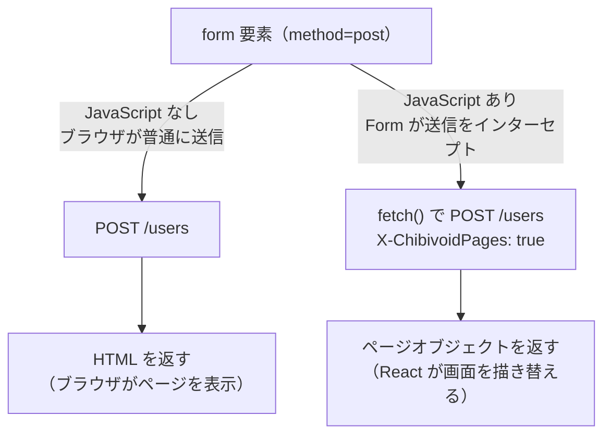

第 8 章と第 9 章で、ページをサーバーで描画して表示し、ページ全体を読み込み直さずに画面を切り替えることができるようになりました。Pages の最後となるこの章では、ユーザーの入力を受け取ってデータを変更するしくみを作っていきます。Void では、ページの `.server.ts` ファイルが [`action`](https://void.cloud/guide/pages-routing/actions-and-forms) をエクスポートすると、そのページへのフォームの送信を処理することができます。たとえば、`/users` ページへのフォームの送信を受け取ってユーザーを追加する action は次のようになります:

```ts
// pages/users/index.server.ts
export const action = defineHandler(async (c) => {
  const { name } = await c.req.json<{ name: string }>();
  await addUser(name);
  // 何も返さなければ、loader をもう一度実行して最新のページを返す
});
```

## この章のゴール

- action を実行した後に、loader を再実行してページを返す流れを実装する
- `ValidationError` を使って、フィールドごとのエラーをページに返す
- JavaScript がない場合でも動き、JavaScript がある場合はページ全体を読み込み直さずに済むフォームを作成する
- 別のサイトから勝手にフォームを送信させる攻撃である、クロスサイトリクエストフォージェリ（CSRF）を防ぐ

## action の設計

action は、ページの URL への `POST`、`PUT`、`PATCH`、`DELETE` リクエストを処理する関数です。以降では、これらのリクエストを、データを変更するためのリクエストという意味で変更リクエストと呼びます。action を実行した後のサーバーの振る舞いは、action の戻り値、または action が投げた例外によって次のように決まります:

| action の結果 | サーバーの振る舞い |
| --- | --- |
| 何も返さない | loader をもう一度実行し、最新の props でページを返す |
| `Response` を返す（`c.redirect()` など） | その `Response` をそのまま返す |
| `ValidationError` を投げる | loader をもう一度実行し、フィールドごとのエラーを含めてページを返す |

ここでの「ページを返す」は、第 9 章の「コア: 同じ URL から HTML と JSON を返し分ける」と同じく、リクエストに `X-ChibivoidPages: true` ヘッダーが付いていればページオブジェクトを JSON で返し、付いていなければ HTML を返すことを指します。

この設計により、1 つのフォームを、次の 2 つの方法で動かすことができます:



JavaScript が無効な場合でも、JavaScript の読み込みが終わる前でも、フォームは普通の HTML のフォームとして動きます。一方、JavaScript が動いている場合は、「アダプター: `Form` と `useErrors()`」で作成する `Form` コンポーネントが送信をインターセプトして、画面の必要な部分だけを描き替えます。このように、フォームも第 9 章の「アダプター: ブラウザで React を動かす」の `Link` と同じくプログレッシブエンハンスメントの考え方により作成します。

## コア: `ValidationError`

まずは、コア側から作っていきましょう。action から投げることで、フィールドごとのエラーをページに返すことができる例外クラス `ValidationError` を `runtime/handler.ts` に追加します:

<!-- diff: code/how-void-works/ch09/packages/chibivoid/src/runtime/handler.ts code/how-void-works/ch10/packages/chibivoid/src/runtime/handler.ts -->
```diff ts:packages/chibivoid/src/runtime/handler.ts
@@ -25,7 +25,7 @@
 export type TypedHandler<R> = ((c: CloudContext) => unknown) & { readonly __output: R };
 
 /**
- * ルートハンドラー・loader を定義する。
+ * ルートハンドラー、loader、action を定義する。
  * 実行時は何もしない恒等関数で、型を付けるためだけに存在する。
  */
 export function defineHandler<R>(
@@ -43,3 +43,14 @@
 
 /** loader の戻り値の型を取り出す: `type Props = InferProps<typeof loader>` */
 export type InferProps<T> = T extends { readonly __output: infer R } ? R : never;
+
+/** action から投げると、フォームにフィールドごとのエラーを返すことができる */
+export class ValidationError extends Error {
+  readonly errors: Record<string, string>;
+
+  constructor(errors: Record<string, string>) {
+    super("Validation failed");
+    this.name = "ValidationError";
+    this.errors = errors;
+  }
+}
```
<!-- /diff -->

`ValidationError` のコンストラクターには、次のように、フィールド名をキー、エラーメッセージを値とするオブジェクトを渡します:

```ts
throw new ValidationError({ name: "名前を入力してください" });
```

また、アプリのコードからインポートできるように、`index.ts` からも `ValidationError` を再エクスポートしておきます:

<!-- diff: code/how-void-works/ch09/packages/chibivoid/src/index.ts code/how-void-works/ch10/packages/chibivoid/src/index.ts -->
```diff ts:packages/chibivoid/src/index.ts
@@ -55,5 +55,5 @@
 
 // アプリのコードから `import { defineHandler } from "chibivoid"` と記述することができるように再エクスポートする。
 // （Worker の中ではこの index.ts ではなく runtime/handler.ts に差し替えられる）
-export { defineHandler, defineMiddleware } from "./runtime/handler.ts";
+export { defineHandler, defineMiddleware, ValidationError } from "./runtime/handler.ts";
 export type { CloudContext, InferProps, TypedHandler } from "./runtime/handler.ts";
```
<!-- /diff -->

## コア: action を処理する

次に、`pages/protocol.ts` に変更リクエストを処理する `handlePageMutation()` を追加します。あわせて、ページオブジェクトにバリデーションエラーを入れるための `errors` フィールドを追加します:

<!-- diff: code/how-void-works/ch09/packages/chibivoid/src/pages/protocol.ts code/how-void-works/ch10/packages/chibivoid/src/pages/protocol.ts -->
```diff ts:packages/chibivoid/src/pages/protocol.ts
@@ -1,4 +1,5 @@
 import type { Context } from "hono";
+import { ValidationError } from "../runtime/handler.ts";
 
 /**
  * サーバーからクライアントへ渡す「ページオブジェクト」。
@@ -13,6 +14,8 @@
   params: Record<string, string>;
   /** このページの URL（パス + クエリ） */
   url: string;
+  /** action のバリデーションエラー（フィールド名 → メッセージ） */
+  errors: Record<string, string> | null;
 };
 
 /** HTML に差し込む <script> などのタグ */
@@ -84,6 +87,7 @@
   c: Context,
   componentId: string,
   props: Record<string, unknown>,
+  errors: Record<string, string> | null,
 ): PageObject {
   const url = new URL(c.req.url);
   return {
@@ -91,6 +95,7 @@
     props,
     params: c.req.param(),
     url: url.pathname + url.search,
+    errors,
   };
 }
 
@@ -104,5 +109,50 @@
   if (props instanceof Response) {
     return props;
   }
-  return respondWithPage(c, createPageObject(c, options.componentId, props), options);
+  return respondWithPage(c, createPageObject(c, options.componentId, props, null), options);
+}
+
+/**
+ * POST などの変更リクエスト: action を実行し、
+ * - Response（リダイレクトなど）が返された場合はそれを返す
+ * - ValidationError が投げられた場合は、loader をもう一度実行して、エラー付きでページを返す
+ * - それ以外は loader をもう一度実行して、最新の props でページを返す
+ */
+export async function handlePageMutation(
+  action: PageHandler,
+  loader: PageHandler | undefined,
+  c: Context,
+  options: PageRouteOptions,
+): Promise<Response> {
+  if (!isSameOrigin(c.req.raw)) {
+    return new Response("Cross-origin page actions are not allowed.", { status: 403 });
+  }
+  let errors: Record<string, string> | null = null;
+  try {
+    const result = await action(c);
+    if (result instanceof Response) {
+      return result;
+    }
+  } catch (error) {
+    if (!(error instanceof ValidationError)) {
+      throw error;
+    }
+    errors = error.errors;
+  }
+  const props = await runLoader(loader, c);
+  if (props instanceof Response) {
+    return props;
+  }
+  const pageObj = createPageObject(c, options.componentId, props, errors);
+  return respondWithPage(c, pageObj, options);
+}
+
+/** 別サイトのページから勝手にフォームを送信させる攻撃（CSRF）を防ぐ */
+function isSameOrigin(request: Request): boolean {
+  const origin = request.headers.get("Origin");
+  if (origin !== null) {
+    return origin === new URL(request.url).origin;
+  }
+  const site = request.headers.get("Sec-Fetch-Site");
+  return !site || site === "same-origin" || site === "none";
 }
```
<!-- /diff -->

`handlePageMutation()` は「action の設計」の表の通りに、次の流れで変更リクエストを処理します:

1. `isSameOrigin()` により、リクエストがアプリ自身と同じオリジンから送られたものかどうかを確かめ、そうでない場合は 403 を返す。このチェックについては、この節の後半で説明する
2. action を実行する。action が `Response` を返した場合は、その `Response` をそのまま返す。action が `ValidationError` を投げた場合は、フィールドごとのエラー（`error.errors`）を `errors` に入れて処理を続ける。それ以外の例外はそのまま投げ直す
3. loader をもう一度実行し、`errors` を入れたページオブジェクトを第 9 章の「コア: 同じ URL から HTML と JSON を返し分ける」で作成した `respondWithPage()` により返す。loader が `Response` を返した場合は、その `Response` をそのまま返す

action を実行した後に loader を実行し直している点に注目してください。たとえば、ユーザーを追加した後であれば、loader が返す一覧には追加したユーザーが含まれています。そのため、クライアント側は返ってきたページオブジェクトにより画面を描き替えるだけで、最新の状態を表示することができます。

### CSRF を防ぐ

`handlePageMutation()` が最初に呼び出している `isSameOrigin()` は、[CSRF を防ぐ](https://cheatsheetseries.owasp.org/cheatsheets/Cross-Site_Request_Forgery_Prevention_Cheat_Sheet.html)ためのチェックです。たとえば、悪意のあるサイト `https://evil.example` に、次のようなフォームが仕込まれていたとします:

```html
<form method="post" action="https://your-app.example/users">
  <input name="name" value="勝手に追加" />
</form>
<script>
  document.forms[0].submit();
</script>
```

あなたのアプリにログインしている人がこのサイトを開くと、本人の知らないうちに、このフォームがあなたのアプリに送信されてしまいます。

このような送信を見分けるために、`isSameOrigin()` はブラウザがリクエストに付けるヘッダーを確かめます。ブラウザは `POST` などのリクエストに、送信元のページのオリジンを表わす `Origin` ヘッダーを付けて送ります。オリジンとは、URL のスキーム、ホスト、ポートの組のことです。上の例では、リクエストに `Origin: https://evil.example` が付きます。`isSameOrigin()` はこの値がアプリ自身のオリジンと一致しない場合に `false` を返し、`handlePageMutation()` はリクエストを 403 で拒否します。

`Origin` ヘッダーがない場合は、[`Sec-Fetch-Site`](https://developer.mozilla.org/en-US/docs/Web/HTTP/Reference/Headers/Sec-Fetch-Site) ヘッダーを確かめます。このヘッダーの値は、同じオリジンのページから送られたリクエストでは `same-origin` に、アドレスバーへの入力など、ユーザー自身の操作によるリクエストでは `none` になります。そのため、この 2 つの値の場合だけリクエストを通します。また、どちらのヘッダーもないリクエストは、`curl` のようなブラウザ以外のクライアントから送られたものと考えられるため、そのまま通しています。

### ルートを登録する

続いて `runtime/routing.ts` に、ページの変更リクエストを処理するハンドラーを作成する `createPageMutationHandler()` を追加します。このハンドラーは、`.server.ts` を遅延ロードし、そのモジュールの `action` と `loader` を `handlePageMutation()` に渡します:

<!-- diff: code/how-void-works/ch09/packages/chibivoid/src/runtime/routing.ts code/how-void-works/ch10/packages/chibivoid/src/runtime/routing.ts -->
```diff ts:packages/chibivoid/src/runtime/routing.ts
@@ -1,6 +1,11 @@
 // 生成されたルートテーブル（virtual:chibivoid-routes）と Worker エントリから呼ばれる実行時の関数。
 import type { Context, ExecutionContext, Hono } from "hono";
-import { handlePageGet, type PageHandler, type PageRouteOptions } from "../pages/protocol.ts";
+import {
+  handlePageGet,
+  handlePageMutation,
+  type PageHandler,
+  type PageRouteOptions,
+} from "../pages/protocol.ts";
 import { withRuntimeEnv } from "./env.ts";
 import { convertReturnValue } from "./response.ts";
 
@@ -35,7 +40,7 @@
   };
 }
 
-type PageServerModule = { loader?: PageHandler };
+type PageServerModule = { loader?: PageHandler; action?: PageHandler };
 
 type PageRouteConfig = PageRouteOptions & {
   /** `.server.ts` を読み込む関数（なければ undefined） */
@@ -50,6 +55,17 @@
   };
 }
 
+/** ページの POST/PUT/PATCH/DELETE ハンドラー（action を実行する） */
+export function createPageMutationHandler(config: PageRouteConfig) {
+  return async (c: Context): Promise<Response> => {
+    const mod = config.load ? await config.load() : {};
+    if (!mod.action) {
+      return c.text("Method Not Allowed", 405);
+    }
+    return handlePageMutation(mod.action, mod.loader, c, config);
+  };
+}
+
 type WorkerEnv = Record<string, unknown>;
 
 /**
```
<!-- /diff -->

最後に、`router/compile.ts` を変更し、`.server.ts` が `action` をエクスポートしているページについて、`POST`、`PUT`、`PATCH`、`DELETE` のルートを登録するコードを生成するようにします。`action` をエクスポートしているかどうかは、第 8 章の「コア: `pages/` をスキャンする」ですでに調べてあり、`page.methods` に入っています:

<!-- diff: code/how-void-works/ch09/packages/chibivoid/src/router/compile.ts code/how-void-works/ch10/packages/chibivoid/src/router/compile.ts -->
```diff ts:packages/chibivoid/src/router/compile.ts
@@ -32,7 +32,7 @@
 export function compileRouteTable(scan: ScanResult, options: CompileOptions): string {
   const imports: string[] = [
     `import { Hono } from "hono";`,
-    `import { createModuleLoader, createHttpRouteHandler, createPageGetHandler, createPagesAssetTags } from "chibivoid/runtime/routing";`,
+    `import { createModuleLoader, createHttpRouteHandler, createPageGetHandler, createPageMutationHandler, createPagesAssetTags } from "chibivoid/runtime/routing";`,
   ];
   const body: string[] = ["const app = new Hono();"];
   // 本番ではロードしたモジュールをキャッシュし、開発中は毎回インポートし直す
@@ -86,5 +86,10 @@
     }
     const routeOptions = `{ componentId: ${str(page.componentId)}, load: ${load}, render: renderPage, assets: getAssetTags }`;
     body.push(`app.get(${str(page.pattern)}, createPageGetHandler(${routeOptions}));`);
+    if (page.methods.includes("action")) {
+      body.push(
+        `app.on(["POST", "PUT", "PATCH", "DELETE"], ${str(page.pattern)}, createPageMutationHandler(${routeOptions}));`,
+      );
+    }
   });
 }
```
<!-- /diff -->

Hono の `app.on()` は、`app.on(メソッドの配列, パス, ハンドラー)` のように呼び出すことで、複数のメソッドに対して同じハンドラーをまとめて登録します。

## コア: ナビゲーションエンジンで送信する

ここからはブラウザ側の処理です。第 9 章の「コア: ブラウザ側のナビゲーションエンジン」で作成した `visit()` が、`GET` 以外のメソッドと送信するデータ（`FormData`）を受け取ることができるようにします:

<!-- diff: code/how-void-works/ch09/packages/chibivoid/src/pages/client.ts code/how-void-works/ch10/packages/chibivoid/src/pages/client.ts -->
```diff ts:packages/chibivoid/src/pages/client.ts
@@ -5,6 +5,8 @@
 export type { PageObject };
 
 export type VisitOptions = {
+  method?: string;
+  body?: FormData;
   /** false の場合は履歴を操作しない（戻る・進むボタンの場合） */
   history?: boolean;
 };
@@ -35,11 +37,13 @@
   let latestVisit = 0;
 
   async function visit(url: string, visitOptions: VisitOptions = {}) {
-    const { history: updateHistory = true } = visitOptions;
+    const { method = "GET", body, history: updateHistory = true } = visitOptions;
     const visitId = ++latestVisit;
 
     // 「HTML ではなくページオブジェクト（JSON）をください」という合図のヘッダー
     const response = await fetch(url, {
+      method,
+      body,
       headers: { "X-ChibivoidPages": "true", Accept: "application/json" },
     });
     if (visitId !== latestVisit) {
@@ -56,12 +60,15 @@
     await options.onPage(page);
 
     if (updateHistory) {
+      // fetch がリダイレクトをたどった場合は page.url が変わっている
       if (page.url !== currentUrl()) {
         history.pushState({ chibivoidPage: true }, "", page.url);
       } else {
         history.replaceState({ chibivoidPage: true }, "", page.url);
       }
-      window.scrollTo(0, 0);
+      if (method === "GET") {
+        window.scrollTo(0, 0);
+      }
     }
     return page;
   }
```
<!-- /diff -->

変更は小さいですが、次の 2 点に注目してください:

- リダイレクト: action が `c.redirect("/users/3", 303)` を返すと、`fetch()` は自動でリダイレクト先に `GET` リクエストを送り直します。このとき、元のリクエストに付けた `X-ChibivoidPages` ヘッダーも一緒に送られるため、リダイレクト先のページオブジェクトが JSON で返ってきます。このページオブジェクトの `url` は今の URL と異なるため、`history.pushState()` によりアドレスバーの URL が新しい URL に変わります。このように、リダイレクトのための特別な処理は必要ありません
- スクロール: `GET` 以外のメソッド、つまりフォームの送信では、ページの先頭までスクロールしません。フォームを送信するたびにページの一番上に戻されてしまうと、ユーザーにとって不便であるためです

## アダプター: `Form` と `useErrors()`

次は、React のアダプターです。まずは、ページの action にフォームを送信する `Form` コンポーネントを `runtime/form.tsx` に作成します:

<!-- file: code/how-void-works/ch10/packages/react/src/runtime/form.tsx -->
```tsx:packages/react/src/runtime/form.tsx
import { useContext, type FormHTMLAttributes, type SubmitEvent } from "react";
import { RouterContext } from "./context.ts";

export type FormProps = Omit<FormHTMLAttributes<HTMLFormElement>, "method" | "action"> & {
  /** 送信先のページ。省略すると今のページ */
  action?: string;
};

/**
 * ページの action に送信するフォーム。普通の <form method="post"> として描画されるため、
 * JavaScript がなくても動く。JavaScript が動いていれば fetch で送信して画面だけを差し替える。
 */
export function Form({ action, onSubmit, ...rest }: FormProps) {
  const router = useContext(RouterContext);

  async function handleSubmit(event: SubmitEvent<HTMLFormElement>) {
    onSubmit?.(event);
    if (!router || event.defaultPrevented) {
      return;
    }
    event.preventDefault();
    const form = event.currentTarget;
    // action を省略した場合は、普通のフォームと同じく今のページに送る
    const url = new URL(action ?? location.href, location.href);
    const page = await router.visit(url.pathname + url.search, {
      method: "POST",
      // 押されたボタン（submitter）の name と value も、普通のフォーム送信と同じく含める
      body: new FormData(form, event.nativeEvent.submitter),
    });
    // 成功した場合は入力欄を初期値に戻す
    if (page && !page.errors) {
      form.reset();
    }
  }

  return <form method="post" action={action} onSubmit={handleSubmit} {...rest} />;
}
```
<!-- /file -->

`Form` は `<form method="post">` として描画されるため、JavaScript がない場合は普通の HTML のフォームとして送信されます。一方、JavaScript が動いている場合は `Form` が送信をインターセプトして次のように処理します:

1. `action` に指定したページを送信先にする。`action` を省略した場合は、今のページを送信先にする
2. フォームの入力値をまとめた `FormData` を `new FormData(form, event.nativeEvent.submitter)` により作成し、`router.visit()` により `POST` リクエストとして送信する
3. 返ってきたページオブジェクトにエラーがなければ、`form.reset()` により入力欄を初期値に戻す。この章のフォームのように、初期値を指定していない入力欄は空になる

なお、`FormData` をそのまま `fetch()` により送信すると、本文は JavaScript がない場合のフォーム送信（`application/x-www-form-urlencoded`）とは異なる `multipart/form-data` の形式になります。Hono の `c.req.formData()` はどちらも読み取ることができるため、action は同じコードで動きます。

最後に、ページオブジェクトの `errors` をコンポーネントから読むためのフック `useErrors()` を `runtime/index.ts` に追加し、`Form` とあわせてエクスポートします:

<!-- diff: code/how-void-works/ch09/packages/react/src/runtime/index.ts code/how-void-works/ch10/packages/react/src/runtime/index.ts -->
```diff ts:packages/react/src/runtime/index.ts
@@ -2,9 +2,15 @@
 import { useContext } from "react";
 import { PageContext } from "./context.ts";
 
+export { Form } from "./form.tsx";
 export { Link } from "./link.tsx";
 
 /** URL パラメータ（例: pages/users/[id].tsx の id） */
 export function useParams(): Record<string, string> {
   return useContext(PageContext)?.params ?? {};
 }
+
+/** action のバリデーションエラー（フィールド名 → メッセージ） */
+export function useErrors(): Record<string, string> {
+  return useContext(PageContext)?.errors ?? {};
+}
```
<!-- /diff -->

`useErrors()` は、エラーがない場合、つまりページオブジェクトの `errors` が `null` の場合は空のオブジェクトを返します。そのため、コンポーネントの側では `errors.name` のようにフィールド名でそのままエラーメッセージを参照することができます。

## フォームを作成する

それでは、playground のユーザーの一覧ページに、ユーザーを追加するフォームを付けてみましょう。まずは、`pages/users/index.server.ts` に action を追加します:

<!-- diff: code/how-void-works/ch09/playground/pages/users/index.server.ts code/how-void-works/ch10/playground/pages/users/index.server.ts -->
```diff ts:playground/pages/users/index.server.ts
@@ -1,8 +1,17 @@
-import { defineHandler, type InferProps } from "chibivoid";
-import { listUsers } from "../../src/users.ts";
+import { defineHandler, ValidationError, type InferProps } from "chibivoid";
+import { addUser, listUsers } from "../../src/users.ts";
 
 export const loader = defineHandler(async () => {
   return { users: await listUsers() };
 });
 
+export const action = defineHandler(async (c) => {
+  const form = await c.req.formData();
+  const name = String(form.get("name") ?? "").trim();
+  if (!name) {
+    throw new ValidationError({ name: "名前を入力してください" });
+  }
+  await addUser(name);
+});
+
 export type Props = InferProps<typeof loader>;
```
<!-- /diff -->

この action は、前後の空白を取り除いた名前が空の場合は `ValidationError` を投げ、そうでない場合はユーザーを追加します。action は何も返さないため、ユーザーを追加した後は loader がもう一度実行され、追加したユーザーを含む一覧が返ります。

次に、`pages/users/index.tsx` のコンポーネントに `Form` を使ったフォームを追加します。`name` フィールドのエラーがある場合は、`useErrors()` から取り出したエラーメッセージを表示します:

<!-- diff: code/how-void-works/ch09/playground/pages/users/index.tsx code/how-void-works/ch10/playground/pages/users/index.tsx -->
```diff tsx:playground/pages/users/index.tsx
@@ -1,7 +1,8 @@
-import { Link } from "@chibivoid/react";
+import { Form, Link, useErrors } from "@chibivoid/react";
 import type { Props } from "./index.server.ts";
 
 export default function Users({ users }: Props) {
+  const errors = useErrors();
   return (
     <div>
       <h1>Users</h1>
@@ -12,6 +13,11 @@
           </li>
         ))}
       </ul>
+      <Form>
+        <input name="name" placeholder="名前" />
+        <button type="submit">追加</button>
+        {errors.name && <p role="alert">{errors.name}</p>}
+      </Form>
     </div>
   );
 }
```
<!-- /diff -->

## 動かしてみる

開発サーバーを起動し直します:

```sh
npm run dev
```

ブラウザで `http://localhost:5173/users` を開き、名前を入力して「追加」ボタンを押してみましょう。一覧にユーザーが追加され、入力欄が空になるはずです。このとき、開発者ツールのネットワークタブを見ると、ページ全体は読み込み直されておらず、`X-ChibivoidPages: true` ヘッダー付きの `POST /users` のリクエストが 1 つ送られ、JSON が返ってきていることがわかります。

また、何も入力せずに「追加」ボタンを押すと、ボタンの下に「名前を入力してください」と表示されるはずです。

### JavaScript が無効な場合の動作を確かめる

次に、ブラウザの開発者ツールで JavaScript を無効にしてから、もう一度試してみてください。今度は、フォームを送信するたびにページ全体が読み込み直されますが、ユーザーの追加とエラーの表示は、どちらも同じように動くはずです。

JavaScript のないブラウザが送るものと同じリクエストを、`curl` でも送ってみましょう。ブラウザと同じく、どのリクエストにも `Origin` ヘッダーを付けておきます:

```sh
# 空の名前を送る → エラー付きの HTML が返る
curl -s -X POST -H 'Origin: http://localhost:5173' -d 'name=' http://localhost:5173/users \
  | grep -o '<form.*</form>'
# <form method="post"><input placeholder="名前" name="name"/><button type="submit">追加</button><p role="alert">名前を入力してください</p></form>

# 名前を送る → 追加された一覧の HTML が返る
# （ブラウザで追加したユーザーがいれば、一覧はもっと長くなり、ID もずれる）
curl -s -X POST -H 'Origin: http://localhost:5173' -d 'name=Grace' http://localhost:5173/users \
  | grep -o '<ul>.*</ul>'
# <ul><li><a href="/users/1">Ada</a></li><li><a href="/users/2">Linus</a></li><li><a href="/users/3">Grace</a></li></ul>

# 別のサイトからの送信 → 断られる
curl -s -o /dev/null -w "%{http_code}\n" -X POST -H 'Origin: https://evil.example' -d 'name=X' http://localhost:5173/users
# 403
```

## まとめ

- action は、ページの URL への変更リクエストを処理する。サーバーは action が何も返さなければ loader を再実行して最新のページを返す。action が `Response` を返せばその `Response` をそのまま返し、`ValidationError` を投げれば loader を再実行して `errors` 付きのページを返す
- サーバーはページを JSON と HTML のどちらでも返すことができるため、フォームは JavaScript がない場合でも動き、JavaScript がある場合は画面の差し替えだけで済む
- `handlePageMutation()` は `Origin` ヘッダー（または `Sec-Fetch-Site` ヘッダー）を確かめて、別のサイトからの送信（CSRF）を拒否する
- `fetch()` はリダイレクトを自動でたどり、ヘッダーも引き継ぐため、action からのリダイレクトも特別な処理なしで扱うことができる

これで、第 8 章から続いた Pages の 3 つの章は終わりです。ページの表示、画面遷移、そしてデータの変更という、ウェブアプリの基本的な流れがすべて chibivoid の上で動くようになりました。

## Void の実装

Void でも `packages/void/src/pages/protocol.ts` に chibivoid と同じ名前の `handlePageMutation()` があり、同じ流れで変更リクエストを処理します。その上で、次のような機能が追加されています:

- 入力のバリデーション: `defineHandler.withValidator({ body: schema })` により、action の入力をバリデーションすることができます。バリデーションに失敗すると、action が 400 の `Response` を返し、`handlePageMutation()` がそれを `flattenValidationErrors()` によりフィールドごとのエラーに変換します。なお、`ValidationError` は `packages/void/src/pages/validation-error.ts` にあり、chibivoid と同じ定義になっています
- 名前付き action: 1 つのページに複数の action が必要な場合は、`export const actions = { create, delete: remove }` のように記述し、`/users?create` のようなクエリにより呼び分けます。この呼び分けは `runtime/routing/pages.ts` の `createPageMutationHandler()` がおこないます
- CSRF のチェック: `isSameOriginAction()` は、`Origin` ヘッダーと `Sec-Fetch-Site` ヘッダーに加えて `Referer` ヘッダーも確かめています

React のアダプターのフォーム（`packages/react/src/runtime/form.tsx`、`use-form.ts`）は、`useForm("/users", { name: "", email: "" })` のように呼び出して、入力値、エラー、送信中かどうかなどをまとめて管理する API になっています。

ただし、Void の `Form` は、この章の `Form` とは異なり、JavaScript が動いていることを前提にしています。`Form` は React 19 の「フォームアクション」により、`<form>` の `action` に関数を渡して送信するため、JavaScript が無効な場合はフォームを送信することができません。また、`useForm()` は入力値にファイルが含まれない限り、入力値を JSON で送信します。この章の冒頭の action が、`c.req.formData()` ではなく `c.req.json()` により入力を受け取っているのは、そのためです。
