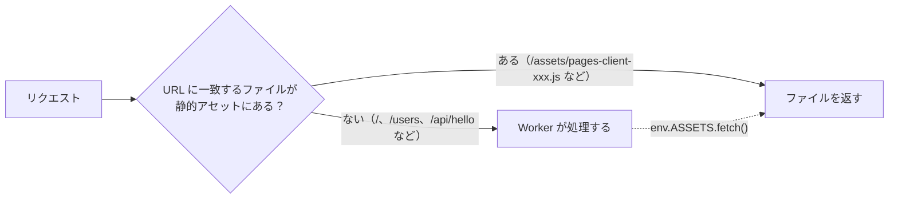
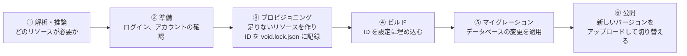

第 11 章までは、chibivoid を開発サーバーの上で動かしながら機能の追加をおこなってきました。この章では、chibivoid のアプリケーションを本番用にビルドし、Cloudflare にデプロイできるようにします。Void では、「推論 → プロビジョニング → ビルド → 公開」という一連の流れを、[`void deploy`](https://void.cloud/guide/deployment) という 1 つのコマンドでおこないます。この章では、その骨格を `chibivoid deploy` コマンドとして実装していきます。

## この章のゴール

- 本番ビルドで、Worker のコードとブラウザ用の JavaScript の両方を出力する
- マニフェスト（manifest）を使って、ハッシュ付きのファイル名を HTML に埋め込む
- `vite preview` により、ビルド結果をローカルの workerd で動かして確かめる
- 推論したリソースを Cloudflare 上に作成し、その ID を記録してビルドに反映し、Worker を公開するまでの流れを実装する

## ビルドしたページに JavaScript が読み込まれない

まずは、第 11 章のコードのまま、playground をビルドしてプレビューしてみましょう。モノレポのルートで次のコマンドを実行します:

```sh
npm run build
npm run preview
```

ブラウザで `http://localhost:4173/` を開くと、ページは表示されますが、第 11 章の「型付き `fetch()` を使ってみる」で作成した「いいね」ボタンをクリックした場合でも、何も起きないはずです。別のターミナルから、返ってくる HTML の末尾を確認してみましょう:

```html
$ curl -s http://localhost:4173/ | tail -4
<div id="app">...<button>いいね </button>...</div>

</body>
</html>
```

HTML には、JavaScript を読み込む `<script>` タグが 1 つもありません。これは、第 9 章の「コア: ブラウザ用のエントリ」で本番ビルド用のアセットタグを空のままにしておいたためです。

また、そもそもブラウザ用の JavaScript がビルドされていません。第 2 章の「ビルドとプレビュー」のビルドログに `building client environment for production...` と表示されていたように、ブラウザで動くコードは `client` 環境でビルドされます。しかし、先ほどの `npm run build` のログには、Worker 用の `chibivoid_worker` 環境の行しかありません:

```
vite v8.4.0 building chibivoid_worker environment for production...
✓ built in 531ms
```

上の出力では、ファイルの一覧を省略しています。一覧には `about-<ハッシュ>.js` のようにページの名前が付いたファイルも並びますが、いずれも `dist/chibivoid_worker/` に出力された Worker 用のコードです。`playground/dist/` を見ても、`chibivoid_worker/` しか見当たらないはずです。そこで、この章の前半では、次の 2 つの対応をおこないます:

1. ブラウザ用のエントリ（`virtual:chibivoid-pages-client`）を、`client` 環境でビルドする
2. ビルドの際にハッシュが付けられたファイル名（`pages-client-CPbe9WZg.js` など）を、Worker が描画する HTML に埋め込む

## ブラウザ用の JavaScript をビルドする

第 3 章の「ビルドとプレビュー」で見たように、Vite 6 以降のビルドは環境ごとにおこなわれます。Cloudflare のプラグインは、`builder.buildApp` オプションを設定して、ビルドの手順を制御しています。このプラグインは、Worker の環境をビルドした後、`client` 環境に入力（エントリ）があれば `client` 環境もビルドして `dist/client/` に出力し、Worker の静的アセット（「マニフェストを Worker から読む」）として配信されるように設定します。

そこで、React のアダプターの `plugin.ts` で、`createPagesPlugin()` に渡している `config` を変更します。これまでは、開発中でない場合は `undefined` を返していましたが、本番ビルドの際には、`client` 環境の入力としてブラウザ用のエントリを指定する設定を返すようにします。ブラウザ用のエントリの ID には、コアの `createPagesPlugin()` が使う ID と食い違わないように、第 9 章で `chibivoid/pages` からエクスポートしておいた定数 `CLIENT_ENTRY_ID` を使います:

<!-- diff: code/how-void-works/ch11/packages/react/src/plugin.ts code/how-void-works/ch12/packages/react/src/plugin.ts -->
```diff ts:packages/react/src/plugin.ts
@@ -1,7 +1,7 @@
 import { join } from "node:path";
 import react from "@vitejs/plugin-react";
 import { WORKER_ENVIRONMENT_NAME } from "chibivoid";
-import { createPagesPlugin, generateComponentManifest } from "chibivoid/pages";
+import { CLIENT_ENTRY_ID, createPagesPlugin, generateComponentManifest } from "chibivoid/pages";
 import { normalizePath, type PluginOption, type UserConfig } from "vite";
 
 /**
@@ -58,7 +58,17 @@
             },
           };
         }
-        return undefined;
+        // 本番ビルドでは、ブラウザ用のエントリを入力に加え、マニフェストを出力させる
+        return {
+          environments: {
+            client: {
+              build: {
+                manifest: true,
+                rolldownOptions: { input: { "pages-client": CLIENT_ENTRY_ID } },
+              },
+            },
+          },
+        };
       },
     }),
   ];
```
<!-- /diff -->

ここでは `client` 環境の `build` オプションに、次の 2 つを指定しています:

- [`manifest: true`](https://vite.dev/config/build-options#build-manifest): ビルドの最後に、マニフェスト（`.vite/manifest.json`）を出力します
- `rolldownOptions.input`: ビルドの入力として、`pages-client` という名前で `CLIENT_ENTRY_ID`（`virtual:chibivoid-pages-client`）を指定します。このように、仮想モジュールもビルドの入力にすることができます

### マニフェストとは何か

第 2 章の「ビルドとプレビュー」で見たように、ビルドで出力されるファイルの名前には、ファイルの中身から計算したハッシュが付きます。そのため、HTML からこれらのファイルを読み込むには、ハッシュ付きのファイル名を知る必要があります。[マニフェスト](https://vite.dev/guide/backend-integration)は、元のモジュールと、出力されたファイル名との対応表です。なお、第 8 章の `pages/manifest.ts` が生成する、コンポーネントを読み込むための対応表は、Vite がビルドの際に出力するこのマニフェストとは別のものです。

たとえば、playground のマニフェストは次のようになります（一部を抜粋しています）:

```json
{
  "virtual:chibivoid-pages-client": {
    "file": "assets/pages-client-CPbe9WZg.js",
    "name": "pages-client",
    "src": "virtual:chibivoid-pages-client",
    "isEntry": true,
    "dynamicImports": [
      "pages/index.tsx",
      "pages/about.tsx",
      "pages/users/index.tsx",
      "pages/users/[id].tsx",
      "pages/layout.tsx"
    ]
  },
  "pages/users/index.tsx": {
    "file": "assets/users-sNv0VolW.js",
    "name": "users",
    "src": "pages/users/index.tsx",
    "isDynamicEntry": true
  }
}
```

エントリのキーは、ビルドの入力に指定したモジュール ID（`virtual:chibivoid-pages-client`）そのものです。ページのコンポーネントは、第 8 章の「コア: コンポーネントの対応表を生成する」で動的インポートにしておいたため、ページごとに別のファイルに分かれています（`dynamicImports`）。

## マニフェストを Worker から読む

ページの HTML は Worker が描画します。では、Worker はどのようにしてマニフェストを読めばよいでしょうか。

マニフェストは `dist/client/` に出力されるため、他のファイルと同じく静的アセットの 1 つとして配信されます。つまり、`dist/client/.vite/manifest.json` は、`/.vite/manifest.json` という URL で取得することができます。また、Worker からは `ASSETS` バインディングの `fetch()` により静的アセットを取得することができます。そこで、Worker から `ASSETS` バインディングを通してマニフェストを読むようにします。

まずは、Worker の設定に `ASSETS` バインディングを追加します。`packages/chibivoid/src/index.ts` の `chibivoidPlugin()` で、`cloudflare()` に渡す `config` の `compatibility_date` の下に、次の 2 行を追加します:

```ts
// Worker から静的アセット（マニフェストなど）を読むための ASSETS バインディング
assets: { binding: "ASSETS" },
```

`assets: { binding: "ASSETS" }` を指定すると、Cloudflare のプラグインは、ビルドの際に静的アセットを置くディレクトリを表わす `directory` を補って `wrangler.json` に次のように出力します:

```json
"assets": { "binding": "ASSETS", "directory": "../client" }
```

また、`runtime/handler.ts` の `CloudBindings` にも `ASSETS` の型を追加しておきます:

<!-- diff: code/how-void-works/ch11/packages/chibivoid/src/runtime/handler.ts code/how-void-works/ch12/packages/chibivoid/src/runtime/handler.ts -->
```diff ts:packages/chibivoid/src/runtime/handler.ts
@@ -12,6 +12,7 @@
 /** Worker に渡される `env`（バインディング）の型 */
 export type CloudBindings = {
   KV: KVNamespaceLike;
+  ASSETS: { fetch(request: Request | string): Promise<Response> };
   [key: string]: unknown;
 };
 
```
<!-- /diff -->

最後に、`runtime/routing-assets.ts` の `createPagesAssetTags()` を変更し、本番ビルド用のアセットタグを作成する処理を実装します:

<!-- diff: code/how-void-works/ch11/packages/chibivoid/src/runtime/routing-assets.ts code/how-void-works/ch12/packages/chibivoid/src/runtime/routing-assets.ts -->
```diff ts:packages/chibivoid/src/runtime/routing-assets.ts
@@ -3,21 +3,47 @@
 /** ブラウザ用のエントリの仮想モジュール ID（pages/plugin.ts と同じ値） */
 const CLIENT_ENTRY_ID = "virtual:chibivoid-pages-client";
 
+/** Vite がビルド時に出力する .vite/manifest.json のかたち（使う部分だけ） */
+type ViteManifest = Record<string, { file: string }>;
+
+type AssetsBinding = { fetch(request: Request | string): Promise<Response> };
+
 /**
  * ページの HTML に入れる <script> タグを作る関数を返す。
- * 開発中は、Vite の開発サーバーが配信する URL をそのまま指す。
+ *
+ * - 開発中: Vite の開発サーバーが配信する URL をそのまま指す
+ * - 本番: ビルド時に出力されたマニフェストからハッシュ付きのファイル名を引く
  */
 export function createPagesAssetTags(options: { dev: boolean }) {
-  return async (_request: Request, _env: unknown): Promise<AssetTags> => {
-    if (!options.dev) {
-      // 本番ビルドへの対応は第 12 章でおこなう
-      return { head: "", body: "" };
+  let manifest: Promise<ViteManifest | null> | undefined;
+
+  return async (request: Request, env: unknown): Promise<AssetTags> => {
+    if (options.dev) {
+      return {
+        // HMR などを担当する Vite のクライアント
+        head: '<script type="module" src="/@vite/client"></script>',
+        // 仮想モジュールは /@id/ の下で配信される。先頭の \0 は URL では __x00__ になる
+        body: `<script type="module" src="/@id/__x00__${CLIENT_ENTRY_ID}"></script>`,
+      };
     }
+    manifest ??= loadManifest(request, (env as { ASSETS?: AssetsBinding }).ASSETS);
+    // マニフェストのキーはエントリのモジュール ID（ここでは仮想モジュールの ID）
+    const entry = (await manifest)?.[CLIENT_ENTRY_ID];
     return {
-      // HMR などを担当する Vite のクライアント
-      head: '<script type="module" src="/@vite/client"></script>',
-      // 仮想モジュールは /@id/ の下で配信される。先頭の \0 は URL では __x00__ になる
-      body: `<script type="module" src="/@id/__x00__${CLIENT_ENTRY_ID}"></script>`,
+      head: "",
+      body: entry ? `<script type="module" src="/${entry.file}"></script>` : "",
     };
   };
 }
+
+/** 静的アセット（dist/client）に含まれるマニフェストを ASSETS バインディング経由で読む */
+async function loadManifest(
+  request: Request,
+  assets: AssetsBinding | undefined,
+): Promise<ViteManifest | null> {
+  if (!assets) {
+    return null;
+  }
+  const response = await assets.fetch(new URL("/.vite/manifest.json", request.url).toString());
+  return response.ok ? ((await response.json()) as ViteManifest) : null;
+}
```
<!-- /diff -->

開発中に返すタグは第 9 章の「コア: ブラウザ用のエントリ」と同じです。一方、本番では最初にページが描画される際に、`loadManifest()` が `env.ASSETS.fetch()` により `/.vite/manifest.json` を読みます。以後は、読み込みに失敗した場合も含めて、その結果を使い回します。`ASSETS` バインディングの `fetch()` には絶対 URL を渡す必要があるため、`request.url` を基準にして URL を組み立てています。そして、マニフェストから `virtual:chibivoid-pages-client` のファイル名を引いて、`<script type="module" src="/assets/pages-client-CPbe9WZg.js"></script>` のようなタグを作成します。

### 静的アセットはどう配信されるのか

Cloudflare Workers の[静的アセット](https://developers.cloudflare.com/workers/static-assets/#routing-behavior)の機能では、リクエストの URL に一致するファイルが `dist/client/` にあれば、Worker を起動せずにそのファイルが返されます。一方、一致するファイルがなければ、Worker が呼び出されます:



図の点線は、`loadManifest()` のように、Worker が `env.ASSETS.fetch()` により静的アセットを取得する場合を表わしています。

このように、ブラウザ用の JavaScript は Worker を経由せずに配信されます。これにより、レスポンスが速くなり、Worker の実行回数も増えません。その代わり、これらのファイルへのリクエストでは、第 6 章で作成したグローバルミドルウェアも動きません。ミドルウェアが動く対象は、Worker に届くリクエストだけであるためです。

## ビルドしてプレビューする

それでは、「ビルドしたページに JavaScript が読み込まれない」で起動したプレビューサーバーを止めて、もう一度ビルドしてみましょう:

```
$ npm run build
vite v8.4.0 building chibivoid_worker environment for production...
dist/chibivoid_worker/index.js                             542.77 kB │ gzip: 111.97 kB │ map: 954.80 kB
✓ built in 567ms
vite v8.4.0 building client environment for production...
dist/client/.assetsignore                      0.02 kB
dist/client/.vite/manifest.json                1.67 kB │ gzip:  0.36 kB
dist/client/assets/about-B0k_k64Y.js           0.24 kB │ gzip:  0.22 kB
dist/client/assets/_id_-CC4f9SYS.js            0.30 kB │ gzip:  0.24 kB
dist/client/assets/layout-kKE9kFhs.js          0.40 kB │ gzip:  0.23 kB
dist/client/assets/users-sNv0VolW.js           0.54 kB │ gzip:  0.34 kB
dist/client/assets/runtime-DyrFW3mq.js         0.89 kB │ gzip:  0.46 kB
dist/client/assets/pages-oTRyNeN9.js           0.89 kB │ gzip:  0.60 kB
dist/client/assets/pages-client-CPbe9WZg.js  222.44 kB │ gzip: 69.90 kB
✓ built in 363ms
```

今度は、`chibivoid_worker` 環境と `client` 環境の 2 つがビルドされました。なお、上の出力では、`chibivoid_worker` 環境のファイルの一覧のうち、最後の `index.js` 以外を省略しています。ビルド後の `playground/dist/` は、次のような構成になっています:

```
playground/dist/
├── client/                    ブラウザ向け（静的アセットとして配信される）
│   ├── .assetsignore
│   ├── .vite/manifest.json
│   └── assets/                ハッシュ付きの JavaScript
└── chibivoid_worker/          Worker
    ├── index.js               Worker のコード（React の SSR も含む）
    ├── assets/                動的インポートしたルートやページのコード（第 5・8 章の遅延ロード）
    └── wrangler.json          デプロイ用の設定
```

続いて、プレビューサーバーを起動します:

```sh
npm run preview
```

別のターミナルから、HTML に含まれる `<script>` タグを確認してみましょう:

```sh
curl -s http://localhost:4173/ | grep -o '<script type="module" src="[^"]*"></script>'
# <script type="module" src="/assets/pages-client-CPbe9WZg.js"></script>
```

ハッシュ付きのファイルを読み込む `<script>` タグが表示されるはずです。ブラウザで `http://localhost:4173/` を開くと、ハイドレーション、`Link` による遷移、フォームの送信、「いいね」ボタンが、すべて本番のビルドで動くはずです。第 3 章の「ビルドとプレビュー」で見たように、`vite preview` はビルドした `index.js` をローカルの workerd で動かしています。そのため、デプロイした場合とほぼ同じ状態をローカルで確認することができます。

## デプロイの流れ

ビルドしたものをデプロイするだけであれば、第 3 章の「ビルドとプレビュー」で見たように、`npx wrangler deploy` コマンドを実行するだけで済みます。しかし、playground のように KV を使うアプリケーションでは、それだけではデプロイすることができません。`wrangler.json` の KV の ID がまだ仮の値（`local`）のままであるためです。そのため、本物の KV ネームスペースを作成し、その ID を設定に入れる必要があります。第 3 章の「ビルドとプレビュー」で触れた Wrangler の自動プロビジョニングを使う方法もありますが、chibivoid は Void の `void deploy` と同じく、リソースを自分で作成します。

Void の `void deploy` コマンドは、Cloudflare に直接デプロイする場合（`void deploy --platform cloudflare`）、おおむね次の流れで処理を進めます:



この流れでは、第 7 章の「ソースコードからバインディングを推論する」で実装したリソース推論が、デプロイでもそのまま使われます。開発中に「KV が必要だ」と判断したのと同じロジックにより、デプロイの際には「KV を作成しなければならない」と判断します。そのため、利用者は設定ファイルにリソースを記述しない場合でも、モジュールをインポートするだけでデプロイまで済ませることができます。

作成したリソースの ID は、Void では `void.lock.json`、chibivoid では `chibivoid.lock.json` というファイルに記録し、リポジトリにコミットしておきます。次回以降のデプロイでは、このファイルに記録された ID を見て、同じリソースを使い続けます。

chibivoid では、このうち、ログインなどの準備（②）とマイグレーション（⑤）を省き、①、③、④、⑥を実装します。

## `chibivoid deploy` コマンドを実装する

### `chibivoid.lock.json` を読み書きする

まずは、`chibivoid.lock.json` を読み書きするコードを作成します。`chibivoid` コマンドのコードを置くための `cli/` ディレクトリを作成しておきましょう:

```sh
mkdir -p packages/chibivoid/src/cli
```

そして、`readLockFile()` と `writeLockFile()` を `cli/lock.ts` に作成します:

<!-- file: code/how-void-works/ch12/packages/chibivoid/src/cli/lock.ts -->
```ts:packages/chibivoid/src/cli/lock.ts
import { existsSync, readFileSync, writeFileSync } from "node:fs";
import { join } from "node:path";

/**
 * デプロイ時に作成した Cloudflare リソースの ID を記録するファイル（chibivoid.lock.json）。
 * Void と同じくリポジトリにコミットしておき、次回以降のデプロイで同じリソースを使う。
 */
export type LockFile = {
  kv?: { id: string; title: string };
};

const LOCK_FILE = "chibivoid.lock.json";

export function readLockFile(root: string): LockFile {
  const path = join(root, LOCK_FILE);
  return existsSync(path) ? (JSON.parse(readFileSync(path, "utf8")) as LockFile) : {};
}

export function writeLockFile(root: string, lock: LockFile): void {
  writeFileSync(join(root, LOCK_FILE), JSON.stringify(lock, null, 2) + "\n");
}
```
<!-- /file -->

### `chibivoid.lock.json` の ID を Worker の設定に入れる

続いて、`index.ts` の `chibivoidPlugin()` で `chibivoid.lock.json` を読み、KV の ID が記録されていればその ID を、記録されていなければ仮の値 `local` を、Worker の設定に入れるようにします。第 11 章からの変更点の全体は、次の通りです（`assets` の 2 行は、「マニフェストを Worker から読む」で追加したものです）:

<!-- diff: code/how-void-works/ch11/packages/chibivoid/src/index.ts code/how-void-works/ch12/packages/chibivoid/src/index.ts -->
```diff ts:packages/chibivoid/src/index.ts
@@ -2,6 +2,7 @@
 import { join } from "node:path";
 import { cloudflare } from "@cloudflare/vite-plugin";
 import type { Plugin } from "vite";
+import { readLockFile } from "./cli/lock.ts";
 import { inferProjectBindings } from "./inference/walk.ts";
 import { routingPlugin } from "./plugin-routing.ts";
 import { compileWorkerEntry } from "./router/compile.ts";
@@ -25,6 +26,8 @@
 
   // ソースコードを静的解析して、必要な Cloudflare リソースを推論する
   const bindings = inferProjectBindings(root);
+  // `chibivoid deploy` が作成したリソースの ID
+  const lock = readLockFile(root);
 
   return [
     routingPlugin(root),
@@ -36,8 +39,10 @@
         name: readWorkerName(root),
         main: entryPath,
         compatibility_date: "2026-10-01",
+        // Worker から静的アセット（マニフェストなど）を読むための ASSETS バインディング
+        assets: { binding: "ASSETS" },
         // `chibivoid/kv` が使われていれば KV バインディングを追加する
-        kv_namespaces: bindings.needsKV ? [{ binding: "KV", id: "local" }] : [],
+        kv_namespaces: bindings.needsKV ? [{ binding: "KV", id: lock.kv?.id ?? "local" }] : [],
       },
     }),
   ];
```
<!-- /diff -->

`chibivoidPlugin()` は開発サーバーの起動時にも呼ばれるため、ID が記録されていれば、開発中もその ID が Worker の設定に入ります。ただし、Miniflare はその ID を名前にした保存場所をローカルに用意するだけで、本物の KV には接続しません。

### `cli/deploy.ts`: デプロイの処理の本体

次に、デプロイの処理の本体である `runDeploy()` を `cli/deploy.ts` に作成します:

<!-- file: code/how-void-works/ch12/packages/chibivoid/src/cli/deploy.ts -->
```ts:packages/chibivoid/src/cli/deploy.ts
import { spawnSync } from "node:child_process";
import { createBuilder } from "vite";
import { readWorkerName } from "../index.ts";
import { inferProjectBindings } from "../inference/walk.ts";
import { readLockFile, writeLockFile } from "./lock.ts";

/**
 * `chibivoid deploy`: 推論 → プロビジョニング → ビルド → 公開
 * Void の `void deploy` がおこなう流れを、一番単純なかたちでなぞる。
 */
export async function runDeploy(root: string, options: { dryRun: boolean }): Promise<void> {
  // 1. どのリソースが必要かを、ソースコードから推論する（vite.config.ts と同じロジック）
  const bindings = inferProjectBindings(root);
  const lock = readLockFile(root);

  // 2. 必要なのにまだ作っていないリソースを、Cloudflare 上に作る（プロビジョニング）
  if (bindings.needsKV && !lock.kv) {
    const title = `${readWorkerName(root)}-kv`;
    if (options.dryRun) {
      console.log(`[dry-run] wrangler kv namespace create ${title}`);
    } else {
      const output = wrangler(["kv", "namespace", "create", title]);
      const id = /"id":\s*"([0-9a-f]{32})"/.exec(output)?.[1];
      if (!id) {
        throw new Error(`KV ネームスペースの ID を読み取れませんでした:\n${output}`);
      }
      // 作った ID を記録しておき、次回からは同じネームスペースを使う
      lock.kv = { id, title };
      writeLockFile(root, lock);
      console.log(`KV ネームスペース ${title}（${id}）を作成しました`);
    }
  }

  // 3. ビルドする。chibivoidPlugin() が chibivoid.lock.json の ID を Worker の設定に書き込む
  const builder = await createBuilder({ root });
  await builder.buildApp();

  // 4. 公開する。Cloudflare の Vite プラグインが、ビルド結果の wrangler.json を指す
  //    リダイレクト設定を出力するため、`wrangler deploy` は引数なしでよい
  wrangler(["deploy", ...(options.dryRun ? ["--dry-run"] : [])], { inherit: true });
}

function wrangler(args: string[], options: { inherit?: boolean } = {}): string {
  const result = spawnSync("npx", ["wrangler", ...args], {
    encoding: "utf8",
    stdio: options.inherit ? "inherit" : "pipe",
    shell: process.platform === "win32",
  });
  if (result.status !== 0) {
    throw new Error(`wrangler ${args.join(" ")} が失敗しました\n${result.stderr ?? ""}`);
  }
  return result.stdout ?? "";
}
```
<!-- /file -->

`runDeploy()` は、「デプロイの流れ」で見た流れをそのままコードにしたもので、次の 4 つの段階からなります:

1. 推論: `inferProjectBindings()` により、必要なリソースを推論します。これは、`vite.config.ts` から呼ばれる `chibivoidPlugin()` が使っているものと同じ関数です
2. プロビジョニング: KV が必要であるにもかかわらず、`chibivoid.lock.json` に KV の記録がない場合は、`wrangler kv namespace create` コマンドにより KV ネームスペースを作成します。そして、Wrangler の出力から ID を取り出し、`chibivoid.lock.json` に書き込みます
3. ビルド: Vite の `createBuilder()` と `builder.buildApp()` により、`vite build` コマンドと同じビルドをプログラムからおこないます。このとき、`vite.config.ts` が読み込まれ、`chibivoidPlugin()` が `chibivoid.lock.json` を読みます。そのため、2. で書き込んだ ID も含めて、`chibivoid.lock.json` に記録されている本物の ID が `wrangler.json` に入ります
4. 公開: `wrangler deploy` コマンドを実行します。第 3 章の「ビルドとプレビュー」で見たリダイレクト設定（`.wrangler/deploy/config.json`）により、引数を指定しない場合でも、ビルド結果がデプロイされます

`--dry-run` オプションを付けた場合は、リソースを作成する代わりに、作成する予定のリソースを表示します。また、公開の段階では、Worker をアップロードせずに確認だけをおこなう `wrangler deploy --dry-run` を実行します。

### `cli/cli.ts`: コマンドの入り口

続いて、`chibivoid` コマンドの入り口となる `cli/cli.ts` を作成します:

<!-- file: code/how-void-works/ch12/packages/chibivoid/src/cli/cli.ts -->
```ts:packages/chibivoid/src/cli/cli.ts
#!/usr/bin/env node
// `chibivoid` コマンドの入り口。Node.js が TypeScript をそのまま実行する（型注釈を取り除くだけ）。
import { parseArgs } from "node:util";
import { runDeploy } from "./deploy.ts";

// 知らないオプション（`--dryrun` のような打ち間違いも）はエラーにする
const { positionals, values } = parseArgs({
  allowPositionals: true,
  options: { "dry-run": { type: "boolean", default: false } },
});
const [command] = positionals;
const root = process.cwd();

switch (command) {
  case "deploy":
    await runDeploy(root, { dryRun: values["dry-run"] });
    break;
  default:
    console.log("使い方: chibivoid deploy [--dry-run]");
    process.exitCode = command ? 1 : 0;
}
```
<!-- /file -->

1 行目の `#!/usr/bin/env node` は、このファイルを直接実行した際に Node.js で動かすための指定です。第 4 章の「TypeScript をビルドせずにパッケージにする」で見たように、Node.js 24 以降は type stripping により `.ts` のファイルもそのまま実行できるため、CLI もビルドせずに使うことができます。

引数の解析には、Node.js に組み込まれている [`util.parseArgs()`](https://nodejs.org/api/util.html#utilparseargsconfig) を使っています。`util.parseArgs()` は、定義していないオプションが渡されるとエラーを投げるため、`--dryrun` のように打ち間違えたまま、本物のリソースを作成してデプロイしてしまうことはありません。ただし、[`npm run`](https://docs.npmjs.com/cli/commands/npm-run) から実行する際は、`--dry-run` を `--` の後ろに記述してください（「`--dry-run` でデプロイの流れを確かめる」）。`--` を省くと、`--dry-run` は npm 自身のオプションとして扱われ、本物のデプロイが始まってしまいます。

### `chibivoid` コマンドを登録する

最後に、`packages/chibivoid/package.json` の `bin` に `chibivoid` コマンドとして `cli.ts` を登録します。`bin` に登録すると、npm が `node_modules/.bin/chibivoid` を作成し、npm のスクリプトから `chibivoid` コマンドを実行することができるようになります:

<!-- diff: code/how-void-works/ch11/packages/chibivoid/package.json code/how-void-works/ch12/packages/chibivoid/package.json -->
```diff json:packages/chibivoid/package.json
@@ -2,6 +2,9 @@
   "name": "chibivoid",
   "version": "0.0.0",
   "private": true,
+  "bin": {
+    "chibivoid": "./src/cli/cli.ts"
+  },
   "type": "module",
   "exports": {
     ".": "./src/index.ts",
```
<!-- /diff -->

そして、playground の `package.json` に `chibivoid deploy` を実行する `deploy` スクリプトを追加します:

<!-- diff: code/how-void-works/ch11/playground/package.json code/how-void-works/ch12/playground/package.json -->
```diff json:playground/package.json
@@ -6,7 +6,8 @@
     "dev": "vite",
     "build": "vite build",
     "preview": "vite preview",
-    "typecheck": "vite build && tsc --noEmit"
+    "typecheck": "vite build && tsc --noEmit",
+    "deploy": "chibivoid deploy"
   },
   "dependencies": {
     "@chibivoid/react": "*",
```
<!-- /diff -->

`bin` を変更したため、試す前にモノレポのルートで `npm install` を実行し直し、続けて `npm rebuild chibivoid` を実行します:

```sh
npm install
npm rebuild chibivoid
```

すでにインストール済みのモノレポでは、`npm install` だけでは `node_modules/.bin/chibivoid` が作成されないことがあるため、`npm rebuild chibivoid` によりこのリンクを作成しています。

## `--dry-run` でデプロイの流れを確かめる

Cloudflare のアカウントがない場合でも、`--dry-run` を付ければデプロイの流れを確かめることができます。モノレポのルートで次のコマンドを実行してみましょう:

```sh
npm run deploy --workspace playground -- --dry-run
```

出力のうち、主な部分を抜き出すと次のようになります（ビルドされたファイルの一覧や、Wrangler が表示するモジュールの表などは省略しています）:

```
> chibivoid deploy --dry-run

[dry-run] wrangler kv namespace create chibivoid-app-kv
vite v8.4.0 building chibivoid_worker environment for production...
✓ built in 596ms
vite v8.4.0 building client environment for production...
✓ built in 298ms

 ⛅️ wrangler 4.168.0
Using redirected Wrangler configuration.
 - Configuration being used: "dist/chibivoid_worker/wrangler.json"
 - Original user's configuration: "<no user config found>"
 - Deploy configuration file: ".wrangler/deploy/config.json"
✨ Read 11 files from the assets directory .../playground/dist/client
Total Upload: 560.87 KiB / gzip: 117.10 KiB
Your Worker has access to the following bindings:
Binding                 Resource
env.KV (local)          KV Namespace
env.ASSETS              Assets
--dry-run: exiting now.
```

`[dry-run]` で始まる行から、推論によって KV が必要と判断され、KV ネームスペースを作成する予定であることがわかります。また、Wrangler はリダイレクト設定から `dist/chibivoid_worker/wrangler.json` を見つけ、静的アセットと 2 つのバインディング（`env.KV`、`env.ASSETS`）を確認しています。`--dry-run` を付けた場合は KV ネームスペースを作成しないため、`env.KV` の ID は `local` のままです。

`chibivoid.lock.json` に ID が記録されている場合の動きも確かめておきましょう。仮の ID を記録した `chibivoid.lock.json` を作成してから先ほどと同じコマンドを実行し、最後に `chibivoid.lock.json` を削除します:

```sh
echo '{ "kv": { "id": "0123456789abcdef0123456789abcdef", "title": "chibivoid-app-kv" } }' > playground/chibivoid.lock.json
npm run deploy --workspace playground -- --dry-run
# ...
# env.KV (0123456789abcdef0123456789abcdef)          KV Namespace
rm playground/chibivoid.lock.json
```

今度は、`chibivoid deploy` が KV ネームスペースを作成しようとせず、`chibivoid.lock.json` に記録した ID がビルド結果の `wrangler.json` に入っているはずです。

## 実際にデプロイする（任意）

Cloudflare のアカウントがある場合は、実際にデプロイしてみましょう。まずは playground のディレクトリに移動し、Wrangler により Cloudflare にログインします:

```sh
cd playground
npx wrangler login
```

コマンドを実行するとブラウザが開くため、Cloudflare にログインして、Wrangler によるアクセスを許可します。ログインが完了した後、デプロイを実行します:

```sh
npm run deploy
```

`npm run deploy` を実行すると、次の順に処理が進みます:

1. KV ネームスペース `chibivoid-app-kv` が作成され、その ID が `chibivoid.lock.json` に記録されます
2. その ID を Worker の設定に入れて、アプリケーションがビルドされます
3. Worker がアップロードされ、`https://chibivoid-app.<あなたのサブドメイン>.workers.dev` のような URL が表示されます

表示された URL を開くと、ローカルで動かしていたものと同じアプリケーションが、Cloudflare の上で動いているはずです。作成された `chibivoid.lock.json` は、リポジトリにコミットしておきましょう。2 回目以降のデプロイでは、KV ネームスペースを新たに作成せず、同じ KV ネームスペースを使い続けます。

後片付けをする場合は、`npx wrangler delete --name chibivoid-app` により Worker を、`npx wrangler kv namespace delete --namespace-id <ID>` により KV ネームスペースを削除することができます。`wrangler delete` は、`wrangler deploy` とは異なり、リダイレクト設定を参照しないため、Worker の名前を指定する必要があります。また、KV ネームスペースを削除した場合は、`chibivoid.lock.json` も削除しておいてください。`chibivoid.lock.json` を残しておくと、次の `npm run deploy` は、KV ネームスペースを作成し直さずに、削除した KV ネームスペースの ID のままデプロイしようとしてしまいます。

## まとめ

- `vite build` は、環境ごとにビルドをおこなう。ブラウザ用のエントリを `client` 環境の入力に加えると、その出力が `dist/client/` に置かれ、静的アセットとして配信される
- ハッシュ付きのファイル名はマニフェストから知ることができる。Worker は `ASSETS` バインディングによりマニフェストを読み、`<script>` タグを作成する
- `vite preview` により、ビルドした Worker をローカルの workerd で動かして確かめることができる
- デプロイは「推論 → プロビジョニング → ビルド → 公開」の流れで進む。作成したリソースの ID は `chibivoid.lock.json` に記録し、ビルドの際に Worker の設定に埋め込む。開発中と同じ推論が、デプロイの際のリソースの作成にも使われる

これで、chibivoid は完成です。第 4 章で骨組みから作り始めた chibivoid は、ファイルベースルーティング、リソース推論、Pages、型付き `fetch()`、そしてデプロイまでをおこなうことができるようになりました。お疲れさまでした！

## Void の実装

Void では、`packages/void/src/runtime/routing/assets.ts` の `createManifestLoader()` がマニフェストを読み込みます。chibivoid と同じく、`env.ASSETS.fetch()` により `/.vite/manifest.json` を取得していますが、読み込みに失敗した結果はキャッシュせず、次のリクエストで読み込みをやり直します。そして、同じファイルの `createClientAssetTags()` が、エントリの `<script>` タグだけでなく、そのページで必要な CSS の `<link rel="stylesheet">` タグや、先読みするファイルの `<link rel="modulepreload">` タグも作成します。

静的アセットをどのように配信するかは、`packages/void/src/asset-routing.ts` が決めています。Pages のアプリケーションでは 404 のページも含めてページの HTML を Worker が返すため、すべてのリクエストをまず Worker に通す設定（`run_worker_first: ['/**']`）にしています。そのため、「マニフェストを Worker から読む」で見た chibivoid とは異なり、静的アセットへのリクエストでもまず Worker が呼ばれます（条件を満たす場合に、ハッシュ付きのファイルを Worker を経由せずに配信する最適化も、`asset-worker-bypass.ts` に入っています）。

デプロイの処理は、`packages/void/src/cli/deploy.ts` の `runDeploy()` から始まります。Cloudflare に直接デプロイする場合は、`cli/deploy-cloudflare.ts` の `runCloudflareDeploy()` が「デプロイの流れ」で見た各段階を順に呼び出します。それぞれの段階は、次のファイルに実装されています:

| 段階 | Void のファイル |
| --- | --- |
| 準備・プロビジョニング | `cli/deploy-cloudflare-preflight.ts`、`cli/provision.ts`（`reconcileKv()`、`reconcileD1()` など、リソースごとの関数がある） |
| ビルド | `cli/deploy-cloudflare-build.ts` |
| マイグレーション | `cli/deploy-cloudflare-migrate.ts`、`cli/deploy-migrations.ts` |
| 公開 | `cli/deploy-cloudflare-publish.ts` |

公開の段階では、Void は新しいバージョンをトラフィックを流さずにアップロードし、`/__void/ready` により正しく動くことを確かめてから、トラフィックを新しいバージョンに切り替えます。ただし、Worker を初めてデプロイする場合は、バージョンのアップロードでは Worker を作成できないため、先に通常のデプロイで公開してから `/__void/ready` を確かめます。これらの処理の本体は、`cli/deploy-cloudflare-publish.ts` が呼び出す、`packages/deploy-cloudflare/src/version.ts` の `activateCloudflareVersion()` にあります。

なお、Void は Cloudflare の操作に Wrangler ではなく `cf` という CLI を使っています。リソースの作成などでは、`cf` が出力する JSON を読んでおり、chibivoid とは異なり、表示用の文字列から ID を探すことはしません。
